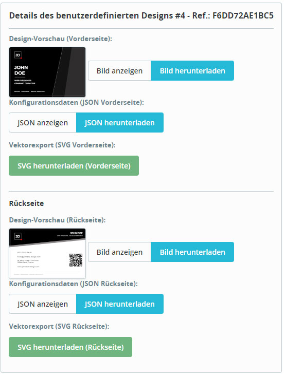

[← Inhaltsverzeichnis](README.md) · [← Druckabmessungen](produktabmessungen.md) · Nächste Seite: [Preise und Varianten →](preise-und-varianten.md)

# So verwalten Sie Bestellungen und laden druckfertige SVG-Dateien mit NonDesigner herunter

Für jede Bestellung mit personalisierten Produkten erstellt **NonDesigner** die Druckdateien (**Vektor-SVG** und **PNG im Maßstab 1:1**) und stellt sie direkt auf der Bestelldetailseite des PrestaShop-Backoffice bereit.

**Pfad:** Kontrollzentrum → Bestellungen → Bestelldetails

Die Verwaltung personalisierter Produkte ist in die Bestelldetailseite integriert.

## Wie sehe ich das Design des Kunden im Backoffice?

- Das Modul lädt die Personalisierungsdetails **asynchron** in die Produkttabelle der Bestellung und ersetzt dabei einen temporären Platzhalter. Während des Ladens sehen Sie einen Ladehinweis.
- Sind die Bilddateien oder Konfigurationsdaten **auf dem Server nicht verfügbar**, wird eine **rote** Textwarnung angezeigt.

> **Bestellbestätigungs-E-Mails:** Die vom Modul erzeugten Grafikdateien werden **nicht direkt** in Bestellbestätigungs-E-Mails angezeigt. Die E-Mail-Zusammenfassung enthält einen Hinweistext, der auf das Vorhandensein eines personalisierten Designs hinweist, das im Bestellverlauf des Kundenkontos eingesehen werden kann.

## Welche Informationen zeigen die Personalisierungsdetails?

- Jedes Design zeigt seine eindeutige **ID** und, falls vorhanden, den der Konfiguration zugewiesenen **Referenznamen**.
- Bei Produkten mit mehrfachem Druck oder **Vorder-/Rückseitendruck** zeigt die Oberfläche einen Bereich für die **Vorderseite** und einen separaten für die **Rückseite**.
- **Grafische Vorschau:** Klicken Sie auf **Bild anzeigen**. Mit der blauen Schaltfläche **Bild herunterladen** speichern Sie sie in hoher Auflösung.
- **Technische Daten (JSON):** Das Modul speichert die genauen Personalisierungsparameter in einer **JSON**-Datei. Sie können sie in einem neuen Browserfenster öffnen (formatiert und lesbar) oder herunterladen.

## Wie exportiere ich die Vektor-SVG-Datei für den Druck?

1. Suchen Sie in den Bestelldetails die zu exportierende Seite (Vorderseite oder Rückseite).
2. Klicken Sie auf die grüne Schaltfläche **SVG herunterladen**. Wenn Sie den Mauszeiger über die Schaltfläche bewegen, sehen Sie die **genauen Druckmaße in Zentimetern**.
3. Beim Klicken deaktiviert die Oberfläche vorübergehend die Steuerelemente und zeigt eine Warteanzeige mit einer Bildschirmbenachrichtigung an.
4. Die `.svg`-Datei wird dynamisch aus den auf dem Server gespeicherten JSON-Daten berechnet und nach Abschluss **automatisch heruntergeladen**.

### Mit welchem Programm öffne ich die SVG-Datei?

Empfohlen wird **Inkscape** (kostenlose Software): Damit lässt sich die Datei auch in Formate exportieren, die mit anderen Grafikprogrammen kompatibel sind.

## Sicherheit und Fehlerbehandlung bei Multistore

- In **Multistore**-Umgebungen prüft ein Kontrollsystem stets, ob das angezeigte Design zum **aktuell aktiven Shop** gehört.
- Wird ein Versuch erkannt, ein Projekt **eines anderen Shops** zu exportieren oder anzuzeigen, wird der Vorgang blockiert und die Warnung **„Zugriff verweigert"** ausgegeben.
- Der Administrator kann Design-Dateien und die zugehörigen Personalisierungsdaten **dauerhaft löschen**.
- Jedes technische Problem beim Abrufen von Daten (fehlende Netzwerkverbindung, fehlende Dateien) erzeugt sofort sichtbare Fehlermeldungen im Backoffice.

---

Nächste Seite: [Preise und Varianten →](preise-und-varianten.md) · Probleme? Siehe die [FAQ](faq.md).
