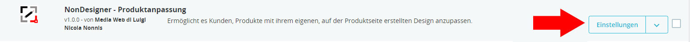

[← Inhaltsverzeichnis](README.md) · Nächste Seite: [Modulkonfiguration →](modulkonfiguration.md)

# So installieren Sie das NonDesigner-Modul in PrestaShop

**NonDesigner** ist ein PrestaShop-Modul, mit dem Kunden Produkte online über einen in das Shop-Frontend integrierten grafischen 2D-Designer personalisieren können und das für jede Bestellung druckfertige Vektor-SVG- und PNG-Dateien (1:1) erstellt. Diese Seite beschreibt die Systemanforderungen, die Kompatibilität mit PrestaShop-Versionen und die Installation.

## Mit welchen PrestaShop- und PHP-Versionen ist NonDesigner kompatibel?

- **Kompatible PrestaShop-Versionen:** v1.7.6.1 bis v8.x und v9.x
- **Unterstützte PHP-Versionen:** PHP 7.2 bis PHP 8.5
- **Erforderliche PHP-Erweiterungen:** GD Library, cURL, Zip, SimpleXML
- **Empfohlene Server-Direktiven:** `upload_max_filesize` ≥ 10M und `post_max_size` ≥ 10M

> Die Direktiven `upload_max_filesize` und `post_max_size` begrenzen letztlich die Größe der Bilder, die Kunden im Designer hochladen können. Siehe [Maximale Bildgröße für Benutzer](modulkonfiguration.md#2-maximale-bildgröße-für-benutzer-mb).

## So installieren Sie NonDesigner Schritt für Schritt

1. Melden Sie sich im PrestaShop-Backoffice an.
2. Gehen Sie zu **Kontrollzentrum → Modul-Manager → Modul-Manager**.
3. Klicken Sie oben rechts auf die Schaltfläche **Modul hochladen**.
4. Ziehen Sie die von PrestaShop Addons heruntergeladene `.zip`-Datei des NonDesigner-Moduls per Drag & Drop hierher oder wählen Sie sie aus.
5. Warten Sie, bis die Installation abgeschlossen ist, und klicken Sie auf **Konfigurieren**.

## Erfordert NonDesigner eine Lizenzaktivierung?

Nein. Das Modul **erfordert keine Lizenzaktivierung**: Nach der Installation und Konfiguration ist es sofort einsatzbereit.

## Wo finde ich die Moduleinstellungen nach der Installation?

**Kontrollzentrum → Modul-Manager → NonDesigner → Konfigurieren**

Alle Moduleinstellungen unterstützen die native **Multistore**-Funktion von PrestaShop: Sie können unterschiedliche Regeln (z. B. Bereinigungstage oder aktive Panels) für jeden Shop oder jede Shop-Gruppe festlegen, indem Sie den Shop über die Auswahl oben rechts wählen. Wenn Sie für einen Shop keinen Wert festlegen, wird automatisch der geerbte globale Wert verwendet.

## Was sollte ich vor der Installation tun?

Erstellen Sie vor der Installation des Moduls eine **Sicherung Ihrer Serverdateien und Ihrer Datenbank** und installieren Sie es nach Möglichkeit zuerst auf einem **Testserver**, um eigene Tests durchzuführen. Die Installation erfolgt auf eigene Verantwortung: Für etwaige während der Installation auftretende nachteilige Auswirkungen wird keine Verantwortung übernommen.

## Nächste Schritte

1. [Globale Moduleinstellungen konfigurieren](modulkonfiguration.md)
2. [Den Designer für ein Produkt konfigurieren](produktkonfiguration.md)
3. Bei Problemen siehe die [FAQ](faq.md)
