[← Inhaltsverzeichnis](README.md) · [← Installation](installation.md) · Nächste Seite: [Produktkonfiguration →](produktkonfiguration.md)

# So konfigurieren Sie das NonDesigner-Modul: globale Einstellungen (Modulseite)

Diese Seite beschreibt die globalen Einstellungen des Moduls **NonDesigner** für PrestaShop, aufgeteilt in vier Registerkarten: **Allgemein**, **Formenverwaltung**, **Schriftartenverwaltung** und **Tool-Konfiguration**.

**Pfad:** Kontrollzentrum → Modul-Manager → NonDesigner → Konfigurieren

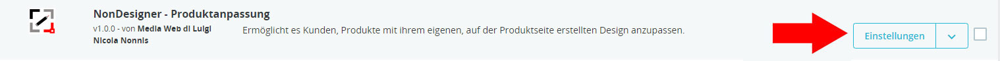

> **Multistore:** Alle Einstellungen unterstützen die native Multistore-Funktion von PrestaShop. Sie können für jeden Shop oder jede Shop-Gruppe unterschiedliche Regeln festlegen, indem Sie den Shop über die Auswahl oben rechts wählen. Wenn Sie für einen Shop keinen Wert festlegen, wird der geerbte globale Wert verwendet.

**Auf dieser Seite**

- [Registerkarte Allgemein](#registerkarte-allgemein)
- [Registerkarte Formenverwaltung](#registerkarte-formenverwaltung)
- [Registerkarte Schriftartenverwaltung](#registerkarte-schriftartenverwaltung)
- [Registerkarte Tool-Konfiguration](#registerkarte-tool-konfiguration)

---

## Registerkarte Allgemein

Die Registerkarte **Allgemein** verwaltet Diagnose (Protokollierung), Beschränkungen für von Kunden hochgeladene Dateien und Berechtigungen zum Herunterladen von Projektdateien im Frontend.

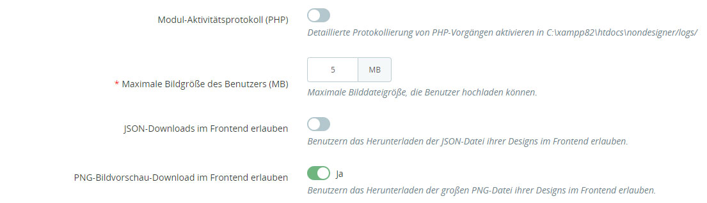

### 1. Aktivitätsprotokoll des Moduls

Ein Schalter (Ja/Nein), der die detaillierte Protokollierung der vom Modul ausgeführten PHP-Vorgänge aktiviert oder deaktiviert. Wenn aktiviert, werden Protokolldateien im Ordner `/logs/` im Stammverzeichnis (`_PS_ROOT_DIR_`) Ihrer PrestaShop-Website gespeichert.

**Tipp:** Lassen Sie ihn im normalen Betrieb auf **Nein**, um den Server nicht zusätzlich zu belasten. Aktivieren Sie ihn nur, wenn Probleme auftreten und Ihr Entwickler Fehler diagnostizieren muss.

### 2. Maximale Bildgröße für Benutzer (MB)

Legt die maximale Größe der Bilddateien fest, die Benutzer im Designer hochladen können.

- Der Wert wird in Megabyte (MB) angegeben und ist erforderlich.
- Er muss eine positive Zahl größer als null sein (z. B. 2 oder 5); andernfalls zeigt das System einen Fehler an und verhindert das Speichern.

> **Wichtig:** Die tatsächliche Grenze hängt letztlich von den Beschränkungen Ihres Hosting-Servers ab (`upload_max_filesize` und `post_max_size` in der `php.ini`). Stellen Sie im Modul einen Wert (z. B. 10 MB) ein, der über dem Serverlimit (z. B. 2 MB) liegt, blockiert der Server Uploads über 2 MB trotzdem. Geben Sie einen Wert ein, der gleich oder niedriger ist als das, was Ihr Hosting-Paket erlaubt.

### 3. JSON-Download im Frontend zulassen

Ein Schalter (Ja/Nein): Ist er aktiviert, findet der Kunde im Frontend eine Schaltfläche zum Herunterladen der **JSON**-Datei mit den Rohdaten der Struktur seines Grafikprojekts.

### 4. PNG-Vorschau-Download im Frontend zulassen

Ein Schalter (Ja/Nein): Ist er aktiviert, kann der Kunde ein **PNG im Maßstab 1:1** des soeben erstellten Designs herunterladen. Die Qualität dieser Vorschau ist **nicht für den professionellen Druck geeignet**: Druckdateien werden im Backoffice heruntergeladen (siehe [Bestellungen und SVG-Export](bestellungen-und-svg-export.md)).

---

## Registerkarte Formenverwaltung

Hier verwalten Sie die geometrischen oder Vektorformen, die Benutzer in ihre Projekte einfügen können. Formen unterstützen Multistore: Jeder Shop erhält seinen eigenen dedizierten Ordner.

### Wie lade ich neue Formen in NonDesigner hoch?

Klicken Sie auf die Schaltfläche zum Hochladen. Das System akzeptiert **ausschließlich `.svg`-Dateien**. Aus Sicherheitsgründen **bereinigt** das Modul hochgeladene SVG-Dateien **automatisch** und entfernt schädliche Tags und Attribute.

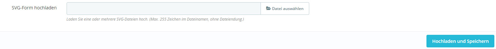

### Wie ändere ich die Reihenfolge der Formen im Designer?

Ziehen Sie die Tabellenzeilen per Drag-and-Drop nach oben oder unten: Die Reihenfolge bestimmt, wie die Formen im Formenpanel des Kunden-Designers erscheinen. Die Position wird automatisch gespeichert.

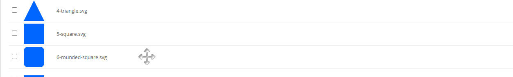

### Wie aktiviere oder deaktiviere ich eine Form?

Klicken Sie auf das grüne Häkchen / das rote X, um eine Form vorübergehend auszublenden, ohne sie zu löschen. Sie können auch mehrere Formen über die Kontrollkästchen auswählen und mit den **Massenaktionen** gemeinsam aktivieren oder deaktivieren.

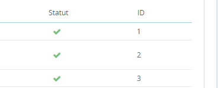

### Kann ich Systemformen löschen?

Von Ihnen hochgeladene Formen können dauerhaft gelöscht werden. **Systemformen** (z. B. einfache Kreise, Quadrate) **können nicht gelöscht, nur deaktiviert werden**, um den Grundbetrieb des Moduls sicherzustellen; beim Versuch, sie zu löschen, erscheint eine Fehlermeldung.

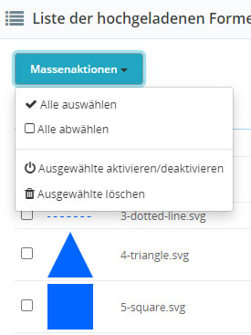

---

## Registerkarte Schriftartenverwaltung

Hier laden Sie die den Kunden im Designer zur Verfügung gestellten **Schriftarten** herunter, aktivieren und löschen sie.

Um maximale Ladeleistung im Frontend zu gewährleisten und die Datenschutzbestimmungen (**DSGVO**) einzuhalten, **lädt das Modul Schriftarten nicht in Echtzeit von externen Diensten**: Es lädt die Schriftdateien (`.ttf`) direkt auf Ihren Hosting-Server herunter und stellt sie lokal bereit.

Der Bildschirm ist in zwei Bereiche unterteilt: **Nicht heruntergeladene Schriftarten** und **Heruntergeladene Schriftarten (installiert)**.

### Multistore und Schriftarten

- Heruntergeladene Schriftarten und ihre Aktivierungsstatus sind **pro Shop isoliert**.
- Bei aktivem Multistore werden die Schriftdateien in dedizierten Unterordnern organisiert (z. B. `/fontfiles/1/`, `/fontfiles/2/`), sodass Sie für jeden Shop einen eigenen Schriftartenkatalog definieren können.

### Nicht heruntergeladene Schriftarten (verfügbarer Katalog)

Zeigt die Schriftarten im Katalog des Moduls, die noch nicht auf Ihrem Server vorhanden sind.

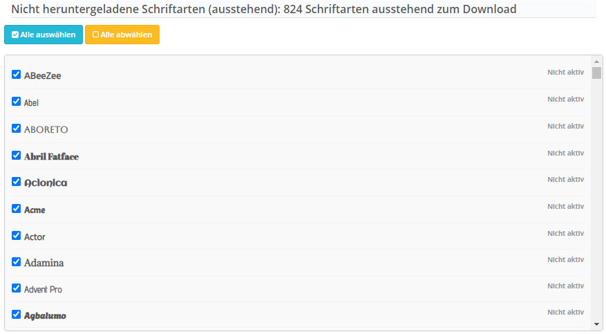

- **Dynamische Vorschau und Lazy-Loading:** Die Vorschau des Schriftnamens wird erst angezeigt, wenn sie auf dem Bildschirm erscheint, um die Seite nicht zu verlangsamen.
- **Selektiver Download:** Wählen Sie die gewünschten Schriftarten aus und klicken Sie auf **Ausgewählte herunterladen**.
- **Massendownload:** Klicken Sie auf **Download starten (Alle neu starten)**, um den gesamten Katalog herunterzuladen; das System wählt automatisch alle ausstehenden Schriftarten aus.
- **Unterbrechungen und Serverfehler:** Während des Downloads zeigt ein Fortschrittsbalken die gerade verarbeitete Schriftart an. Sie können jederzeit auf **Abbrechen** klicken (der Vorgang stoppt nach Abschluss der aktuellen Schriftart). Bei einer vorübergehenden Serverüberlastung (z. B. HTTP-500-Fehler) geht die bereits geleistete Arbeit nicht verloren und das Modul versucht, den Download an der Unterbrechungsstelle fortzusetzen.

### Heruntergeladene Schriftarten (installiert)

Nach dem Download werden Schriftarten in die Liste der installierten Schriftarten verschoben.

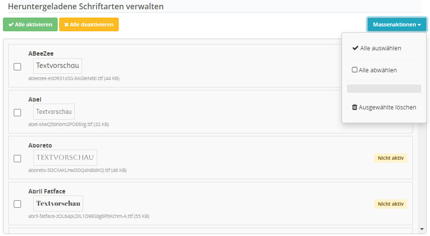

- **Echte lokale Vorschau:** Wird anhand der auf Ihrem Server gespeicherten `.ttf`-Datei erzeugt, mit Dateiname und Größe in KB.
- **Einzelne Aktivierung:** Um eine Schriftart für Kunden verfügbar zu machen, klicken Sie auf die Statusschaltfläche (**Inaktiv** / **Aktivieren**). Neu heruntergeladene Schriftarten sind **standardmäßig deaktiviert**.
- **Massenaktivierung/-deaktivierung:** Schaltflächen **Alle aktivieren** / **Alle deaktivieren**.
- **Löschen:** Wählen Sie Schriftarten aus und klicken Sie auf **Auswahl löschen**; sowohl der Datenbankeintrag als auch die Datei auf dem Server werden entfernt, und die Schriftart kehrt zu „Nicht heruntergeladene Schriftarten" zurück.
- **Geschützte Systemschriften:** Die im Modul integrierten Basisschriften (ID 1, 2, 3, 4 oder als lokal markiert) haben kein Auswahlkästchen und können nicht gelöscht werden.

> **Leistung:** Das gleichzeitige Aktivieren vieler Schriftarten kann das Laden des Designers im Frontend verlangsamen. Aktivieren Sie nur die unbedingt benötigten Schriftarten.

---

## Registerkarte Tool-Konfiguration

Steuert die Oberfläche des Designers, die Ihre Kunden sehen, die Regeln für das Hinzufügen zum Warenkorb und die Datenbankwartung (Bereinigung temporärer Dateien). Sie ist in vier Bereiche unterteilt, zuzüglich eines Bedienfelds für die manuelle Bereinigung.

### 1. Panel-Einstellungen

Aktivieren oder deaktivieren Sie ganze Register des Kunden-Designers. Ein deaktiviertes Panel verschwindet vollständig aus der Oberfläche.

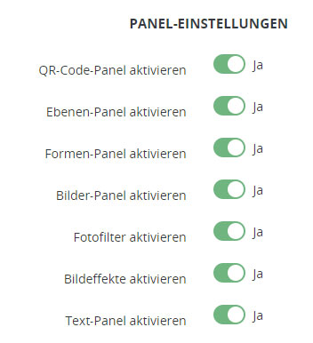

| Option | Funktion |
|---|---|
| QR-Code-Panel aktivieren | Benutzer können einen individuellen QR-Code erzeugen und auf dem Produkt platzieren |
| Ebenen-Panel aktivieren | Ebenenverwaltung (in den Vordergrund bringen, in den Hintergrund senden usw.) für komplexe Überlappungen |
| Formen-Panel aktivieren | Einfügen vordefinierter Formen (verwaltet unter „Formenverwaltung") |
| Bilder-Panel aktivieren | Kunden laden eigene Fotos oder Logos von ihrem Gerät hoch |
| Fotofilter aktivieren | Werkzeuge zur Anpassung von Farbe und Helligkeit und zum Anwenden von Filtern auf hochgeladene Bilder |
| Bildeffekte aktivieren | Erweiterte Grafikeffekte für hochgeladene Bilder |
| Text-Panel aktivieren | Einfügen individueller Textfelder auf dem Produkt |

### 2. Schaltflächen-Einstellungen

Aktivieren oder deaktivieren Sie bestimmte Transformationswerkzeuge für Texte oder Bilder im Arbeitsbereich.

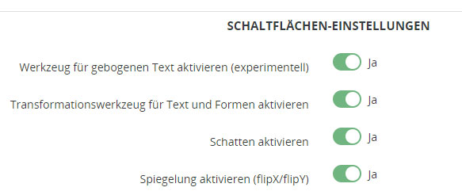

| Option | Funktion |
|---|---|
| Werkzeug für gebogenen Text aktivieren (experimentell) | Ordnet Text entlang einer gebogenen Linie an (z. B. runde Logos, Aufnäher). Experimentelle Funktion: vor der Aktivierung testen |
| Transformationswerkzeug aktivieren (Warp) | Verformt Text und Formen frei (Perspektive, Verzerrung) mit Dutzenden von Transformationen |
| Schatten aktivieren | Fügt Schatten hinter Elementen hinzu und passt sie an |
| Spiegeln aktivieren | Schaltflächen zum horizontalen (Flip X) oder vertikalen (Flip Y) Spiegeln von Elementen |

### 3. Design- und Warenkorb-Einstellungen

Verhaltensregeln für den Fall, dass ein Kunde ein Projekt speichert oder dem Warenkorb hinzufügt.

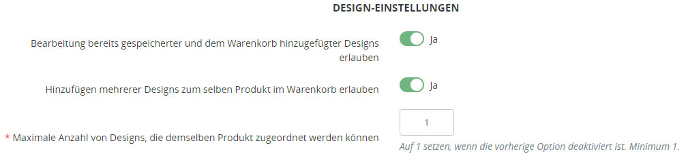

- **Bearbeitung bereits gespeicherter und dem Warenkorb hinzugefügter Designs zulassen** – bei **Ja** kann der Kunde im Warenkorb auf sein Produkt klicken und in den Designer zurückkehren, um vor dem Kauf einen Fehler zu korrigieren.
- **Hinzufügen mehrerer Designs zum selben Produkt im Warenkorb zulassen** – bei **Ja** kann der Kunde dasselbe Produkt mehrmals mit verschiedenen Designs personalisieren und als separate Positionen in den Warenkorb legen.
- **Maximale Anzahl von Designs, die mit demselben Produkt verknüpft werden können** – Obergrenze verschiedener Personalisierungen für denselben Artikel (z. B. 5). Mindestwert: 1.

> Deaktivieren Sie die vorherige Option (**Nein**), verschwindet dieses Feld und das System erzwingt den Grenzwert **1**, um unerwünschte Duplikate zu vermeiden.

### 4. Bereinigung von Designs abgebrochener Warenkörbe

Viele Kunden beginnen mit der Personalisierung eines Produkts und verlassen die Website, ohne zu bestellen. Diese Designs (ohne Bestell-ID) belegen Speicherplatz auf dem Server: Dieser Bereich automatisiert ihre Löschung.

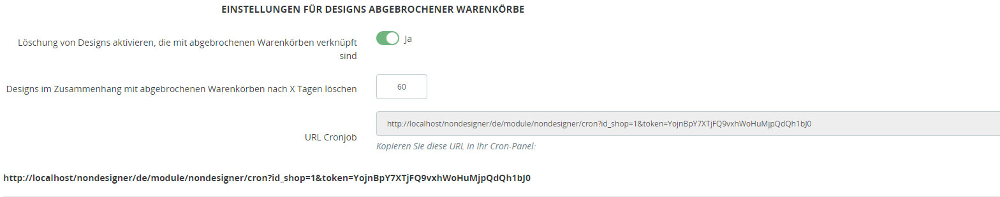

- **Löschung von Designs abgebrochener Warenkörbe aktivieren** – bei **Ja** werden die Bereinigungseinstellungen freigeschaltet und das Panel für die manuelle Bereinigung eingeblendet.
- **Designs nach X Tagen löschen** – wie lange nicht gekaufte Projekte aufbewahrt werden (Standard **30 Tage**). Jeder Wert unter 1 wird auf 30 erzwungen.
- **Cronjob-URL (Automatisierung)** – das System erzeugt eine eindeutige, sichere Adresse mit einem 32-stelligen geheimen Token. Tragen Sie sie in den Cron-Manager Ihres Servers (cPanel/Plesk) ein, damit alte Dateien automatisch jede Nacht oder jede Woche gelöscht werden. Der Server muss einen HTTP-GET-Aufruf ausführen (z. B. mit `wget` oder `curl`).

### 5. Manuelle Bereinigung

Wenn Sie keinen Cronjob einrichten möchten, können Sie manuell bereinigen.

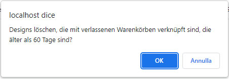

> Das Feld ist nur sichtbar, wenn Sie die Löschung von Designs abgebrochener Warenkörbe aktiviert haben, und funktioniert nur innerhalb eines bestimmten Shops (nicht in der Ansicht „Alle Shops" bei Multistore).

1. Klicken Sie auf die gelbe Schaltfläche **Jetzt löschen**.
2. Bestätigen Sie die Frage „Möchten Sie Designs abgebrochener Warenkörbe löschen, die älter als [X] Tage sind?".
3. Ein Fortschrittsbalken erscheint.
4. Die Löschung erfolgt im Hintergrund in **Stapeln von jeweils 20 Designs**: Der Server blockiert auch bei Tausenden von Dateien nicht (Timeout).
5. Warten Sie, bis 100 % erreicht sind: Sie erhalten eine grüne Erfolgsmeldung („Bereinigung abgeschlossen!") oder, falls nichts zu bereinigen ist, einen blauen Hinweis („Keine Designs zu löschen").

---

Nächste Seite: [So konfigurieren Sie den Designer für ein Produkt →](produktkonfiguration.md)
