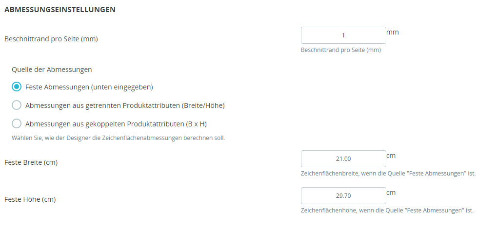
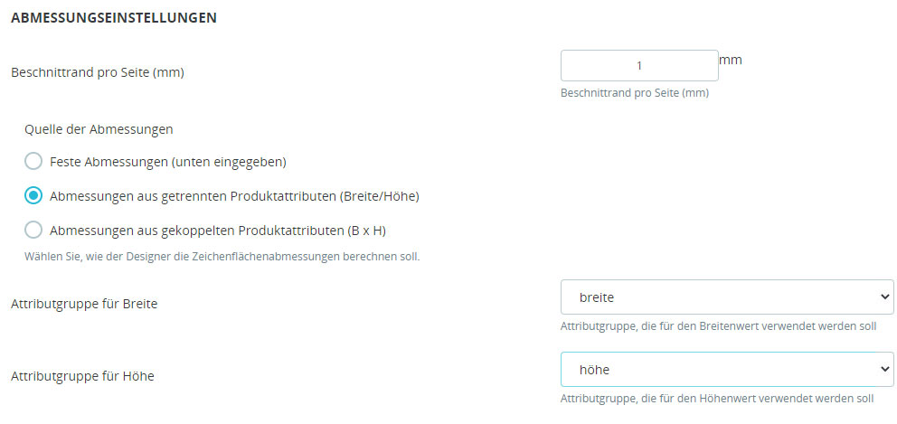
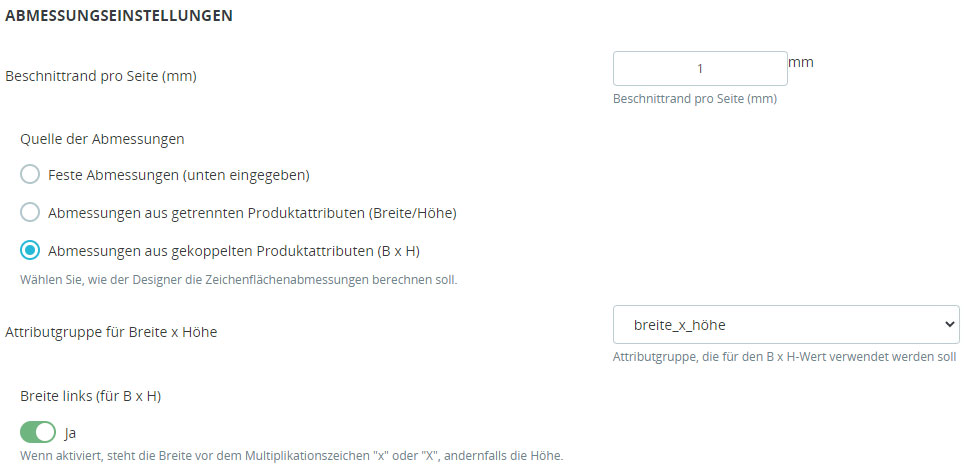

[← Inhaltsverzeichnis](README.md) · [← Produktkonfiguration](produktkonfiguration.md) · Nächste Seite: [Bestellungen und SVG-Export →](bestellungen-und-svg-export.md)

# So legen Sie die Druckabmessungen eines Produkts in NonDesigner fest

Die Abmessungen des Druckbereichs eines Produkts werden durch **Breite** und **Höhe** in **Zentimetern** angegeben. In **NonDesigner** (PrestaShop-Modul) können Sie sie auf drei Arten ermitteln, zuzüglich einer Beschnittzugabe.

**Pfad:** Katalog → Produkte → Produkt bearbeiten → Module → NonDesigner → Konfigurieren → *Größeneinstellungen*

**Auf dieser Seite**

- [Was Attribut und Kombination bedeuten](#was-attribut-und-kombination-bedeuten)
- [Welche Methode soll ich wählen?](#welche-methode-zur-größenberechnung-soll-ich-wählen)
- [Beschnittzugabe](#1-beschnittzugabe-pro-seite-mm)
- [Methode 2: feste Abmessungen](#2-feste-abmessungen)
- [Methode 3: separate Attribute](#3-abmessungen-aus-separaten-produktattributen-breitehöhe)
- [Methode 4: gepaarte Werte B x H](#4-abmessungen-aus-gepaarten-werten-b-x-h-in-einem-einzigen-attribut)

## Was Attribut und Kombination bedeuten

Ein **Attribut** ist ein Merkmal, das Produktvarianten erzeugt (z. B. die Attributgruppe „Größe" mit den Werten „50x70 cm", „70x100 cm" …). Eine **Kombination** ist die Paarung von Attributen, die der Kunde vor dem Kauf wählt (z. B. Größe: 50x70 cm + Farbe: Rot).

Hat Ihr Produkt **keine Varianten/Attribute** konfiguriert, können die Methoden 3 und 4 nicht verwendet werden: Wählen Sie **Feste Abmessungen** (Methode 2).

## Welche Methode zur Größenberechnung soll ich wählen?

| Situation | Methode |
|---|---|
| Das Produkt hat bei allen Varianten immer dieselbe Abmessung (z. B. immer 50x70 cm) | **Feste Abmessungen** |
| Breite und Höhe sind zwei separate Attribute (zwei Dropdown-Menüs) | **Separate Attribute** |
| Breite und Höhe stehen zusammen in einem einzigen Attribut (z. B. Variante „50x70") | **Gepaarte Werte (B x H)** |

Mit Ausnahme von „Feste Abmessungen" ist die **Auswahl der Attributgruppe obligatorisch**: Bleibt die Auswahl leer, kann nicht gespeichert werden und es erscheint eine Warnung auf dem Bildschirm.

---

## 1. Beschnittzugabe pro Seite (mm)

> **Kurz gesagt:** Wenn Sie sich nicht sicher sind, fragen Sie Ihren Druckdienstleister nach dem empfohlenen Wert (üblicherweise 2–3 mm) und geben Sie ihn hier ein. Er dient lediglich dazu, unerwünschte weiße Ränder nach dem Zuschneiden zu vermeiden.

Dies ist ein einzelnes Textfeld, das **unabhängig von der gewählten Methode immer sichtbar** ist und die auf **jeder Seite** des Druckbereichs hinzugefügte Beschnittzugabe in **Millimetern** darstellt.

### Wozu dient die Beschnittzugabe?

Wird ein Design auf einen größeren Bogen gedruckt und anschließend auf die endgültige Größe zugeschnitten (Visitenkarten, Aufkleber, Poster, Tafeln usw.), ist die Schneidemaschine nie millimetergenau. Reicht der Hintergrund oder ein Bild exakt bis an den Rand des nutzbaren Bereichs und verschiebt sich der Schnitt auch nur geringfügig, bleibt am Rand ein dünner **Streifen unbedruckten weißen Papiers**: ein optisch offensichtlicher Mangel, der als Druckfehler gilt.

Die Beschnittzugabe erweitert Hintergrund und Bilder um einige Millimeter pro Seite über den tatsächlichen Produktrand hinaus. Die Druckdatei ist größer als das Endformat: Selbst bei leichter Verschiebung liegt der Schnitt stets im überstehenden, weiterhin bedruckten Bereich.

Ein typischer Wert liegt bei **1 bis 5 mm pro Seite**, je nach Produkttyp, Material und den Toleranzen der Schneidemaschine des Druckers. Der Designer erweitert den Hintergrund **automatisch** über die nominellen Abmessungen hinaus, ohne dass sich der Endbenutzer darum kümmern muss.

### Welches Format akzeptiert das Feld?

Die Validierung ist streng und **blockiert das Speichern**, wenn das Format nicht korrekt ist:

- Nur **positive ganze Zahlen** (Ziffern 0–9): `0`, `5`, `12`, `100`.
- **Keine Dezimalstellen**: weder Punkt noch Komma.
- **Kein Vorzeichen**: negative Werte sind nicht zulässig.
- Das Feld kann **leer** bleiben: Es wird als `0` gespeichert (keine Beschnittzugabe).

> **Blockierender Fehler:** Werte wie `5.5`, `5,5`, `-5`, `5mm`, `abc` verhindern das Speichern des gesamten Produktdatenblatts und zeigen eine explizite Fehlermeldung an.

---

## 2. Feste Abmessungen

> **Kurz gesagt:** Wählen Sie diese Methode, wenn das Produkt bei allen Varianten immer dieselbe Abmessung hat: Geben Sie die beiden Zahlen einmal ein, ohne Attribute zu verknüpfen.

Es werden zwei Eingabefelder angezeigt (Breite und Höhe), in die nur Zahlen eingegeben werden können.

### Welches Format akzeptieren feste Abmessungen?

Der Wert wird **nicht interpretiert oder bereinigt**: Er wird genau wie eingegeben direkt in eine Dezimalzahl umgewandelt.

- Dezimaltrennzeichen: **Punkt** (`.`) oder **Komma** (`,`). Gültige Beispiele: `50`, `50.5`, `120.75`, `50,5`, `120,75`.
- Das Komma wird beim Speichern **automatisch in einen Punkt umgewandelt** (`50,5` → `50.5`).
- Keine Maßeinheiten, Leerzeichen oder Symbole: `50 cm` würde als `50` gespeichert, wird jedoch nicht empfohlen.
- Breite und Höhe sind **Pflichtfelder** und müssen **größer als null** sein (> 0,01 cm), andernfalls wird das Speichern blockiert.

> Da dies die strengste Methode ist (keine automatische Extraktion aus Text oder Symbolen), geben Sie **nur Zahlen mit optionalem Dezimalpunkt** ein (z. B. `45`, `45.5`).

---

## 3. Abmessungen aus separaten Produktattributen (Breite/Höhe)

> **Kurz gesagt:** Wählen Sie diese Methode, wenn Breite und Höhe zwei separate Attribute sind (z. B. ein Dropdown-Menü für die Breite und eines für die Höhe): Das System liest die Zahl automatisch aus jedem der beiden.

Es werden zwei Auswahlfelder angezeigt (Breite und Höhe), die jeweils die Liste der Attributgruppen enthalten, die Teil der Kombinationen des Produkts sind.

### Wie werden die Werte gelesen?

Sobald die Attributgruppen für Breite und Höhe gewählt sind, liest das System den Wert/Namen jedes Attributs der vom Kunden gewählten Kombination und **extrahiert die Zahl automatisch**, wobei Text, Maßeinheiten und Symbole entfernt werden, **sofern der Wert nur eine einzige Zahl enthält**.

| Attributwert (Beispiel) | Gelesener Wert |
|---|---|
| `50` | 50 |
| `50 cm` | 50 |
| `50cm` | 50 |
| `H: 50 cm` | 50 |
| `Höhe 50 cm` | 50 |
| `50.5` / `50.5 cm` | 50.5 |
| `50,5` / `50,5 cm` | 50.5 |

Sowohl Punkt als auch Komma werden als Dezimaltrennzeichen akzeptiert.

### Welche Attributwerte sollten vermieden werden?

> **Grundlegende Regel:** Jeder Attributwert darf **nur eine Zahl** enthalten. Enthält er mehrere Zahlen (ein Code, eine numerische Größe, zwei Maße), ist das Ergebnis unvorhersehbar und mit hoher Wahrscheinlichkeit falsch, **ohne dass ein Fehler gemeldet wird**.

| Attributwert (fehlerhaft) | Gelesener Wert | Problem |
|---|---|---|
| `50x70` | 5070 | die beiden Zahlen werden zu einer zusammengeführt |
| `Modell X200, 50 cm` | 200.50 | die beiden Zahlen werden zusammengeführt, wodurch falsche Dezimalstellen entstehen |
| `1.234 cm` (Tausender) | 1.234 | interpretiert als „1 Komma 234" statt „1234" |
| `-50 cm` | 50 | das negative Vorzeichen wird ignoriert |

**Empfehlung:** Der Name jedes Attributs in der gewählten Gruppe (für Breite und Höhe) darf **nur die Maßzahl** enthalten, optional begleitet von Text oder einer Maßeinheit, **niemals weitere Zahlen**.

---

## 4. Abmessungen aus gepaarten Werten (B x H) in einem einzigen Attribut

> **Kurz gesagt:** Wählen Sie diese Methode, wenn Breite und Höhe zusammen in einem einzigen Attribut stehen (z. B. die Variante heißt `50x70`): Das System trennt die beiden Zahlen selbstständig, sofern sie im richtigen Format geschrieben sind.

Es wird nur ein Auswahlfeld angezeigt, aus dem sowohl Breite als auch Höhe gelesen werden.

### Wie funktioniert das?

Das System sucht im Attributwert nach **zwei durch ein „x" getrennten Zahlen** (oder einem gleichwertigen Symbol) und weist sie gemäß der Option **Position der Breite** Breite und Höhe zu.

### Welche Trennzeichen sind gültig?

Das Trennzeichen zwischen den beiden Zahlen muss eines der folgenden sein:

- `x` (Kleinbuchstabe)
- `X` (Großbuchstabe)
- `*` (Sternchen)

| Attributwert (Beispiel) | 1. Wert | 2. Wert |
|---|---|---|
| `50x70` | 50 | 70 |
| `50X70` | 50 | 70 |
| `50*70` | 50 | 70 |
| `50 x 70` | 50 | 70 |
| `50 x 70 cm` | 50 | 70 |
| `50cm x 70cm` | 50 | 70 |
| `B: 50 x H: 70 cm` | 50 | 70 |
| `50,5 x 70,2` | 50.5 | 70.2 |
| `50.5x70.2` | 50.5 | 70.2 |

Punkt und Komma werden für beide Zahlen als Dezimaltrennzeichen akzeptiert.

### Welche Formate werden NICHT erkannt?

> Diese Formate ergeben Breite und Höhe gleich **0 / 0**, **ohne für den Benutzer sichtbare Fehlermeldung**.

| Attributwert (fehlerhaft) | Ergebnis | Problem |
|---|---|---|
| `50-70` | 0 / 0 | der Bindestrich ist kein gültiges Trennzeichen |
| `50 / 70` | 0 / 0 | der Schrägstrich ist kein gültiges Trennzeichen |
| `50×70` (Symbol ×) | 0 / 0 | es muss der Buchstabe x verwendet werden, nicht das Symbol × |
| `50 mal 70` | 0 / 0 | es muss der Buchstabe x verwendet werden, nicht das Wort „mal" |
| `Einzelgröße` | 0 / 0 | keine Zahl vorhanden |
| `70 cm` (ein einzelner Wert) | 0 / 0 | die zweite Zahl und/oder das Trennzeichen fehlt |

### Was passiert bei mehr als zwei Maßen?

Bei drei oder mehr Zahlen (z. B. `50x70x30`, um eine Tiefe einzuschließen) werden **nur die ersten beiden Maße** (50 und 70) gelesen; der dritte Wert wird ignoriert.

**Empfehlung:** Jedes Attribut der gewählten Gruppe muss **genau zwei Zahlen** enthalten, getrennt nur durch `x`, `X` oder `*` (z. B. `50x70 cm`, `50,5 X 70,2`); vermeiden Sie Bindestriche, Schrägstriche, das Symbol × oder Textbeschreibungen des Trennzeichens.

---

Werden die Abmessungen im Frontend als 0 / 0 gelesen, siehe die [FAQ](faq.md#die-produktabmessungen-werden-im-frontend-als-0--0-gelesen-wie-behebe-ich-das).

Nächste Seite: [Bestellungen und SVG-Export →](bestellungen-und-svg-export.md)
