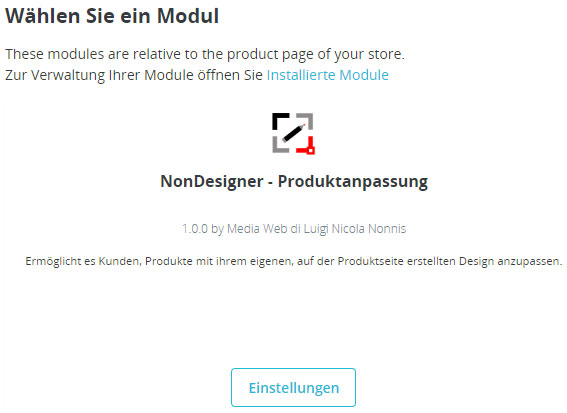
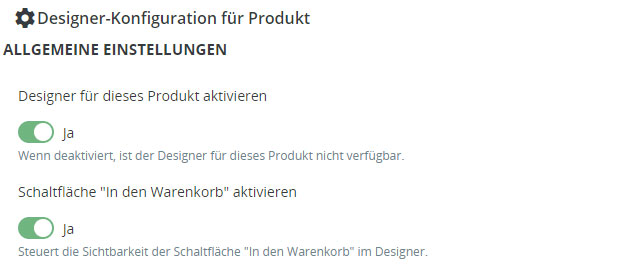
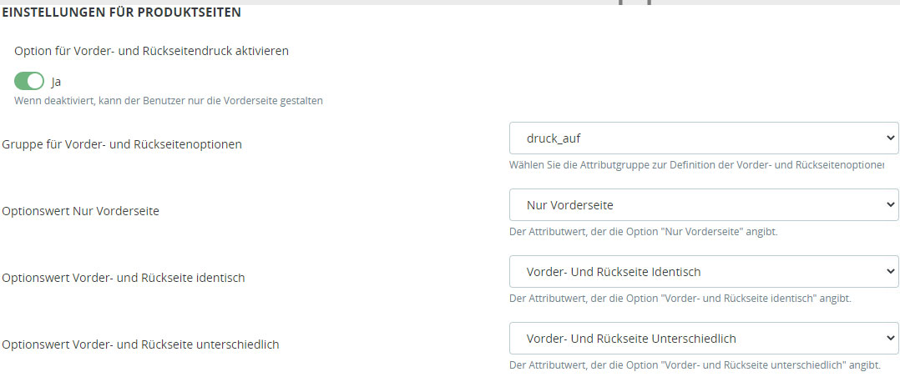
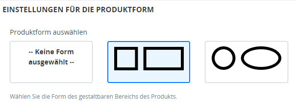
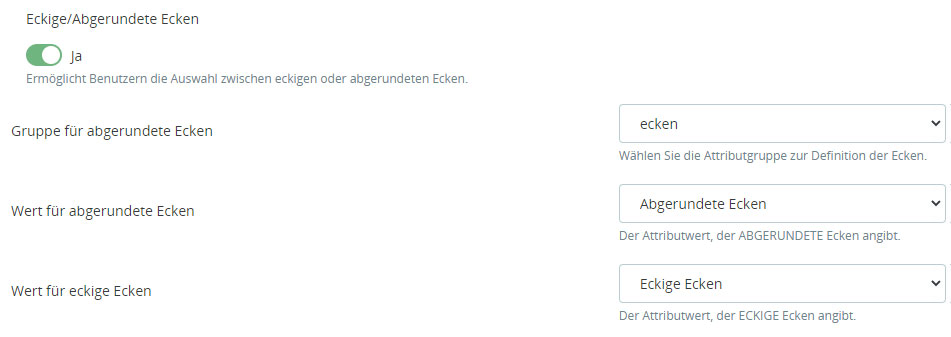
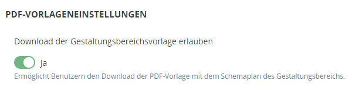
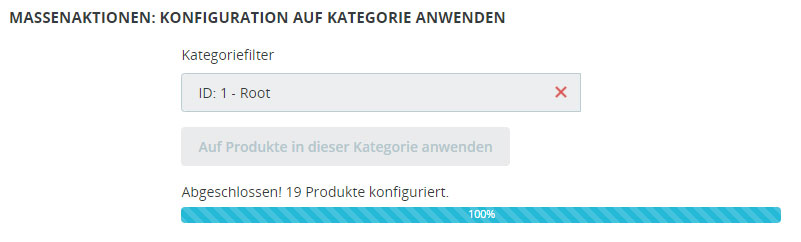

[← Inhaltsverzeichnis](README.md) · [← Modulkonfiguration](modulkonfiguration.md) · Nächste Seite: [Druckabmessungen →](produktabmessungen.md)

# So konfigurieren Sie den NonDesigner-Designer für ein einzelnes PrestaShop-Produkt

Nachdem Sie das [Modul global konfiguriert](modulkonfiguration.md) haben, wird der **NonDesigner**-Designer Produkt für Produkt eingerichtet. Diese Seite beschreibt Aktivierung, Vorder-/Rückseitendruck, Produktform, PDF-Vorlage und die Massenanwendung der Konfiguration auf eine ganze Kategorie.

**Pfad:** Kontrollzentrum → Katalog → Produkte → Produkt bearbeiten/hinzufügen → Module → NonDesigner → Konfigurieren

## Allgemeine Einstellungen

### Wie aktiviere ich den Designer für ein Produkt?

Aktivieren Sie **Designer für dieses Produkt aktivieren**. Ist er deaktiviert, verhält sich das Produkt wie ein normaler Katalogartikel.

> Es ist sinnvoll, ihn **deaktiviert** zu lassen, während Sie eine Konfiguration vorbereiten, die Sie anschließend [per Massenaktion auf andere Produkte kopieren](#wie-wende-ich-die-konfiguration-auf-alle-produkte-einer-kategorie-an): So können Sie die Konfiguration jedes Produkts prüfen, bevor Sie den Designer aktivieren.

### Was bewirkt die Option „Schaltfläche In den Warenkorb aktivieren"?

Sie steuert die Sichtbarkeit der Schaltfläche „In den Warenkorb" **innerhalb der Designer-Oberfläche**. Wenn der Benutzer ein Design speichert, wird das zugehörige Produkt **automatisch dem Warenkorb hinzugefügt**.

- **Blenden Sie** die Schaltfläche **aus**, wenn Sie den Kunden **zwingen** möchten, dem Produkt ein Design zuzuordnen.
- **Lassen Sie sie sichtbar**, wenn der Kauf des Produkts auch **ohne** zugehöriges Design möglich sein soll (siehe [neutrales Produkt „Kein Druck"](preise-und-varianten.md#a-wie-verkaufe-ich-auch-das-neutrale-produkt-ohne-druck)).

## Wie richte ich den Vorder-/Rückseitendruck ein?

- **Option für Vorder-/Rückseitendruck aktivieren:** Ist sie deaktiviert, kann der Kunde nur **die Vorderseite** personalisieren.
- Wenn Sie Vorder-/Rückseite aktivieren, erscheinen neue Zuordnungsfelder:
  - **Gruppe der Vorder-/Rückseitenoptionen:** Die Attributgruppe, die die Druckvarianten definiert.
  - **Wertzuordnung:** Geben Sie nach Auswahl der Gruppe an, welcher Wert **Nur Vorderseite**, welcher **Identisch Vorder-/Rückseite** und welcher **Unterschiedlich Vorder-/Rückseite** entspricht.

Die Felder zur Wertzuordnung werden automatisch anhand der gewählten Gruppe befüllt. Zur Verwaltung von Zuschlägen für diese Varianten siehe [Preise und Varianten](preise-und-varianten.md).

## Abmessungen des Produkts

Breite und Höhe des Druckbereichs werden mit drei Methoden (feste Abmessungen, separate Attribute, gepaarte Werte B x H) plus Beschnittzugabe festgelegt. Das ist die heikelste Einstellung und hat eine eigene Seite → [So legen Sie die Druckabmessungen fest](produktabmessungen.md).

## Produktform

Definiert die visuelle Maske des Produkts, also den bearbeitbaren Bereich.

### Wie wähle ich die Produktform?

Wählen Sie unter **Produktform auswählen** die Grundform: **quadratisch/rechteckig** oder **rund/oval**.

### Wie stelle ich abgerundete Ecken ein?

Der Schalter **Eckige/Abgerundete Ecken** ist **nur bei quadratischer/rechteckiger Form** sichtbar; bei runder/ovaler Form wird die Option erzwungen und auf „Nein" ausgeblendet.

Aktivieren Sie sie (**Ja**), müssen Sie die **Gruppe der abgerundeten Ecken** zuordnen und angeben, welche Attributwerte **Abgerundete Ecken** und welche **Eckige Ecken** entsprechen.

## PDF-Vorlage des Zeichenbereichs

**Download der Vorlage des Zeichenbereichs zulassen:** Ist die Option aktiviert, können Benutzer das **PDF**-Layout des Arbeitsbereichs im **Maßstab 1:1 mit 300 dpi** herunterladen, in den in der Produktregisterkarte gewählten Abmessungen.

> Die Option wird nur angezeigt, wenn bereits eine gültige **Produktform** ausgewählt wurde.

## Wie wende ich die Konfiguration auf alle Produkte einer Kategorie an?

Mit der Funktion **Massenaktionen** wählen Sie eine Kategorie aus (durch Eingabe von Name oder ID im Suchfeld) und wenden die Konfiguration des aktuellen Produkts **rekursiv** auf die Produkte der Kategorie und ihrer Unterkategorien an.

> Nur verfügbar, wenn das aktuelle Produkt über eine **gültige, bereits gespeicherte Designer-Konfiguration** verfügt.

---

Nächste Seite: [So legen Sie die Druckabmessungen fest →](produktabmessungen.md)
