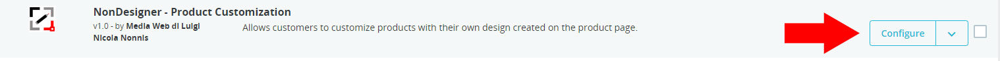

[← Index](README.md) · Next page: [Module configuration →](module-configuration.md)

# How to install the NonDesigner module on PrestaShop

**NonDesigner** is a PrestaShop module that lets customers personalize products online with a 2D graphic designer built into the shop's frontend and, for every order, generates vector SVG and 1:1 PNG files ready for printing. This page covers system requirements, compatibility with PrestaShop versions and the installation procedure.

## Which PrestaShop and PHP versions is NonDesigner compatible with?

- **Compatible PrestaShop versions:** v1.7.6.1 up to v8.x and v9.x
- **Supported PHP versions:** PHP 7.2 to PHP 8.5
- **Required PHP extensions:** GD Library, cURL, Zip, SimpleXML
- **Recommended server directives:** `upload_max_filesize` ≥ 10M and `post_max_size` ≥ 10M

> The `upload_max_filesize` and `post_max_size` directives ultimately limit the size of the images customers can upload into the designer. See [Maximum user image size](module-configuration.md#2-maximum-user-image-size-mb).

## How to install NonDesigner step by step

1. Log in to the PrestaShop Back Office.
2. Go to **Control Panel → Module Manager → Module Manager**.
3. Click the **Upload a module** button at the top right.
4. Drag and drop, or select, the NonDesigner module `.zip` file downloaded from PrestaShop Addons.
5. Wait for the installation to finish and click **Configure**.

## Does NonDesigner require a license activation?

No. The module **does not require any license activation**: once installed and configured, it is immediately operational.

## Where are the module settings after installation?

**Control Panel → Module Manager → NonDesigner → Configure**

All module settings support PrestaShop's native **Multistore** feature: you can have different rules (e.g. cleanup days or active panels) for each store or group of stores by selecting the shop from the selector at the top right. If you don't set a value for a store, the inherited global value is used automatically.

## What should I do before installing?

**Back up your server files and database** before installing the module and, if possible, install it first on a **test server** to run your own tests. Installation is at your own responsibility: the developers take no responsibility for adverse effects occurring during installation.

## Next steps

1. [Configure the global module settings](module-configuration.md)
2. [Configure the designer on a product](product-configuration.md)
3. If you run into problems, see the [FAQ](faq.md)
