[← Index](README.md) · [← Installation](installation.md) · Next page: [Product configuration →](product-configuration.md)

# How to configure the NonDesigner module: global settings (module side)

This page describes the global settings of the **NonDesigner** module for PrestaShop, split into four tabs: **General**, **Shape Management**, **Font Management** and **Tools Configuration**.

**Path:** Control Panel → Module Manager → NonDesigner → Configure

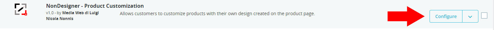

> **Multistore:** all settings support PrestaShop's native Multistore. You can define different rules for each store or group of stores by selecting the shop from the selector at the top right. If you don't set a value for a store, the inherited global value is used.

**On this page**

- [General tab](#general-tab)
- [Shape Management tab](#shape-management-tab)
- [Font Management tab](#font-management-tab)
- [Tools Configuration tab](#tools-configuration-tab)

---

## General tab

The **General** tab manages diagnostics (logging), limits on file uploads by customers and permissions for downloading project files in the frontend.

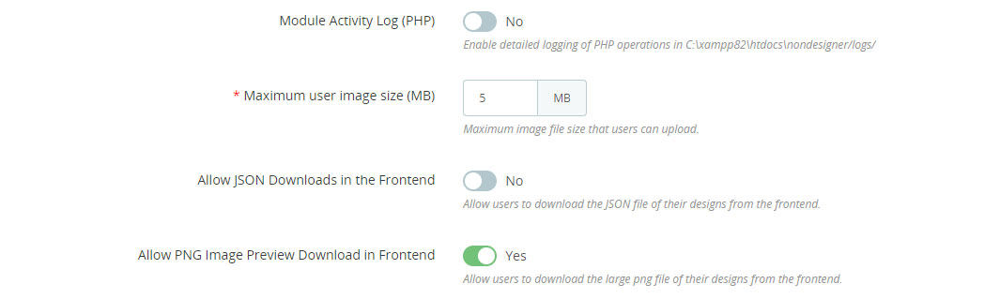

### 1. Module activity log

A Yes/No toggle that enables or disables detailed logging of the PHP operations performed by the module. When active, log files are saved in the `/logs/` folder in the root directory (`_PS_ROOT_DIR_`) of your PrestaShop site.

**Tip:** keep it set to **No** during normal operation to avoid extra load on the server. Enable it only if you have problems and your developer needs to diagnose errors.

### 2. Maximum user image size (MB)

Defines the maximum size of the image files users can upload into the designer.

- The value is expressed in Megabytes (MB) and is required.
- It must be a positive number greater than zero (e.g. 2 or 5); otherwise the system shows an error and prevents saving.

> **Important:** the actual limit ultimately depends on your hosting server limits (`upload_max_filesize` and `post_max_size` in `php.ini`). If you set a value in the module (e.g. 10 MB) higher than the server limit (e.g. 2 MB), the server will still block uploads above 2 MB. Set a value equal to or lower than what your hosting plan allows.

### 3. Allow JSON download in the Frontend

Yes/No toggle: if enabled, the customer finds a button in the frontend to download the **JSON** file with the raw data of their graphic project's structure.

### 4. Allow PNG preview download in the Frontend

Yes/No toggle: if enabled, the customer can download a **1:1 scale PNG** image of the design they just created. The quality of this preview is **not suitable for professional printing**: print files are downloaded from the Back Office (see [Orders and SVG export](orders-and-svg-export.md)).

---

## Shape Management tab

Here you manage the geometric or vector shapes users can insert into their projects. Shapes support Multistore: each store has its own dedicated folder.

### How do I upload new shapes to NonDesigner?

Click the upload button. The system accepts **only `.svg` files**. For security, the module **automatically sanitizes** uploaded SVG files, removing harmful tags and attributes.

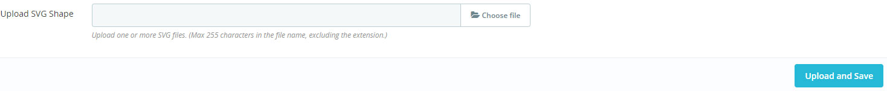

### How do I change the order of shapes in the designer?

Drag the table rows up or down (drag-and-drop): the order determines how shapes appear in the shapes panel of the customer's designer. The position is saved automatically.

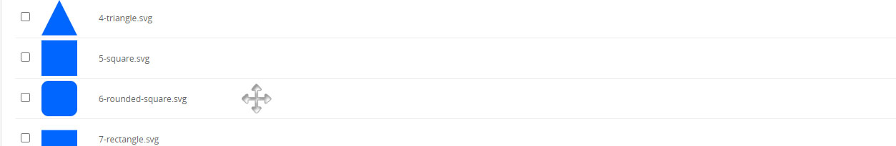

### How do I activate or deactivate a shape?

Click the green check / red X to temporarily hide a shape without deleting it. You can also select several shapes with the checkboxes and use **Bulk Actions** to activate or deactivate them together.

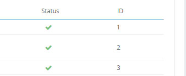

### Can I delete system shapes?

Shapes you uploaded can be permanently deleted. **System Shapes** (e.g. basic circles, squares) **cannot be deleted, only deactivated**, to ensure the module's basic operation; trying to delete one shows an error message.

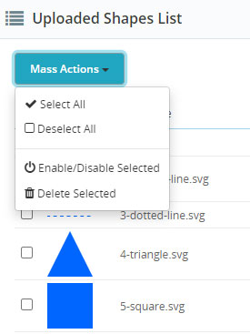

---

## Font Management tab

Here you download, activate and delete the **fonts** made available to customers in the designer.

To ensure maximum frontend performance and compliance with privacy regulations (**GDPR**), the module **does not load fonts from external services in real time**: it downloads the typeface files (`.ttf`) directly to your hosting server and serves them locally.

The screen has two sections: **Not Downloaded Fonts** and **Downloaded Fonts (Installed)**.

### Multistore and fonts

- Downloaded fonts and their activation states are **isolated per store**.
- With Multistore active, font files are organized in dedicated subfolders (e.g. `/fontfiles/1/`, `/fontfiles/2/`), so you can have a different font catalog for each store.

### Not Downloaded Fonts (available catalog)

Lists the fonts in the module's catalog not yet on your server.

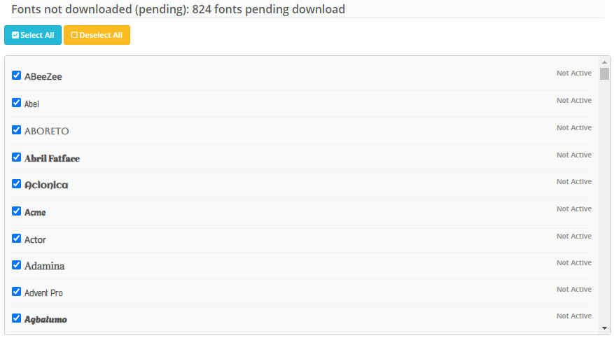

- **Dynamic preview and lazy-loading:** the font name preview is shown only when it appears on screen, so the page isn't slowed down.
- **Selective download:** check the fonts you want and click **Download selected**.
- **Bulk download:** click **Start Download (Restart All)** to download the whole catalog; the system automatically selects all pending fonts.
- **Interruptions and server errors:** during download you see a progress bar with the font being processed. You can click **Cancel** at any time (the process stops once the current font is finished). If the server has a temporary overload (e.g. HTTP 500 error), the module does not lose the work done and tries to resume the download from where it stopped.

### Downloaded Fonts (Installed)

After download, fonts move to the installed list.

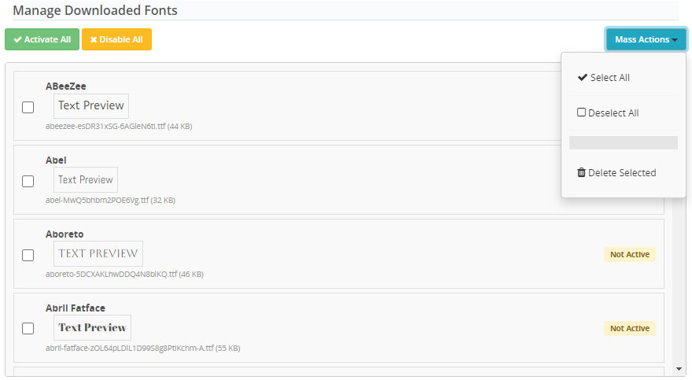

- **Real local preview:** generated from the `.ttf` file saved on your server, with file name and size in KB.
- **Individual activation:** to make a font available to customers, click its status button (**Inactive** / **Activate**). Newly downloaded fonts are **disabled by default**.
- **Bulk activation/deactivation:** **Activate All** / **Deactivate All** buttons.
- **Deletion:** select fonts and click **Delete Selected**; both the database record and the file on the server are removed, and the font returns to "Not Downloaded Fonts".
- **Protected system fonts:** the base fonts built into the module (ID 1, 2, 3, 4, or marked as local) have no selection checkbox and cannot be deleted.

> **Performance:** activating many fonts at once may slow down the designer's loading in the frontend. Activate only the fonts you strictly need.

---

## Tools Configuration tab

Controls the designer interface seen by customers, the add-to-cart rules and database maintenance (temporary file cleanup). It is split into four sections plus a manual cleanup panel.

### 1. Panel Settings

Enable or disable whole tabs of the customer's designer. A disabled panel disappears completely from the interface.

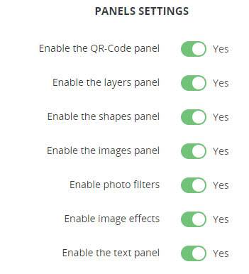

| Option | What it does |
|---|---|
| Enable the QR-Code panel | Lets users generate and place a custom QR code on the product |
| Enable the layers panel | Layer management (bring to front, send to back, etc.) for complex overlaps |
| Enable the shapes panel | Insertion of predefined shapes (managed in "Shape Management") |
| Enable the images panel | Customers upload their own photos or logos from their device |
| Enable photo filters | Tools to adjust color, brightness and apply filters to uploaded images |
| Enable image effects | Advanced graphic effects for uploaded images |
| Enable the text panel | Insertion of custom text fields on the product |

### 2. Button Settings

Enable or disable specific transformation tools applicable to text or images on the workspace.

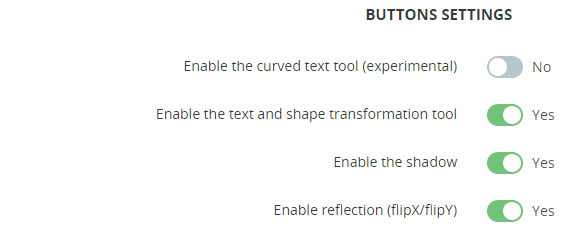

| Option | What it does |
|---|---|
| Enable the curved text tool (Experimental) | Arranges text along a curved line (e.g. circular logos or patches). Experimental: test it before enabling |
| Enable the transformation tool (Warp) | Freely deforms text and shapes (perspective, distortion) with dozens of transformations |
| Enable shadow | Adds and customizes shadows behind elements |
| Enable flip | Buttons to flip elements horizontally (Flip X) or vertically (Flip Y) |

### 3. Design and Cart Settings

Behavior rules for when a customer saves a project or adds it to the cart.

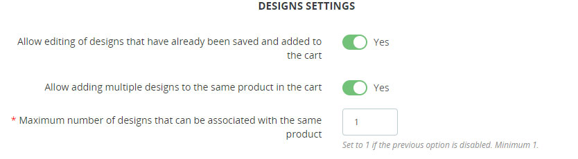

- **Allow editing of designs already saved and added to the cart** – if **Yes**, the customer can click the product in the cart and go back into the designer to fix a mistake before purchase.
- **Allow adding multiple designs to the same product in the cart** – if **Yes**, the customer can personalize the same product several times with different designs and add them to the cart as separate lines.
- **Maximum number of designs that can be linked to the same product** – maximum cap of different personalizations for the same item (e.g. 5). Minimum value: 1.

> If you disable the previous option (**No**), this field disappears and the system forces the limit to **1**, to avoid unwanted duplicates.

### 4. Abandoned Cart Design Cleanup

Many customers start personalizing a product and leave the site without ordering. These designs (with no Order ID) take up space on the server: this section automates their deletion.

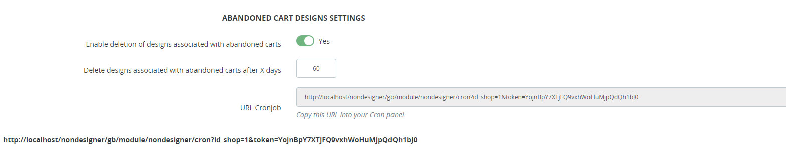

- **Enable deletion of designs linked to abandoned carts** – if **Yes**, unlocks the cleanup settings and shows the Manual Cleanup panel.
- **Delete designs after X days** – how long to keep unpurchased projects (default **30 days**). A value below 1 is forced to 30.
- **Cronjob URL (Automation)** – the system generates a unique, secure address with a 32-character secret token. Copy it into your server's Cron manager (cPanel/Plesk) to delete old files automatically every night or week. The server must perform an HTTP GET call (e.g. with `wget` or `curl`).

### 5. Manual Cleanup

If you don't want to set up a cronjob, you can clean up manually.

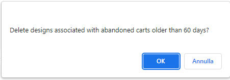

> The box is only visible if you enabled deletion of abandoned-cart designs, and it only works within a specific store (not in the "All shops" view in Multistore).

1. Click the yellow **Delete Now** button.
2. Confirm the prompt "Do you want to delete abandoned cart designs older than [X] days?".
3. A progress bar appears.
4. Deletion runs in the background in **batches of 20 designs** at a time: the server doesn't time out even with thousands of files.
5. Wait for 100%: you get a green notification ("Cleanup complete!") or, if there is nothing to clean, a blue notice ("No designs to delete").

---

Next page: [How to configure the designer on a product →](product-configuration.md)
