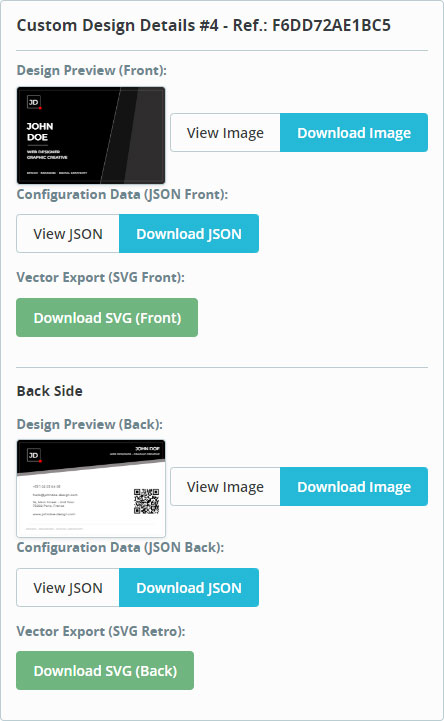

[← Index](README.md) · [← Print dimensions](product-dimensions.md) · Next page: [Pricing and variants →](pricing-and-variants.md)

# How to manage orders and download print-ready SVG files with NonDesigner

For every order with personalized products, **NonDesigner** generates the print files (**vector SVG** and **1:1 scale PNG**) and makes them available directly in the order detail page of the PrestaShop Back Office.

**Path:** Control Panel → Orders → Order Detail

Management of personalized products is integrated in the order detail page.

## How do I see the customer's design in the Back Office?

- The module loads the personalization details **asynchronously** in the order's products table, replacing a temporary placeholder. While data loads you see a loading indicator.
- If the image files or configuration data are **not available on the server**, a **red** text warning is shown.

> **Order confirmation emails:** the graphic files generated by the module are **not displayed directly** in order confirmation emails. The email summary includes a courtesy text indicating the presence of a personalized design, which can be viewed in the customer account's order history.

## What information does the personalization detail show?

- Each design shows its own unique **ID** and, if present, the **reference name** assigned to the configuration.
- For products with multiple or **front/back** printing, the interface shows a section for the **Front** and a separate one for the **Back**.
- **Graphic preview:** click **View Image**. You can save it in high resolution with the blue **Download Image** button.
- **Technical data (JSON):** the module saves the exact personalization parameters in a **JSON** file. You can open it in a new browser window (formatted and readable) or download it.

## How do I export the vector SVG file for printing?

1. In the order detail, find the side (Front or Back) to export.
2. Click the green **Download SVG** button. Hovering over the button shows the **exact print dimensions in centimeters**.
3. On click, the interface temporarily disables the controls and shows a waiting indicator with an on-screen notification.
4. The `.svg` file is calculated dynamically from the JSON data saved on the server and **downloaded automatically** when finished.

### Which program opens the SVG file?

**Inkscape** (free software) is recommended: it also lets you export the file to formats compatible with other graphics programs.

## Security and error handling in Multistore

- In **Multistore** setups a control always verifies that the displayed design belongs to the **currently active store**.
- If an attempt to export or view a project belonging to **another store** is detected, the operation is blocked and an **"Access Denied"** warning is returned.
- The administrator can **permanently delete** the design files and related personalization data.
- Any technical issue while retrieving data (no network connection, missing files) immediately generates error notifications visible in the Back Office.

---

Next page: [Pricing and variants →](pricing-and-variants.md) · Problems? See the [FAQ](faq.md).
