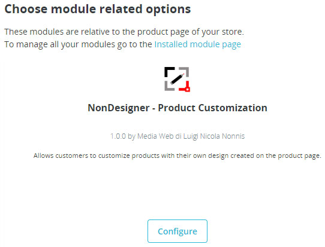
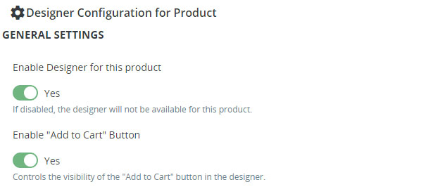
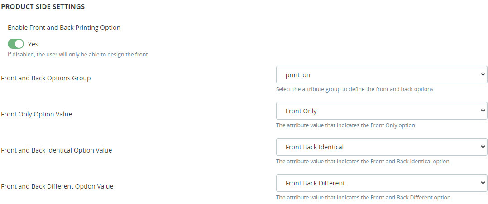
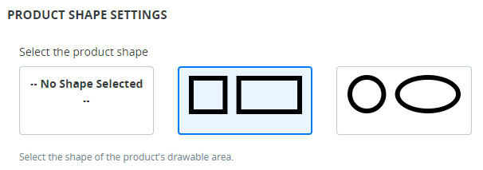
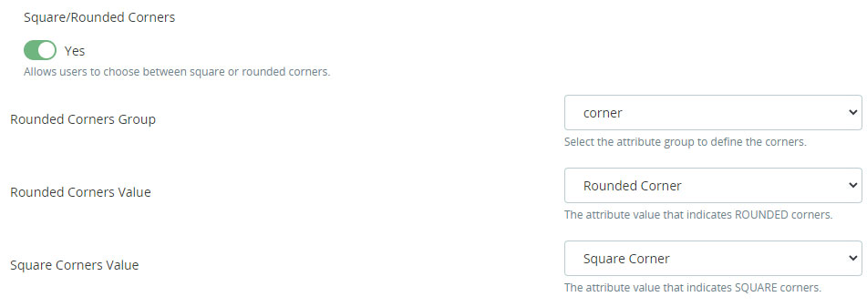
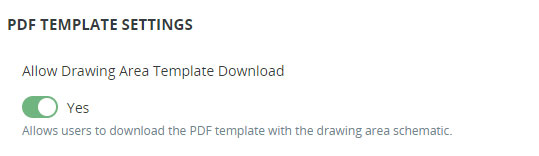
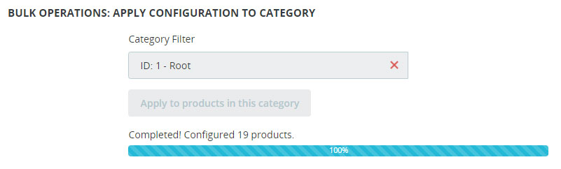

[← Index](README.md) · [← Module configuration](module-configuration.md) · Next page: [Print dimensions →](product-dimensions.md)

# How to configure the NonDesigner designer on a single PrestaShop product

After setting up the [module globally](module-configuration.md), the **NonDesigner** designer is configured product by product. This page covers enabling, front/back printing, product shape, PDF template and bulk-applying the configuration to a whole category.

**Path:** Control Panel → Catalog → Products → Edit/Add product → Modules → NonDesigner → Configure

## General settings

### How do I enable the designer for a product?

Turn on **Enable the designer for this product**. If disabled, the product behaves like a normal catalog item.

> It is useful to keep it **disabled** while you prepare a configuration that you will then [copy in bulk to other products](#how-do-i-apply-the-configuration-to-all-products-of-a-category): this lets you verify each product's configuration before enabling the designer.

### What does the "Enable the Add to cart button" option do?

It controls the visibility of the add-to-cart button **inside the designer's interface**. When the user saves a design, the associated product is **automatically added to the cart**.

- **Hide** the button if you want to **force** the customer to attach a design to the product.
- **Leave it visible** if you want to allow buying the product even **without** an associated design (see [plain "No printing" product](pricing-and-variants.md#a-how-do-i-also-sell-the-plain-product-without-printing)).

## How do I set up front/back printing?

- **Enable Front/Back Printing Option:** if disabled, the customer can personalize **the front only**.
- If you enable front/back, new mapping fields appear:
  - **Front/Back Options Group:** the attribute group that defines the print variants.
  - **Value Mapping:** after choosing the group, indicate which value corresponds to **Front Only**, which to **Identical Front/Back** and which to **Different Front/Back**.

The value mapping fields populate automatically based on the chosen group. To manage surcharges for these variants see [Pricing and variants](pricing-and-variants.md).

## Product dimensions

Width and height of the print area are set with three different methods (fixed dimensions, distinct attributes, paired values W x H) plus the bleed margin. This is the most delicate setting and has its own page → [How to set the print dimensions](product-dimensions.md).

## Product shape

Defines the product's visual mask, i.e. the drawable area.

### How do I choose the product shape?

In **Select the product shape** choose the base shape: **square/rectangular** or **circular/elliptical**.

### How do I set rounded corners?

The **Square/Rounded Corners** toggle is visible **only with the square/rectangular shape**; with the circular/elliptical shape the option is forced and hidden to "No".

If you enable it (**Yes**), you must map the **Rounded Corners Group** and indicate which attribute values correspond to **Rounded Corners** and which to **Square Corners**.

## PDF template of the drawing area

**Allow download of the drawing area template:** if enabled, users can download the **PDF** layout of the work area at **1:1 scale and 300 dpi**, in dimensions matching those set in the product tab.

> The option is only shown if a valid **Product shape** has already been selected.

## How do I apply the configuration to all products of a category?

The **Bulk operations** feature lets you select a category (by typing its name or ID in the search field) and **recursively** apply the current product's configuration to the products in the category and its subcategories.

> Available only if the current product has a **valid, already saved designer configuration**.

---

Next page: [How to set the print dimensions →](product-dimensions.md)
