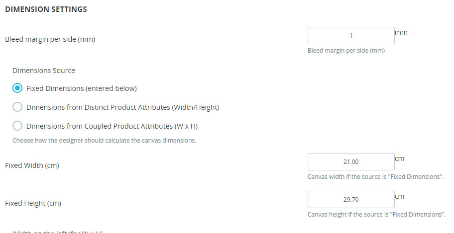
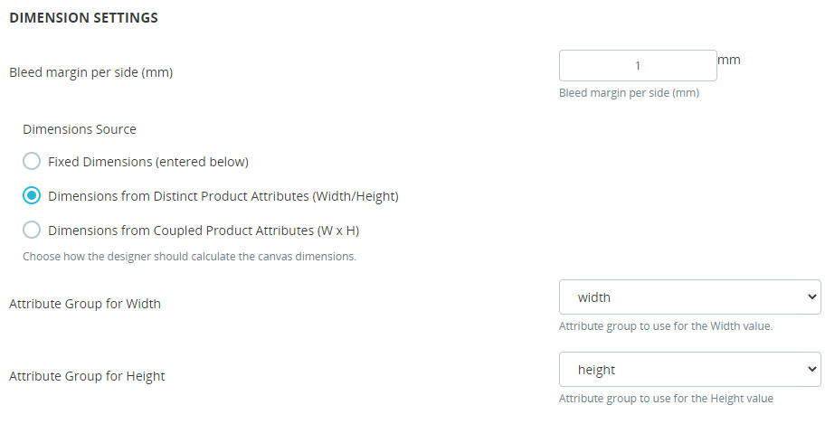
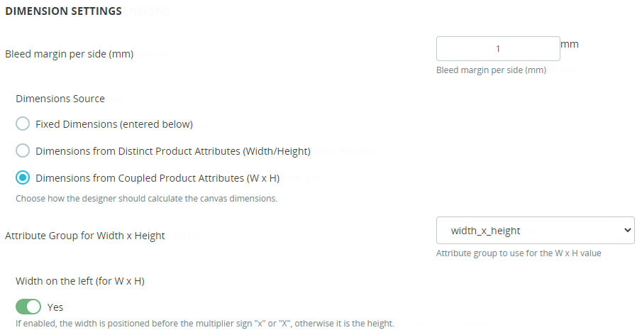

[← Index](README.md) · [← Product configuration](product-configuration.md) · Next page: [Orders and SVG export →](orders-and-svg-export.md)

# How to set the print dimensions of a product in NonDesigner

The product's print area dimensions are identified by **width** and **height**, expressed in **centimeters**. In **NonDesigner** (PrestaShop module) you can derive them in three ways, plus a bleed margin.

**Path:** Catalog → Products → Edit product → Modules → NonDesigner → Configure → *Size settings*

**On this page**

- [What "attribute" and "combination" mean](#what-attribute-and-combination-mean)
- [Which sizing method to choose](#which-sizing-method-to-choose)
- [Bleed margin](#1-bleed-margin-per-side-mm)
- [Method 2: fixed dimensions](#2-fixed-dimensions)
- [Method 3: distinct attributes](#3-dimensions-derived-from-distinct-product-attributes-widthheight)
- [Method 4: paired values W x H](#4-dimensions-derived-from-paired-values-w-x-h-in-a-single-attribute)

## What "attribute" and "combination" mean

An **attribute** is a characteristic that generates product variants (e.g. the attribute group "Size" with values "50x70 cm", "70x100 cm"…). A **combination** is the pairing of attributes the customer chooses before purchasing (e.g. Size: 50x70 cm + Color: Red).

If your product has **no variants/attributes** configured, methods 3 and 4 cannot be used: choose **Fixed dimensions** (method 2).

## Which sizing method to choose

| Situation | Method |
|---|---|
| The product always has the same dimension for all variants (e.g. always 50x70 cm) | **Fixed dimensions** |
| Width and height are two separate attributes (two dropdown menus) | **Distinct attributes** |
| Width and height are written together in a single attribute (e.g. variant "50x70") | **Paired values (W x H)** |

Except for "Fixed dimensions", **selecting the attribute group is mandatory**: leaving the selection blank prevents saving and shows an on-screen warning.

---

## 1. Bleed margin per side (mm)

> **In short:** if you're not sure what to choose, ask your print supplier for the recommended value (usually 2–3 mm) and enter it here. It is only used to avoid unwanted white borders after cutting.

This is a single text field, **always visible** regardless of the selected method, representing the bleed margin added on **each side** of the print area, in **millimeters**.

### What is the bleed margin for?

When a design is printed on a larger sheet and then cut to the final size (business cards, stickers, posters, panels…), the cutter is never precise to the millimeter. If the background or an image reaches exactly to the edge of the usable area and the cut shifts even slightly, a thin **strip of unprinted white** remains along the edge: an obvious aesthetic defect considered a printing error.

The bleed margin extends the background and images beyond the product's real edge by a few millimeters per side. The print file is larger than the final format: even if the cut shifts slightly, it always falls within the oversized, still-printed area.

A typical value is **1 to 5 mm per side**, depending on product type, material and the tolerances of the printer's cutting machine. The designer **automatically** extends the background beyond the nominal dimensions, without the end user having to do anything.

### Which format does the field accept?

Validation is strict and **blocks saving** if the format is wrong:

- Only **positive whole numbers** (digits 0–9): `0`, `5`, `12`, `100`.
- **No decimals**: neither period nor comma.
- **No sign**: negative values are not allowed.
- The field can be left **blank**: it is saved as `0` (no margin).

> **Blocking error:** values such as `5.5`, `5,5`, `-5`, `5mm`, `abc` prevent saving the entire product sheet and show an explicit error message.

---

## 2. Fixed dimensions

> **In short:** choose this method if the product always has the same dimension for all variants: write the two numbers once, with no need to link attributes.

Two input fields (width and height) appear, accepting only numbers.

### Which format do fixed dimensions accept?

The value is **not interpreted or cleaned up**: it is converted directly into a decimal number exactly as typed.

- Decimal separator: **period** (`.`) or **comma** (`,`). Valid examples: `50`, `50.5`, `120.75`, `50,5`, `120,75`.
- The comma is **automatically converted to a period** when saving (`50,5` → `50.5`).
- No units, spaces or symbols: `50 cm` would be saved as `50`, but it is not recommended.
- Width and height are **required** and must be **greater than zero** (> 0.01 cm), otherwise saving is blocked.

> Since this is the strictest method (no automatic extraction from text or symbols), enter **only numbers with an optional decimal point** (e.g. `45`, `45.5`).

---

## 3. Dimensions derived from distinct product attributes (width/height)

> **In short:** choose this method if width and height are two separate attributes (e.g. one dropdown for width and one for height): the system automatically reads the number from each.

Two selection fields appear (width and height), each listing the attribute groups that are part of the product's combinations.

### How are the values read?

Once the attribute groups for width and height are chosen, the system reads the value/name of each attribute of the combination chosen by the customer and **automatically extracts the number**, stripping text, units and symbols, **as long as there is only one number in the value**.

| Attribute value (example) | Value read |
|---|---|
| `50` | 50 |
| `50 cm` | 50 |
| `50cm` | 50 |
| `H: 50 cm` | 50 |
| `Height 50 cm` | 50 |
| `50.5` / `50.5 cm` | 50.5 |
| `50,5` / `50,5 cm` | 50.5 |

Both period and comma are accepted as decimal separators.

### Which attribute values should be avoided?

> **Fundamental rule:** each attribute value must contain **only one number**. If it contains more numbers (a code, a numeric size, two measurements) the result is unpredictable and almost certainly wrong, **with no error reported**.

| Attribute value (incorrect) | Value read | Problem |
|---|---|---|
| `50x70` | 5070 | the two numbers are merged into one |
| `Model X200, 50 cm` | 200.50 | the two numbers are merged, creating incorrect decimals |
| `1.234 cm` (thousands) | 1.234 | interpreted as "1 point 234" instead of "1234" |
| `-50 cm` | 50 | the negative sign is ignored |

**Recommendation:** the name of each attribute in the selected group (for both width and height) must contain **only the measurement number**, optionally with text or a unit of measurement, **never other numbers**.

---

## 4. Dimensions derived from paired values (W x H) in a single attribute

> **In short:** choose this method if width and height are written together in a single attribute (e.g. the variant is called `50x70`): the system separates the two numbers on its own, as long as they are in the correct format.

A single selection field appears, from which both width and height are read.

### How does it work?

The system searches the attribute value for **two numbers separated by an "x"** (or an equivalent symbol) and assigns them to width and height in the order set in the **Width position** option.

### Which separators are valid?

The separator between the two numbers must be one of:

- `x` (lowercase)
- `X` (uppercase)
- `*` (asterisk)

| Attribute value (example) | 1st value | 2nd value |
|---|---|---|
| `50x70` | 50 | 70 |
| `50X70` | 50 | 70 |
| `50*70` | 50 | 70 |
| `50 x 70` | 50 | 70 |
| `50 x 70 cm` | 50 | 70 |
| `50cm x 70cm` | 50 | 70 |
| `L: 50 x H: 70 cm` | 50 | 70 |
| `50,5 x 70,2` | 50.5 | 70.2 |
| `50.5x70.2` | 50.5 | 70.2 |

Period and comma are accepted as decimal separators for both numbers.

### Which formats are NOT recognized?

> These formats produce width and height equal to **0 / 0**, **with no error message** visible to the user.

| Attribute value (incorrect) | Result | Problem |
|---|---|---|
| `50-70` | 0 / 0 | the hyphen is not a valid separator |
| `50 / 70` | 0 / 0 | the slash is not a valid separator |
| `50×70` (× symbol) | 0 / 0 | the letter x must be used, not the × symbol |
| `50 by 70` | 0 / 0 | the letter x must be used, not the word "by" |
| `Single size` | 0 / 0 | no number present |
| `70 cm` (a single value) | 0 / 0 | the second number and/or the separator is missing |

### What happens with more than two measurements?

With three or more numbers (e.g. `50x70x30` to include a depth) **only the first two measurements** (50 and 70) are read; the third is ignored.

**Recommendation:** each attribute in the selected group must contain **exactly two numbers**, separated only by `x`, `X` or `*` (e.g. `50x70 cm`, `50,5 X 70,2`), avoiding hyphens, slashes, the × symbol or textual descriptions of the separator.

---

If dimensions show as 0 / 0 in the frontend, see the [FAQ](faq.md#product-dimensions-are-read-as-0--0-in-the-frontend-how-do-i-fix-it).

Next page: [Orders and SVG export →](orders-and-svg-export.md)
