[← Índice](README.md) · [← Instalación](instalacion.md) · Página siguiente: [Configuración del producto →](configuracion-producto.md)

# Cómo configurar el módulo NonDesigner: ajustes globales (lado del módulo)

Esta página describe los ajustes globales del módulo **NonDesigner** para PrestaShop, divididos en cuatro pestañas: **General**, **Gestión de formas**, **Gestión de fuentes** y **Configuración de herramientas**.

**Ruta:** Panel de Control → Gestor de Módulos → NonDesigner → Configurar

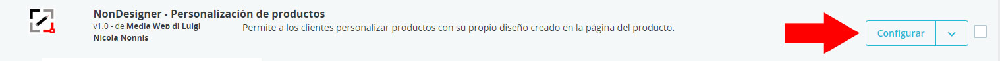

> **Multitienda:** todos los ajustes son compatibles con la función Multitienda nativa de PrestaShop. Puede establecer reglas diferentes para cada tienda o grupo de tiendas seleccionando la tienda desde el selector de la parte superior derecha. Si no establece un valor para una tienda, se utiliza el valor global heredado.

**En esta página**

- [Pestaña General](#pestaña-general)
- [Pestaña Gestión de formas](#pestaña-gestión-de-formas)
- [Pestaña Gestión de fuentes](#pestaña-gestión-de-fuentes)
- [Pestaña Configuración de herramientas](#pestaña-configuración-de-herramientas)

---

## Pestaña General

La pestaña **General** gestiona el diagnóstico (registro), las restricciones de los archivos subidos por los clientes y los permisos de descarga de los archivos del proyecto en el frontend.

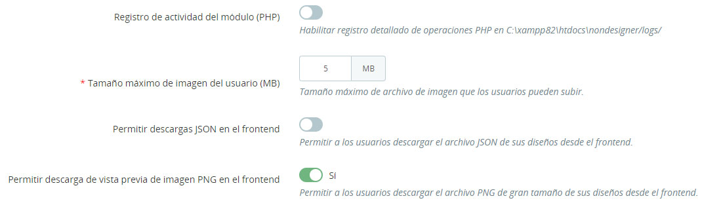

### 1. Registro de actividad del módulo

Interruptor (Sí/No) que activa o desactiva el registro detallado de las operaciones PHP realizadas por el módulo. Cuando está activado, los archivos de registro se guardan en la carpeta `/logs/` del directorio raíz (`_PS_ROOT_DIR_`) de su sitio PrestaShop.

**Consejo:** manténgalo en **No** durante el funcionamiento normal para no sobrecargar el servidor. Actívelo únicamente si surgen problemas y su desarrollador necesita diagnosticar errores.

### 2. Tamaño máximo de imagen de usuario (MB)

Establece el tamaño máximo de los archivos de imagen que los usuarios pueden subir en el diseñador.

- El valor se indica en megabytes (MB) y es obligatorio.
- Debe ser un número positivo mayor que cero (por ejemplo, 2 o 5); de lo contrario, el sistema muestra un error e impide el guardado.

> **Importante:** el límite real depende, en última instancia, de las restricciones de su servidor de hosting (`upload_max_filesize` y `post_max_size` en `php.ini`). Si establece en el módulo un valor (por ejemplo, 10 MB) superior al límite del servidor (por ejemplo, 2 MB), el servidor seguirá bloqueando las subidas superiores a 2 MB. Introduzca un valor igual o inferior a lo que permite su plan de hosting.

### 3. Permitir la descarga de JSON en el Frontend

Interruptor (Sí/No): si está activado, el cliente encuentra en el frontend un botón para descargar el archivo **JSON** con los datos en bruto de la estructura de su proyecto gráfico.

### 4. Permitir la descarga de vista previa PNG en el Frontend

Interruptor (Sí/No): si está activado, el cliente puede descargar una imagen **PNG a escala 1:1** del diseño que acaba de crear. La calidad de esta vista previa **no es adecuada para impresión profesional**: los archivos de impresión se descargan desde el back office (consulte [Pedidos y exportación SVG](pedidos-y-exportacion-svg.md)).

---

## Pestaña Gestión de formas

Aquí gestiona las formas geométricas o vectoriales que los usuarios pueden insertar en sus proyectos. Las formas son compatibles con Multitienda: cada tienda tiene su propia carpeta dedicada.

### ¿Cómo subo nuevas formas a NonDesigner?

Haga clic en el botón de subida. El sistema acepta **únicamente archivos `.svg`**. Por motivos de seguridad, el módulo **sanea automáticamente** los archivos SVG subidos, eliminando etiquetas y atributos maliciosos.

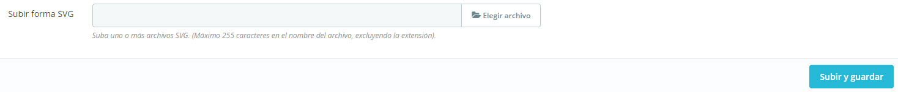

### ¿Cómo cambio el orden de las formas en el diseñador?

Arrastre las filas de la tabla hacia arriba o hacia abajo (arrastrar y soltar): el orden determina cómo aparecen las formas en el panel de formas del diseñador del cliente. La posición se guarda automáticamente.

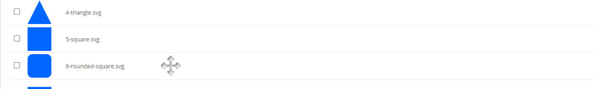

### ¿Cómo activo o desactivo una forma?

Haga clic en la marca verde / la X roja para ocultar temporalmente una forma sin eliminarla. También puede seleccionar varias formas con las casillas de verificación y usar las **Operaciones masivas** para activarlas o desactivarlas a la vez.

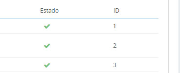

### ¿Puedo eliminar las formas del sistema?

Las formas que haya subido se pueden eliminar permanentemente. Las **formas del sistema** (por ejemplo, círculos o cuadrados simples) **no se pueden eliminar, solo desactivar**, para garantizar el funcionamiento básico del módulo; si intenta eliminarlas, aparece un mensaje de error.

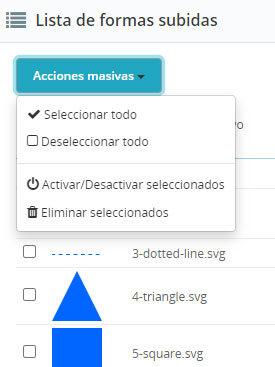

---

## Pestaña Gestión de fuentes

Aquí descarga, activa y elimina las **fuentes** puestas a disposición de los clientes en el diseñador.

Para garantizar el máximo rendimiento en el frontend y cumplir con las normativas de privacidad (**RGPD**), el módulo **no carga las fuentes desde servicios externos en tiempo real**: descarga los archivos de fuentes (`.ttf`) directamente en su servidor de hosting y los sirve localmente.

La pantalla se divide en dos áreas: **Fuentes no descargadas** y **Fuentes descargadas (instaladas)**.

### Multitienda y fuentes

- Las fuentes descargadas y sus estados de activación están **aislados por tienda**.
- Con Multitienda activo, los archivos de fuentes se organizan en subcarpetas dedicadas (por ejemplo, `/fontfiles/1/`, `/fontfiles/2/`), de modo que puede definir un catálogo de fuentes propio para cada tienda.

### Fuentes no descargadas (catálogo disponible)

Muestra las fuentes del catálogo del módulo que aún no están en su servidor.

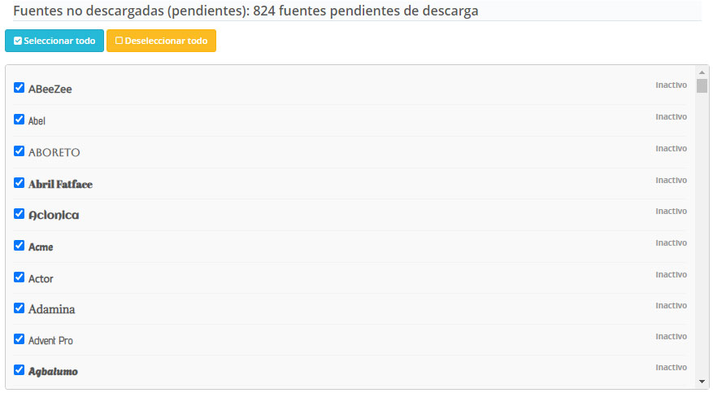

- **Vista previa dinámica y carga diferida:** la vista previa del nombre de la fuente solo se muestra cuando aparece en pantalla, para no ralentizar la página.
- **Descarga selectiva:** marque las fuentes deseadas y haga clic en **Descargar seleccionadas**.
- **Descarga masiva:** haga clic en **Iniciar descarga (Reiniciar todo)** para descargar todo el catálogo; el sistema selecciona automáticamente todas las fuentes pendientes.
- **Interrupciones y errores del servidor:** durante la descarga, una barra de progreso muestra la fuente en proceso. Puede hacer clic en **Cancelar** en cualquier momento (el proceso se detiene al terminar la fuente actual). En caso de sobrecarga temporal del servidor (por ejemplo, error HTTP 500), el trabajo ya realizado no se pierde y el módulo intenta reanudar la descarga desde el punto de interrupción.

### Fuentes descargadas (instaladas)

Tras la descarga, las fuentes pasan a la lista de fuentes instaladas.

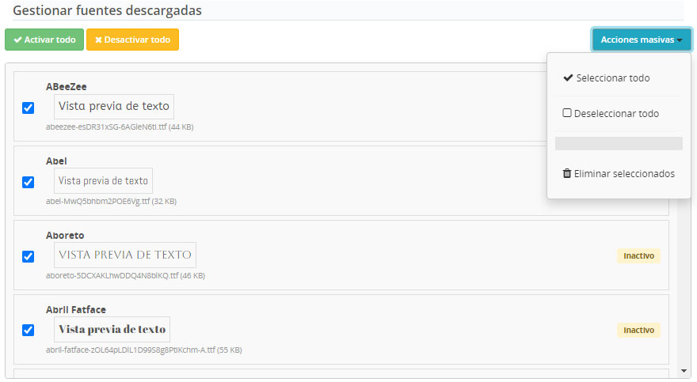

- **Vista previa local real:** se genera a partir del archivo `.ttf` guardado en su servidor, con el nombre del archivo y su tamaño en KB.
- **Activación individual:** para que una fuente esté disponible para los clientes, haga clic en su botón de estado (**Inactiva** / **Activar**). Las fuentes recién descargadas están **desactivadas por defecto**.
- **Activación/desactivación masiva:** botones **Activar todas** / **Desactivar todas**.
- **Eliminación:** seleccione las fuentes y haga clic en **Eliminar selección**; se eliminan tanto el registro de la base de datos como el archivo del servidor, y la fuente vuelve a «Fuentes no descargadas».
- **Fuentes del sistema protegidas:** las fuentes básicas integradas en el módulo (ID 1, 2, 3, 4 o marcadas como locales) no tienen casilla de selección y no se pueden eliminar.

> **Rendimiento:** activar muchas fuentes a la vez puede ralentizar la carga del diseñador en el frontend. Active únicamente las fuentes estrictamente necesarias.

---

## Pestaña Configuración de herramientas

Controla la interfaz del diseñador que ven sus clientes, las reglas para añadir al carrito y el mantenimiento de la base de datos (limpieza de archivos temporales). Se divide en cuatro áreas, más un panel de limpieza manual.

### 1. Ajustes de paneles

Active o desactive pestañas enteras del diseñador del cliente. Un panel desactivado desaparece por completo de la interfaz.

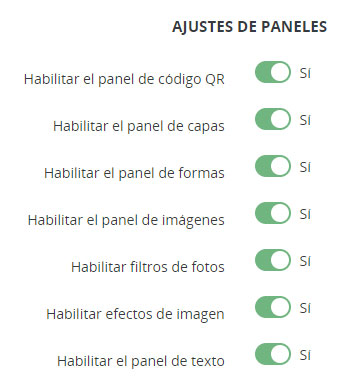

| Opción | Función |
|---|---|
| Activar el panel de código QR | Permite generar y colocar un código QR personalizado en el producto |
| Activar el panel de capas | Gestión de capas (traer al frente, enviar atrás, etc.) para superposiciones complejas |
| Activar el panel de formas | Inserción de formas predefinidas (gestionadas en «Gestión de formas») |
| Activar el panel de imágenes | Los clientes suben sus propias fotos o logotipos desde su dispositivo |
| Activar filtros de fotos | Herramientas para ajustar color y brillo y aplicar filtros a las imágenes subidas |
| Activar efectos de imagen | Efectos gráficos avanzados para las imágenes subidas |
| Activar el panel de texto | Inserción de campos de texto personalizados en el producto |

### 2. Ajustes de botones

Active o desactive herramientas de transformación específicas aplicables a textos o imágenes del área de trabajo.

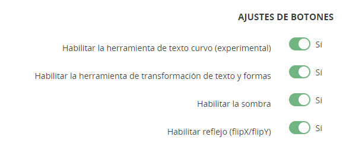

| Opción | Función |
|---|---|
| Activar la herramienta de texto curvo (experimental) | Dispone el texto a lo largo de una línea curva (por ejemplo, logotipos redondos o parches). Función experimental: pruébela antes de activarla |
| Activar la herramienta de transformación (Warp) | Deforma libremente texto y formas (perspectiva, distorsión) con docenas de transformaciones |
| Activar sombra | Añade y personaliza sombras detrás de los elementos |
| Activar reflejo | Botones para voltear los elementos horizontalmente (Flip X) o verticalmente (Flip Y) |

### 3. Ajustes de diseño y carrito

Reglas de comportamiento cuando un cliente guarda un proyecto o lo añade al carrito.

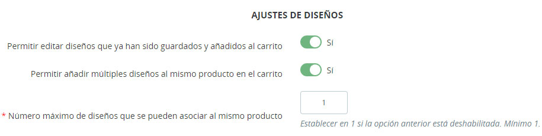

- **Permitir la edición de diseños ya guardados y añadidos al carrito** – si **Sí**, el cliente puede hacer clic en su producto en el carrito y volver al diseñador para corregir un error antes de finalizar la compra.
- **Permitir añadir varios diseños al mismo producto en el carrito** – si **Sí**, el cliente puede personalizar el mismo producto varias veces con diseños diferentes y añadirlos al carrito como líneas independientes.
- **Número máximo de diseños que se pueden asociar al mismo producto** – límite máximo de personalizaciones diferentes para el mismo artículo (por ejemplo, 5). Valor mínimo: 1.

> Si desactiva la opción anterior (**No**), este campo desaparece y el sistema impone el límite **1**, para evitar duplicados no deseados.

### 4. Limpieza de diseños de carritos abandonados

Muchos clientes empiezan a personalizar un producto y abandonan el sitio sin finalizar el pedido. Estos diseños (sin ID de pedido) ocupan espacio en el servidor: esta sección automatiza su eliminación.

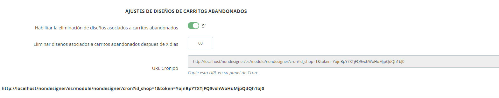

- **Activar la eliminación de diseños de carritos abandonados** – si **Sí**, desbloquea los ajustes de limpieza y muestra el panel de limpieza manual.
- **Eliminar diseños después de X días** – cuánto tiempo se conservan los proyectos no comprados (por defecto **30 días**). Cualquier valor inferior a 1 se fuerza a 30.
- **URL de tarea Cron (automatización)** – el sistema genera una dirección única y segura con un token secreto de 32 caracteres. Cópiela en el gestor de tareas Cron de su servidor (cPanel/Plesk) para eliminar automáticamente los archivos antiguos cada noche o cada semana. El servidor debe realizar una llamada HTTP GET (por ejemplo, con `wget` o `curl`).

### 5. Limpieza manual

Si no desea configurar una tarea Cron, puede limpiar manualmente.

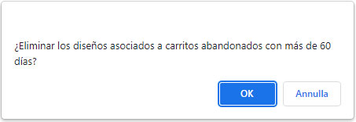

> El campo solo es visible si ha activado la eliminación de diseños de carritos abandonados, y solo funciona dentro de una tienda específica (no en la vista «Todas las tiendas» con Multitienda).

1. Haga clic en el botón amarillo **Eliminar ahora**.
2. Confirme: «¿Desea eliminar los diseños de carritos abandonados con más de [X] días de antigüedad?».
3. Aparece una barra de progreso.
4. La eliminación se realiza en segundo plano en **lotes de 20 diseños**: el servidor no se bloquea (tiempo de espera agotado) ni siquiera con miles de archivos.
5. Espere al 100 %: recibirá un mensaje de éxito en verde («¡Limpieza completada!») o, si no hay nada que limpiar, un aviso en azul («No hay diseños que eliminar»).

---

Página siguiente: [Cómo configurar el diseñador en un producto →](configuracion-producto.md)
