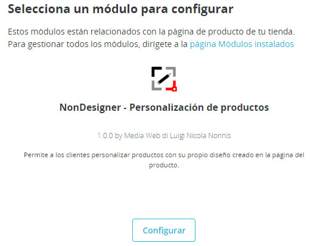
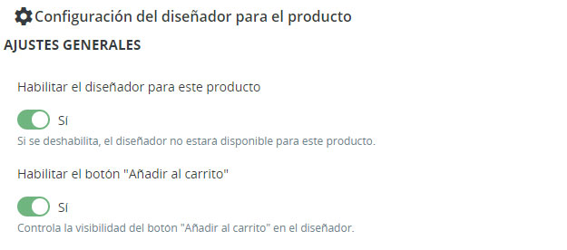
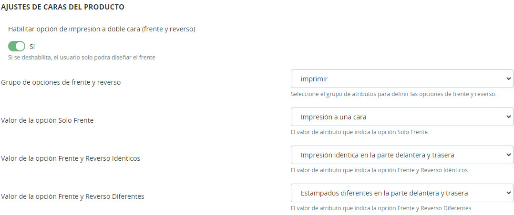
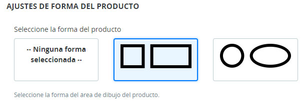
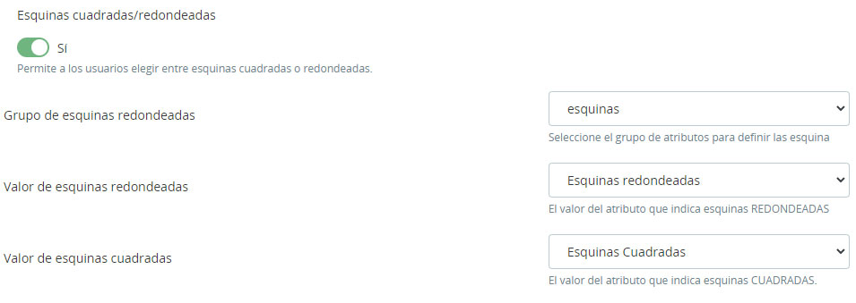
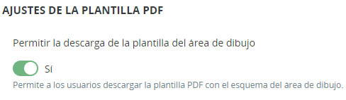
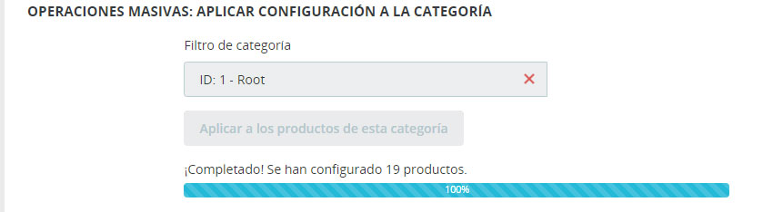

[← Índice](README.md) · [← Configuración del módulo](configuracion-modulo.md) · Página siguiente: [Dimensiones de impresión →](dimensiones-producto.md)

# Cómo configurar el diseñador NonDesigner en un producto de PrestaShop

Después de configurar el [módulo a nivel global](configuracion-modulo.md), el diseñador **NonDesigner** se configura producto por producto. Esta página describe la activación, la impresión frontal/trasera, la forma del producto, la plantilla PDF y la aplicación masiva de la configuración a toda una categoría.

**Ruta:** Panel de Control → Catálogo → Productos → Editar/añadir producto → Módulos → NonDesigner → Configurar

## Ajustes generales

### ¿Cómo activo el diseñador para un producto?

Active **Activar el diseñador para este producto**. Si está desactivado, el producto se comporta como un artículo normal del catálogo.

> Es útil dejarlo **desactivado** mientras prepara una configuración que luego [copiará de forma masiva a otros productos](#cómo-aplico-la-configuración-a-todos-los-productos-de-una-categoría): así puede comprobar la corrección de la configuración de cada producto antes de activar el diseñador.

### ¿Qué hace la opción Activar el botón Añadir al carrito?

Controla la visibilidad del botón «Añadir al carrito» **dentro de la interfaz del diseñador**. Cuando el usuario guarda un diseño, el producto correspondiente se **añade automáticamente al carrito**.

- **Oculte** el botón si desea **obligar** al cliente a asociar un diseño al producto.
- **Déjelo visible** si desea permitir la compra del producto también **sin** un diseño asociado (consulte [producto neutro «Sin impresión»](precios-y-variantes.md#a-cómo-vendo-también-el-producto-neutro-sin-impresión)).

## ¿Cómo configuro la impresión frontal/trasera?

- **Activar la opción de impresión frontal/trasera:** si está desactivada, el cliente solo puede personalizar **la parte frontal**.
- Si activa frente/reverso, aparecen nuevos campos de asignación:
  - **Grupo de opciones de frente/reverso:** el grupo de atributos que define las variantes de impresión.
  - **Asignación de valores:** tras seleccionar el grupo, indique qué valor corresponde a **Solo frente**, cuál a **Frente/reverso idéntico** y cuál a **Frente/reverso diferente**.

Los campos de asignación de valores se rellenan automáticamente según el grupo elegido. Para gestionar los recargos de estas variantes, consulte [Precios y variantes](precios-y-variantes.md).

## Dimensiones del producto

El ancho y el alto del área de impresión se establecen con tres métodos (dimensiones fijas, atributos separados, valores combinados An x Al) más el margen de sangrado. Es el ajuste más delicado y tiene su propia página → [Cómo establecer las dimensiones de impresión](dimensiones-producto.md).

## Forma del producto

Define la máscara visual del producto, es decir, el área editable.

### ¿Cómo elijo la forma del producto?

En **Seleccionar la forma del producto** elija la forma base: **cuadrada/rectangular** o **redonda/ovalada**.

### ¿Cómo configuro las esquinas redondeadas?

El interruptor **Esquinas cuadradas/redondeadas** solo es visible **con la forma cuadrada/rectangular**; con la forma redonda/ovalada, la opción se fuerza y se oculta como «No».

Si la activa (**Sí**), debe asignar el **Grupo de esquinas redondeadas** e indicar qué valores de atributo corresponden a **Esquinas redondeadas** y cuáles a **Esquinas cuadradas**.

## Plantilla PDF del área de dibujo

**Permitir la descarga de la plantilla del área de dibujo:** si la opción está activada, los usuarios pueden descargar el diseño **PDF** del área de trabajo a **escala 1:1 y 300 ppp**, en las dimensiones seleccionadas en la pestaña del producto.

> La opción solo se muestra si previamente se ha seleccionado una **Forma del producto** válida.

## ¿Cómo aplico la configuración a todos los productos de una categoría?

La función **Operaciones masivas** permite seleccionar una categoría (introduciendo su nombre o ID en el campo de búsqueda) y aplicar **de forma recursiva** la configuración del producto actual a los productos de la categoría y de sus subcategorías.

> Disponible solo si el producto actual dispone de una **configuración de diseñador válida y ya guardada**.

---

Página siguiente: [Cómo establecer las dimensiones de impresión →](dimensiones-producto.md)
