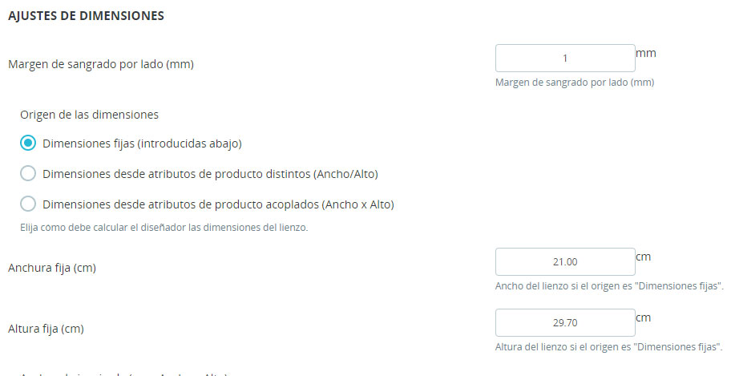
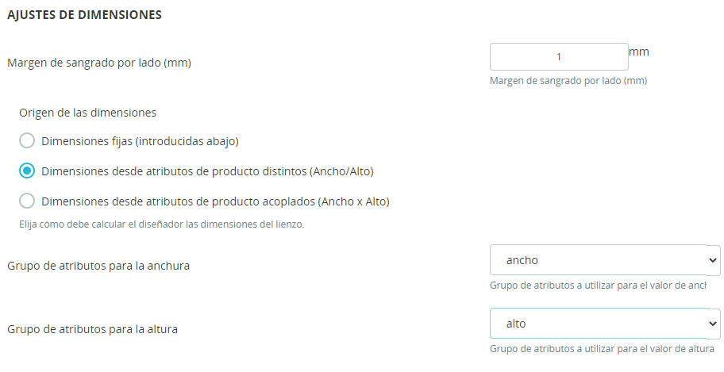
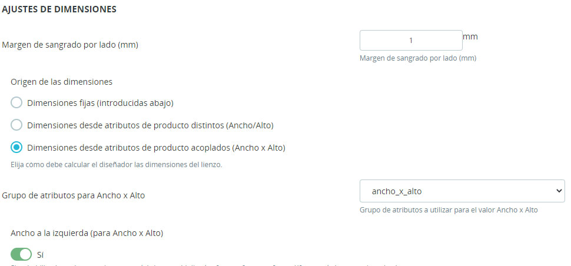

[← Índice](README.md) · [← Configuración del producto](configuracion-producto.md) · Página siguiente: [Pedidos y exportación SVG →](pedidos-y-exportacion-svg.md)

# Cómo establecer las dimensiones de impresión de un producto en NonDesigner

Las dimensiones del área de impresión del producto se expresan mediante **ancho** y **alto**, en **centímetros**. En **NonDesigner** (módulo de PrestaShop) puede obtenerlas de tres formas, más un margen de sangrado.

**Ruta:** Catálogo → Productos → Editar producto → Módulos → NonDesigner → Configurar → *Ajustes de tamaño*

**En esta página**

- [Qué significan atributo y combinación](#qué-significan-atributo-y-combinación)
- [Qué método elegir](#qué-método-de-cálculo-del-tamaño-elegir)
- [Margen de sangrado](#1-margen-de-sangrado-por-lado-mm)
- [Método 2: dimensiones fijas](#2-dimensiones-fijas)
- [Método 3: atributos separados](#3-dimensiones-derivadas-de-atributos-de-producto-distintos-anchoalto)
- [Método 4: valores combinados An x Al](#4-dimensiones-derivadas-de-valores-combinados-an-x-al-en-un-único-atributo)

## Qué significan atributo y combinación

Un **atributo** es una característica que genera variantes de producto (por ejemplo, el grupo de atributos «Tamaño» con los valores «50x70 cm», «70x100 cm»…). Una **combinación** es el emparejamiento de atributos que el cliente elige antes de comprar (por ejemplo, Tamaño: 50x70 cm + Color: Rojo).

Si su producto **no tiene variantes/atributos** configurados, no podrá utilizar los métodos 3 y 4: seleccione **Dimensiones fijas** (método 2).

## Qué método de cálculo del tamaño elegir

| Situación | Método |
|---|---|
| El producto tiene siempre la misma dimensión en todas las variantes (por ejemplo, siempre 50x70 cm) | **Dimensiones fijas** |
| El ancho y el alto son dos atributos separados (dos menús desplegables) | **Atributos separados** |
| El ancho y el alto están escritos juntos en un único atributo (por ejemplo, la variante «50x70») | **Valores combinados (An x Al)** |

A excepción de «Dimensiones fijas», la **selección del grupo de atributos es obligatoria**: si se deja vacía, no será posible guardar y aparecerá una advertencia en pantalla.

---

## 1. Margen de sangrado por lado (mm)

> **En resumen:** si no está seguro de qué elegir, pregunte a su proveedor de impresión el valor recomendado (normalmente 2-3 mm) e introdúzcalo aquí. Sirve únicamente para evitar márgenes blancos no deseados tras el corte.

Es un único campo de texto, **siempre visible** independientemente del método elegido, que representa el margen de sangrado añadido a **cada lado** del área de impresión, en **milímetros**.

### Para qué sirve el margen de sangrado

Cuando un diseño se imprime en una hoja más grande y luego se corta al tamaño final (tarjetas de visita, pegatinas, pósteres, paneles, etc.), el corte nunca es milimétricamente exacto. Si el fondo o una imagen llega exactamente hasta el borde del área útil y el corte se desplaza aunque sea ligeramente, aparece una fina **franja de papel blanco sin imprimir** en el borde: un defecto visualmente evidente, considerado un error de impresión.

El margen de sangrado extiende el fondo y las imágenes unos milímetros por lado más allá del borde real del producto. El archivo de impresión es más grande que el formato final: incluso con un ligero desplazamiento, el corte siempre queda dentro del área sobresaliente que sigue impresa.

Un valor típico oscila entre **1 y 5 mm por lado**, según el tipo de producto, el material y las tolerancias de la máquina de corte de la imprenta. El diseñador extiende **automáticamente** el fondo más allá de las dimensiones nominales, sin que el usuario final tenga que preocuparse.

### ¿Qué formato acepta el campo?

La validación es estricta y **bloquea el guardado** si el formato no es correcto:

- Solo **números enteros positivos** (dígitos 0-9): `0`, `5`, `12`, `100`.
- **Sin decimales**: ni punto ni coma.
- **Sin signo**: no se admiten valores negativos.
- El campo puede dejarse **vacío**: se guarda como `0` (sin margen de sangrado).

> **Error bloqueante:** valores como `5.5`, `5,5`, `-5`, `5mm`, `abc` impiden guardar toda la ficha del producto y muestran un mensaje de error explícito.

---

## 2. Dimensiones fijas

> **En resumen:** elija este método si el producto tiene siempre la misma dimensión en todas las variantes: introduzca los dos números una sola vez, sin vincular atributos.

Se muestran dos campos de entrada (ancho y alto) en los que solo se pueden introducir números.

### ¿Qué formato aceptan las dimensiones fijas?

El valor **no se interpreta ni se limpia**: se convierte directamente en número decimal tal como se introdujo.

- Separador decimal: **punto** (`.`) o **coma** (`,`). Ejemplos válidos: `50`, `50.5`, `120.75`, `50,5`, `120,75`.
- La coma se **convierte automáticamente en punto** al guardar (`50,5` → `50.5`).
- Sin unidades de medida, espacios ni símbolos: `50 cm` se guardaría como `50`, pero no se recomienda.
- El ancho y el alto son **obligatorios** y deben ser **mayores que cero** (> 0,01 cm); de lo contrario, el guardado se bloquea.

> Al ser el método más estricto (sin extracción automática desde texto o símbolos), introduzca **únicamente números con un punto decimal opcional** (por ejemplo, `45`, `45.5`).

---

## 3. Dimensiones derivadas de atributos de producto distintos (ancho/alto)

> **En resumen:** elija este método si el ancho y el alto son dos atributos separados (por ejemplo, un menú desplegable para el ancho y otro para el alto): el sistema lee automáticamente el número de cada uno.

Se muestran dos campos de selección (ancho y alto), cada uno con la lista de grupos de atributos que forman parte de las combinaciones del producto.

### ¿Cómo se leen los valores?

Una vez seleccionados los grupos de atributos de ancho y alto, el sistema lee el valor/nombre de cada atributo de la combinación elegida por el cliente y **extrae automáticamente el número**, eliminando texto, unidades y símbolos, **siempre que el valor contenga un único número**.

| Valor del atributo (ejemplo) | Valor leído |
|---|---|
| `50` | 50 |
| `50 cm` | 50 |
| `50cm` | 50 |
| `H: 50 cm` | 50 |
| `Altura 50 cm` | 50 |
| `50.5` / `50.5 cm` | 50.5 |
| `50,5` / `50,5 cm` | 50.5 |

Tanto el punto como la coma se aceptan como separador decimal.

### ¿Qué valores de atributo hay que evitar?

> **Regla fundamental:** cada valor de atributo debe contener **un único número**. Si contiene más de uno (un código, una talla numérica, dos medidas), el resultado es impredecible y con gran probabilidad incorrecto, **sin que se muestre ningún error**.

| Valor del atributo (incorrecto) | Valor leído | Problema |
|---|---|---|
| `50x70` | 5070 | los dos números se fusionan en uno |
| `Modelo X200, 50 cm` | 200.50 | los dos números se fusionan, generando decimales incorrectos |
| `1.234 cm` (miles) | 1.234 | interpretado como «1 coma 234» en lugar de «1234» |
| `-50 cm` | 50 | el signo negativo se ignora |

**Recomendación:** el nombre de cada atributo del grupo elegido (para ancho y alto) debe contener **únicamente el número de la medida**, opcionalmente acompañado de texto o una unidad de medida, **nunca de otros números**.

---

## 4. Dimensiones derivadas de valores combinados (An x Al) en un único atributo

> **En resumen:** elija este método si el ancho y el alto están escritos juntos en un único atributo (por ejemplo, la variante se llama `50x70`): el sistema separa los dos números de forma autónoma, siempre que estén en el formato correcto.

Se muestra un solo campo de selección, del que se leen tanto el ancho como el alto.

### ¿Cómo funciona?

El sistema busca en el valor del atributo **dos números separados por una «x»** (o un símbolo equivalente) y los asigna a ancho y alto según el orden establecido en la opción **Posición del ancho**.

### ¿Qué separadores son válidos?

El separador entre los dos números debe ser uno de los siguientes:

- `x` (minúscula)
- `X` (mayúscula)
- `*` (asterisco)

| Valor del atributo (ejemplo) | 1.º valor | 2.º valor |
|---|---|---|
| `50x70` | 50 | 70 |
| `50X70` | 50 | 70 |
| `50*70` | 50 | 70 |
| `50 x 70` | 50 | 70 |
| `50 x 70 cm` | 50 | 70 |
| `50cm x 70cm` | 50 | 70 |
| `An: 50 x Al: 70 cm` | 50 | 70 |
| `50,5 x 70,2` | 50.5 | 70.2 |
| `50.5x70.2` | 50.5 | 70.2 |

El punto y la coma se aceptan como separador decimal para cada uno de los dos números.

### ¿Qué formatos NO se reconocen?

> Estos formatos dan como resultado ancho y alto iguales a **0 / 0**, **sin ningún mensaje de error** visible para el usuario.

| Valor del atributo (incorrecto) | Resultado | Problema |
|---|---|---|
| `50-70` | 0 / 0 | el guion no es un separador válido |
| `50 / 70` | 0 / 0 | la barra no es un separador válido |
| `50×70` (símbolo ×) | 0 / 0 | debe usarse la letra x, no el símbolo × |
| `50 por 70` | 0 / 0 | debe usarse la letra x, no la palabra «por» |
| `Talla única` | 0 / 0 | no hay ningún número presente |
| `70 cm` (un único valor) | 0 / 0 | falta el segundo número y/o el separador |

### ¿Qué ocurre con más de dos medidas?

Con tres o más números (por ejemplo, `50x70x30` para incluir una profundidad), **solo se leen las dos primeras medidas** (50 y 70); el tercer valor se ignora.

**Recomendación:** cada atributo del grupo elegido debe contener **exactamente dos números**, separados únicamente por `x`, `X` o `*` (por ejemplo, `50x70 cm`, `50,5 X 70,2`), evitando guiones, barras, el símbolo × o descripciones textuales del separador.

---

Si las dimensiones aparecen como 0 / 0 en el frontend, consulte las [FAQ](faq.md#las-dimensiones-del-producto-se-leen-como-0--0-en-el-frontend-cómo-lo-resuelvo).

Página siguiente: [Pedidos y exportación SVG →](pedidos-y-exportacion-svg.md)
