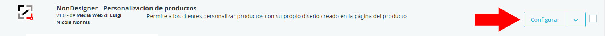

[← Índice](README.md) · Página siguiente: [Configuración del módulo →](configuracion-modulo.md)

# Cómo instalar el módulo NonDesigner en PrestaShop

**NonDesigner** es un módulo de PrestaShop que permite a los clientes personalizar productos en línea mediante un diseñador gráfico 2D integrado en el frontend de la tienda y que genera, para cada pedido, archivos SVG vectoriales y PNG 1:1 listos para imprimir. Esta página describe los requisitos del sistema, la compatibilidad con las versiones de PrestaShop y el procedimiento de instalación.

## ¿Con qué versiones de PrestaShop y PHP es compatible NonDesigner?

- **Versiones de PrestaShop compatibles:** v1.7.6.1 a v8.x y v9.x
- **Versiones de PHP compatibles:** de PHP 7.2 a PHP 8.5
- **Extensiones PHP necesarias:** GD Library, cURL, Zip, SimpleXML
- **Directivas de servidor recomendadas:** `upload_max_filesize` ≥ 10M y `post_max_size` ≥ 10M

> Las directivas `upload_max_filesize` y `post_max_size` limitan, en última instancia, el tamaño de las imágenes que los clientes pueden subir en el diseñador. Consulte [Tamaño máximo de imagen de usuario](configuracion-modulo.md#2-tamaño-máximo-de-imagen-de-usuario-mb).

## Cómo instalar NonDesigner paso a paso

1. Inicie sesión en el Back Office de PrestaShop.
2. Vaya a **Panel de Control → Gestor de Módulos → Gestor de Módulos**.
3. Haga clic en el botón **Subir un módulo** en la parte superior derecha.
4. Arrastre y suelte, o seleccione, el archivo `.zip` del módulo NonDesigner descargado desde PrestaShop Addons.
5. Espere a que finalice la instalación y haga clic en **Configurar**.

## ¿NonDesigner requiere activar una licencia?

No. El módulo **no requiere ninguna activación de licencia**: una vez instalado y configurado, está inmediatamente operativo.

## ¿Dónde están los ajustes del módulo tras la instalación?

**Panel de Control → Gestor de Módulos → NonDesigner → Configurar**

Todos los ajustes del módulo son compatibles con la función nativa **Multitienda** de PrestaShop: puede establecer reglas diferentes (por ejemplo, días de limpieza o paneles activos) para cada tienda o grupo de tiendas seleccionando la tienda desde el selector de la parte superior derecha. Si no establece un valor para una tienda, el sistema utiliza automáticamente el valor global heredado.

## ¿Qué debo hacer antes de instalar?

Realice una **copia de seguridad de los archivos de su servidor y de su base de datos** antes de instalar el módulo y, si es posible, instálelo primero en un **servidor de pruebas** para realizar sus propias pruebas. La instalación se realiza bajo su responsabilidad: no se asume ninguna responsabilidad por posibles efectos adversos durante la instalación.

## Siguientes pasos

1. [Configurar los ajustes globales del módulo](configuracion-modulo.md)
2. [Configurar el diseñador en un producto](configuracion-producto.md)
3. Si surge algún problema, consulte las [FAQ](faq.md)
