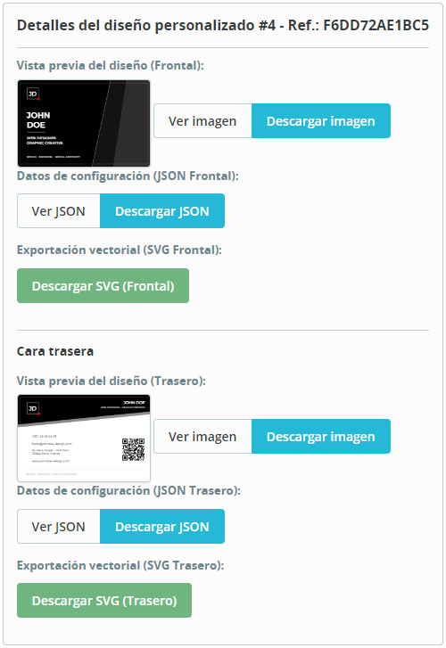

[← Índice](README.md) · [← Dimensiones de impresión](dimensiones-producto.md) · Página siguiente: [Precios y variantes →](precios-y-variantes.md)

# Cómo gestionar los pedidos y descargar archivos SVG listos para imprimir con NonDesigner

Para cada pedido con productos personalizados, **NonDesigner** genera los archivos de impresión (**SVG vectorial** y **PNG a escala 1:1**) y los pone a disposición directamente en la página de detalles del pedido del back office de PrestaShop.

**Ruta:** Panel de Control → Pedidos → Detalles del pedido

La gestión de los productos personalizados está integrada en la página de detalles del pedido.

## ¿Cómo veo el diseño del cliente en el back office?

- El módulo carga los detalles de personalización de forma **asíncrona** en la tabla de productos del pedido, sustituyendo un marcador de posición temporal. Mientras se cargan los datos, verá un mensaje de carga.
- Si los archivos de imagen o los datos de configuración **no están disponibles en el servidor**, se muestra una advertencia de texto en **rojo**.

> **Correos de confirmación del pedido:** los archivos gráficos generados por el módulo **no se muestran directamente** en los correos electrónicos de confirmación del pedido. El resumen del correo incluye un texto informativo que indica la presencia de un diseño personalizado, consultable en el historial de pedidos de la cuenta del cliente.

## ¿Qué información muestra el detalle de la personalización?

- Cada diseño muestra su **identificador** único y, si existe, el **nombre de referencia** asignado a la configuración.
- Para productos con impresión múltiple o **frente/reverso**, la interfaz muestra un área para el **Frente** y otra separada para el **Reverso**.
- **Vista previa gráfica:** haga clic en **Ver imagen**. Puede guardarla en alta resolución con el botón azul **Descargar imagen**.
- **Datos técnicos (JSON):** el módulo guarda los parámetros exactos de la personalización en un archivo **JSON**. Puede abrirlo en una nueva ventana del navegador (formateado y legible) o descargarlo.

## ¿Cómo exporto el archivo SVG vectorial para imprimir?

1. En los detalles del pedido, localice el lado (Frente o Reverso) que desea exportar.
2. Haga clic en el botón verde **Descargar SVG**. Al pasar el ratón sobre el botón, puede consultar las **medidas exactas de impresión en centímetros**.
3. Al hacer clic, la interfaz desactiva temporalmente los controles y muestra un indicador de espera junto con una notificación en pantalla.
4. El archivo `.svg` se calcula dinámicamente a partir de los datos JSON guardados en el servidor y se **descarga automáticamente** al finalizar.

### ¿Con qué programa se abre el archivo SVG?

Se recomienda **Inkscape** (programa gratuito): permite también exportar el archivo a formatos compatibles con otros programas de diseño gráfico.

## Seguridad y gestión de errores en Multitienda

- En entornos **Multitienda**, un sistema de control verifica siempre que el diseño mostrado pertenezca a la **tienda actualmente activa**.
- Si se detecta un intento de exportar o visualizar un proyecto perteneciente a **otra tienda**, la operación se bloquea y se devuelve el aviso **«Acceso denegado»**.
- El administrador puede **eliminar permanentemente** los archivos de diseño y los datos de personalización asociados.
- Cualquier problema técnico al recuperar datos (falta de conexión de red, archivos ausentes) genera inmediatamente mensajes de error visibles en el back office.

---

Página siguiente: [Precios y variantes →](precios-y-variantes.md) · ¿Problemas? Consulte las [FAQ](faq.md).
