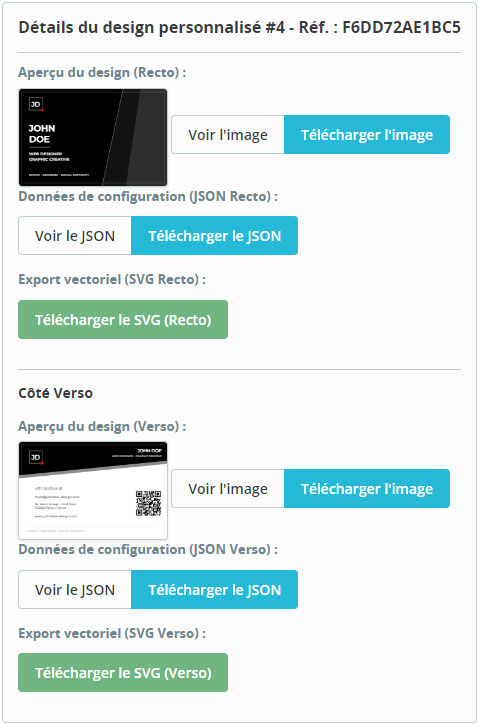

[← Sommaire](README.md) · [← Dimensions d'impression](dimensions-produit.md) · Page suivante : [Prix et déclinaisons →](prix-et-declinaisons.md)

# Comment gérer les commandes et télécharger les fichiers SVG prêts à imprimer avec NonDesigner

Pour chaque commande contenant des produits personnalisés, **NonDesigner** génère les fichiers d'impression (**SVG vectoriel** et **PNG à l'échelle 1:1**) et les met à disposition directement dans la page de détails de la commande du back office de PrestaShop.

**Chemin :** Panneau de contrôle → Commandes → Détails de la commande

La gestion des produits personnalisés est intégrée à la page de détails de la commande.

## Comment voir le design du client dans le back office ?

- Le module charge les détails de la personnalisation de façon **asynchrone** dans le tableau des produits de la commande, en remplaçant un espace réservé temporaire. Pendant le chargement, un message de chargement s'affiche.
- Si les fichiers image ou les données de configuration **ne sont pas disponibles sur le serveur**, un avertissement en texte **rouge** s'affiche.

> **E-mails de confirmation de commande :** les fichiers graphiques générés par le module **ne sont pas affichés directement** dans les e-mails de confirmation de commande. Le résumé de l'e-mail contient un texte informatif indiquant la présence d'un design personnalisé, consultable dans l'historique des commandes du compte client.

## Quelles informations affiche le détail de la personnalisation ?

- Chaque design affiche son **identifiant** unique et, le cas échéant, le **nom de référence** attribué à la configuration.
- Pour les produits avec impression multiple ou **recto/verso**, l'interface présente une zone pour le **Recto** et une zone distincte pour le **Verso**.
- **Aperçu graphique :** cliquez sur **Voir l'image**. Vous pouvez l'enregistrer en haute résolution avec le bouton bleu **Télécharger l'image**.
- **Données techniques (JSON) :** le module enregistre les paramètres exacts de la personnalisation dans un fichier **JSON**. Vous pouvez l'ouvrir dans une nouvelle fenêtre du navigateur (formaté et lisible) ou le télécharger.

## Comment exporter le fichier SVG vectoriel pour l'impression ?

1. Dans les détails de la commande, repérez le côté (Recto ou Verso) à exporter.
2. Cliquez sur le bouton vert **Télécharger le SVG**. En survolant le bouton, vous voyez les **mesures d'impression exactes en centimètres**.
3. Au clic, l'interface désactive temporairement les contrôles et affiche un indicateur d'attente avec une notification à l'écran.
4. Le fichier `.svg` est calculé dynamiquement à partir des données JSON enregistrées sur le serveur et **téléchargé automatiquement** à la fin de l'opération.

### Avec quel logiciel ouvrir le fichier SVG ?

**Inkscape** (logiciel gratuit) est recommandé : il permet aussi d'exporter le fichier dans des formats compatibles avec d'autres logiciels de graphisme.

## Sécurité et gestion des erreurs en Multiboutique

- Dans les environnements **Multiboutique**, un contrôle vérifie toujours que le design affiché appartient à la **boutique actuellement active**.
- Si une tentative d'exportation ou d'affichage d'un projet appartenant à **une autre boutique** est détectée, l'opération est bloquée et l'avertissement **« Accès refusé »** s'affiche.
- L'administrateur peut **supprimer définitivement** les fichiers de design et les données de personnalisation associées.
- Tout problème technique lors de la récupération des données (connexion réseau manquante, fichiers absents) génère immédiatement des messages d'erreur visibles dans le back office.

---

Page suivante : [Prix et déclinaisons →](prix-et-declinaisons.md) · Un problème ? Consultez la [FAQ](faq.md).
