[← Sommaire](README.md) · [← Installation](installation.md) · Page suivante : [Configuration du produit →](configuration-produit.md)

# Comment configurer le module NonDesigner : paramètres globaux (côté module)

Cette page décrit les paramètres globaux du module **NonDesigner** pour PrestaShop, répartis en quatre onglets : **Général**, **Gestion des formes**, **Gestion des polices** et **Configuration des outils**.

**Chemin :** Panneau de contrôle → Gestionnaire de Modules → NonDesigner → Configurer

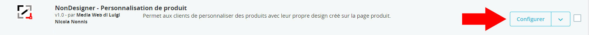

> **Multiboutique :** tous les paramètres prennent en charge le Multiboutique natif de PrestaShop. Vous pouvez définir des règles différentes pour chaque boutique ou groupe de boutiques en sélectionnant la boutique via le sélecteur en haut à droite. Si vous ne définissez pas de valeur pour une boutique, la valeur globale héritée est utilisée.

**Sur cette page**

- [Onglet Général](#onglet-général)
- [Onglet Gestion des formes](#onglet-gestion-des-formes)
- [Onglet Gestion des polices](#onglet-gestion-des-polices)
- [Onglet Configuration des outils](#onglet-configuration-des-outils)

---

## Onglet Général

L'onglet **Général** gère le diagnostic (journalisation), les restrictions sur les fichiers téléchargés par les clients et les autorisations de téléchargement des fichiers de projet dans le frontend.

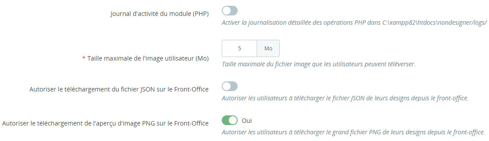

### 1. Journal d'activité du module

Commutateur Oui/Non qui active ou désactive la journalisation détaillée des opérations PHP effectuées par le module. Lorsqu'il est activé, les fichiers journaux sont enregistrés dans le dossier `/logs/` du répertoire racine (`_PS_ROOT_DIR_`) de votre site PrestaShop.

**Conseil :** laissez-le sur **Non** en fonctionnement normal pour ne pas surcharger le serveur. Activez-le uniquement en cas de problème, si votre développeur doit diagnostiquer des erreurs.

### 2. Taille maximale des images utilisateur (Mo)

Définit la taille maximale des fichiers image que les utilisateurs peuvent télécharger dans le designer.

- La valeur est exprimée en mégaoctets (Mo) et est obligatoire.
- Elle doit être un nombre positif supérieur à zéro (par exemple 2 ou 5) ; sinon le système affiche une erreur et empêche l'enregistrement.

> **Important :** la limite réelle dépend en définitive des restrictions de votre serveur d'hébergement (`upload_max_filesize` et `post_max_size` dans `php.ini`). Si vous définissez dans le module une valeur (par exemple 10 Mo) supérieure à la limite du serveur (par exemple 2 Mo), le serveur bloquera quand même les téléchargements supérieurs à 2 Mo. Saisissez une valeur égale ou inférieure à ce qu'autorise votre offre d'hébergement.

### 3. Autoriser le téléchargement du JSON dans le Frontend

Commutateur Oui/Non : s'il est activé, le client trouve dans le frontend un bouton pour télécharger le fichier **JSON** contenant les données brutes de la structure de son projet graphique.

### 4. Autoriser le téléchargement de l'aperçu PNG dans le Frontend

Commutateur Oui/Non : s'il est activé, le client peut télécharger une image **PNG à l'échelle 1:1** du design qu'il vient de créer. La qualité de cet aperçu **n'est pas adaptée à une impression professionnelle** : les fichiers d'impression se téléchargent depuis le back office (voir [Commandes et export SVG](commandes-et-export-svg.md)).

---

## Onglet Gestion des formes

Vous gérez ici les formes géométriques ou vectorielles que les utilisateurs peuvent insérer dans leurs projets. Les formes prennent en charge le Multiboutique : chaque boutique dispose de son propre dossier dédié.

### Comment télécharger de nouvelles formes dans NonDesigner ?

Cliquez sur le bouton de téléchargement. Le système n'accepte **que les fichiers `.svg`**. Pour des raisons de sécurité, le module **nettoie automatiquement** les fichiers SVG téléchargés, en supprimant les balises et attributs malveillants.

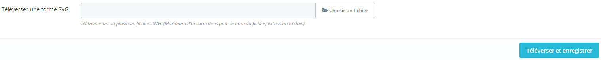

### Comment modifier l'ordre des formes dans le designer ?

Faites glisser les lignes du tableau vers le haut ou vers le bas (glisser-déposer) : l'ordre détermine l'apparition des formes dans le panneau des formes du designer du client. La position est enregistrée automatiquement.

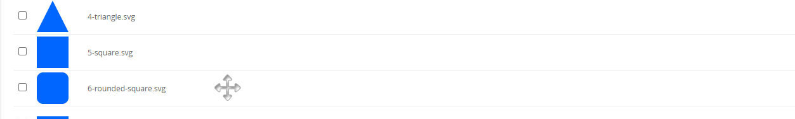

### Comment activer ou désactiver une forme ?

Cliquez sur la coche verte / le X rouge pour masquer temporairement une forme sans la supprimer. Vous pouvez aussi sélectionner plusieurs formes avec les cases à cocher et utiliser les **Opérations en masse** pour les activer ou les désactiver ensemble.

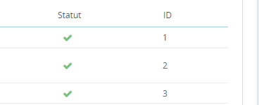

### Puis-je supprimer les formes système ?

Les formes que vous avez téléchargées peuvent être supprimées définitivement. Les **formes système** (par exemple cercles ou carrés simples) **ne peuvent pas être supprimées, seulement désactivées**, afin de garantir le fonctionnement de base du module ; si vous tentez de les supprimer, un message d'erreur s'affiche.

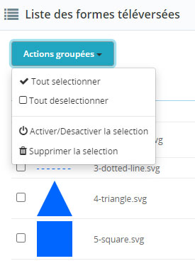

---

## Onglet Gestion des polices

Vous téléchargez, activez et supprimez ici les **polices** mises à la disposition des clients dans le designer.

Pour garantir des performances maximales dans le frontend et respecter la réglementation sur la protection des données (**RGPD**), le module **ne charge pas les polices depuis des services externes en temps réel** : il télécharge les fichiers de polices (`.ttf`) directement sur votre serveur d'hébergement et les sert localement.

L'écran est divisé en deux zones : **Polices non téléchargées** et **Polices téléchargées (installées)**.

### Multiboutique et polices

- Les polices téléchargées et leurs statuts d'activation sont **isolés par boutique**.
- Lorsque le Multiboutique est actif, les fichiers des polices sont organisés dans des sous-dossiers dédiés (par exemple `/fontfiles/1/`, `/fontfiles/2/`), ce qui permet de définir un catalogue de polices distinct pour chaque boutique.

### Polices non téléchargées (catalogue disponible)

Affiche les polices du catalogue du module pas encore présentes sur votre serveur.

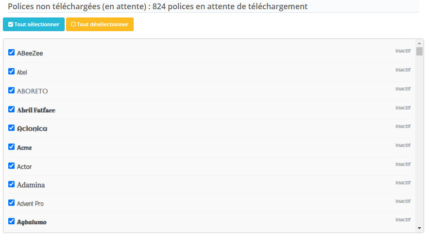

- **Aperçu dynamique et chargement différé :** l'aperçu du nom de la police n'est affiché que lorsqu'il apparaît à l'écran, afin de ne pas ralentir la page.
- **Téléchargement ciblé :** cochez les polices souhaitées et cliquez sur **Télécharger la sélection**.
- **Téléchargement en masse :** cliquez sur **Démarrer le téléchargement (Tout redémarrer)** pour télécharger tout le catalogue ; le système sélectionne automatiquement toutes les polices en attente.
- **Interruptions et erreurs serveur :** pendant le téléchargement, une barre de progression indique la police en cours. Vous pouvez cliquer sur **Annuler** à tout moment (l'opération s'arrête une fois la police en cours terminée). En cas de surcharge temporaire du serveur (par exemple erreur HTTP 500), le travail déjà effectué n'est pas perdu et le module tente de reprendre le téléchargement là où il s'est interrompu.

### Polices téléchargées (installées)

Après le téléchargement, les polices passent dans la liste des polices installées.

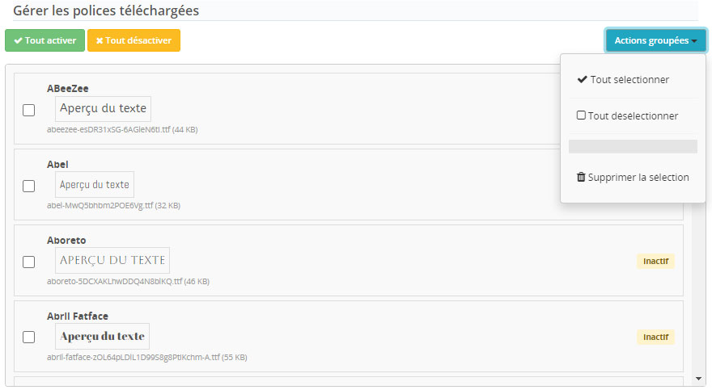

- **Véritable aperçu local :** généré à partir du fichier `.ttf` enregistré sur votre serveur, avec le nom du fichier et sa taille en Ko.
- **Activation individuelle :** pour rendre une police disponible aux clients, cliquez sur son bouton de statut (**Inactive** / **Activer**). Les polices nouvellement téléchargées sont **désactivées par défaut**.
- **Activation/désactivation en masse :** boutons **Tout activer** / **Tout désactiver**.
- **Suppression :** sélectionnez les polices et cliquez sur **Supprimer la sélection** ; l'enregistrement en base de données et le fichier du serveur sont supprimés, et la police retourne dans « Polices non téléchargées ».
- **Polices système protégées :** les polices de base intégrées au module (ID 1, 2, 3, 4 ou marquées comme locales) n'ont pas de case à cocher et ne peuvent pas être supprimées.

> **Performances :** activer un grand nombre de polices simultanément peut ralentir le chargement du designer dans le frontend. N'activez que les polices strictement nécessaires.

---

## Onglet Configuration des outils

Contrôle l'interface du designer vue par les clients, les règles d'ajout au panier et la maintenance de la base de données (nettoyage des fichiers temporaires). Il est divisé en quatre zones, plus un panneau de nettoyage manuel.

### 1. Paramètres des panneaux

Activez ou désactivez des onglets entiers du designer client. Un panneau désactivé disparaît entièrement de l'interface.

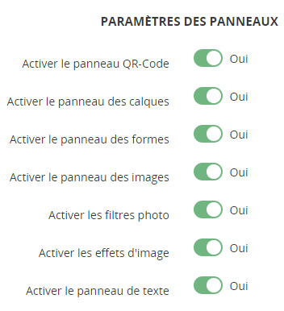

| Option | Fonction |
|---|---|
| Activer le panneau code QR | Permet de générer et placer un code QR personnalisé sur le produit |
| Activer le panneau des calques | Gestion des calques (premier plan, arrière-plan, etc.) pour les superpositions complexes |
| Activer le panneau des formes | Insertion de formes prédéfinies (gérées dans « Gestion des formes ») |
| Activer le panneau des images | Les clients téléchargent leurs photos ou logos depuis leur appareil |
| Activer les filtres photo | Outils pour ajuster couleur, luminosité et appliquer des filtres aux images téléchargées |
| Activer les effets d'image | Effets graphiques avancés applicables aux images téléchargées |
| Activer le panneau de texte | Insertion de champs de texte personnalisés sur le produit |

### 2. Paramètres des boutons

Activez ou désactivez des outils de transformation spécifiques applicables aux textes ou images de la zone de travail.

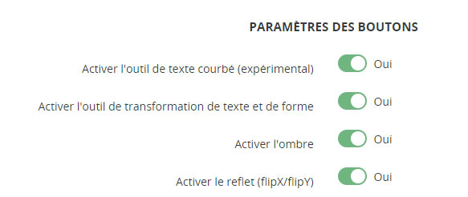

| Option | Fonction |
|---|---|
| Activer l'outil de texte courbé (expérimental) | Dispose le texte le long d'une ligne courbe (logos ronds, écussons). Fonction expérimentale : testez-la avant de l'activer |
| Activer l'outil de transformation (Warp) | Déforme librement textes et formes (perspective, distorsion) avec des dizaines de transformations |
| Activer l'ombre | Ajoute et personnalise des ombres derrière les éléments |
| Activer le miroir | Boutons pour retourner les éléments horizontalement (Flip X) ou verticalement (Flip Y) |

### 3. Paramètres de design et de panier

Règles de comportement lorsqu'un client enregistre un projet ou l'ajoute au panier.

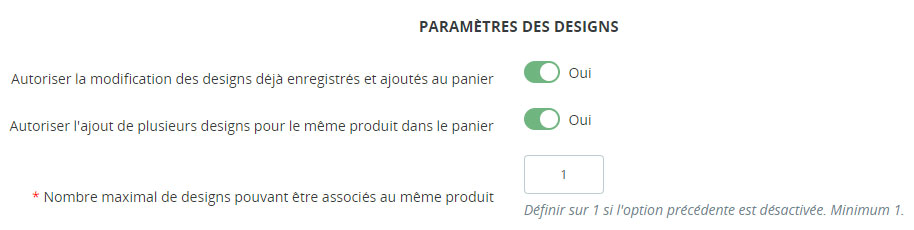

- **Autoriser la modification des designs déjà enregistrés et ajoutés au panier** – si **Oui**, le client peut cliquer sur son produit dans le panier et revenir dans le designer pour corriger une erreur avant l'achat.
- **Autoriser l'ajout de plusieurs designs pour le même produit dans le panier** – si **Oui**, le client peut personnaliser plusieurs fois le même produit avec des designs différents et les ajouter au panier comme des lignes distinctes.
- **Nombre maximal de designs pouvant être associés au même produit** – limite maximale de personnalisations différentes pour le même article (par exemple 5). Valeur minimale : 1.

> Si vous désactivez l'option précédente (**Non**), ce champ disparaît et le système impose la limite **1**, pour éviter les doublons indésirables.

### 4. Nettoyage des designs des paniers abandonnés

De nombreux clients commencent à personnaliser un produit puis quittent le site sans commander. Ces designs (sans identifiant de commande) occupent de l'espace sur le serveur : cette section automatise leur suppression.

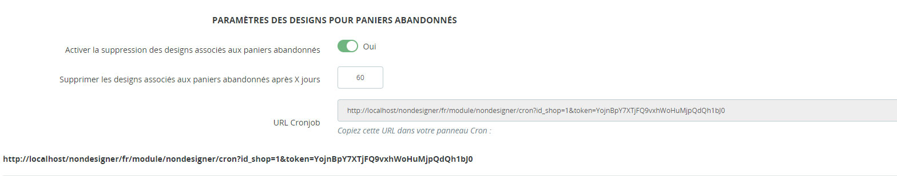

- **Activer la suppression des designs des paniers abandonnés** – si **Oui**, débloque les paramètres de nettoyage et affiche le panneau de nettoyage manuel.
- **Supprimer les designs après X jours** – durée de conservation des projets non achetés (par défaut **30 jours**). Toute valeur inférieure à 1 est forcée à 30.
- **URL de la tâche Cron (automatisation)** – le système génère une adresse unique et sécurisée avec un jeton secret de 32 caractères. Copiez-la dans le gestionnaire de tâches Cron de votre serveur (cPanel/Plesk) pour supprimer automatiquement les anciens fichiers chaque nuit ou chaque semaine. Le serveur doit effectuer un appel HTTP GET (par exemple avec `wget` ou `curl`).

### 5. Nettoyage manuel

Si vous ne souhaitez pas configurer de tâche Cron, vous pouvez nettoyer manuellement.

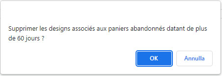

> Le champ n'est visible que si vous avez activé la suppression des designs des paniers abandonnés, et il ne fonctionne qu'au sein d'une boutique spécifique (pas dans la vue « Toutes les boutiques » en Multiboutique).

1. Cliquez sur le bouton jaune **Supprimer maintenant**.
2. Confirmez : « Voulez-vous supprimer les designs des paniers abandonnés datant de plus de [X] jours ? ».
3. Une barre de progression apparaît.
4. La suppression s'effectue en arrière-plan par **lots de 20 designs** : le serveur ne se bloque pas, même avec des milliers de fichiers.
5. Attendez 100 % : vous recevez un message de succès en vert (« Nettoyage terminé ! ») ou, s'il n'y a rien à nettoyer, un avis en bleu (« Aucun design à supprimer »).

---

Page suivante : [Comment configurer le designer sur un produit →](configuration-produit.md)
