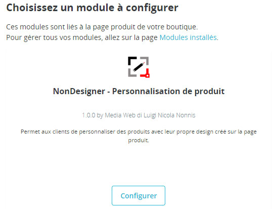
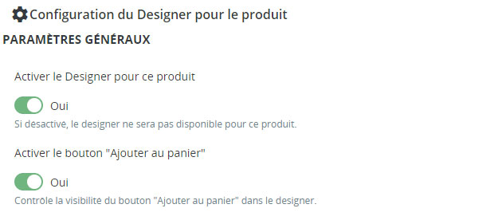
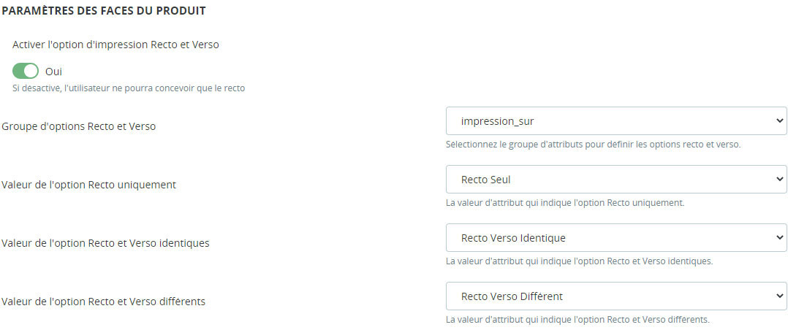
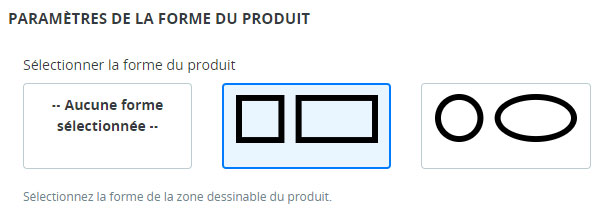
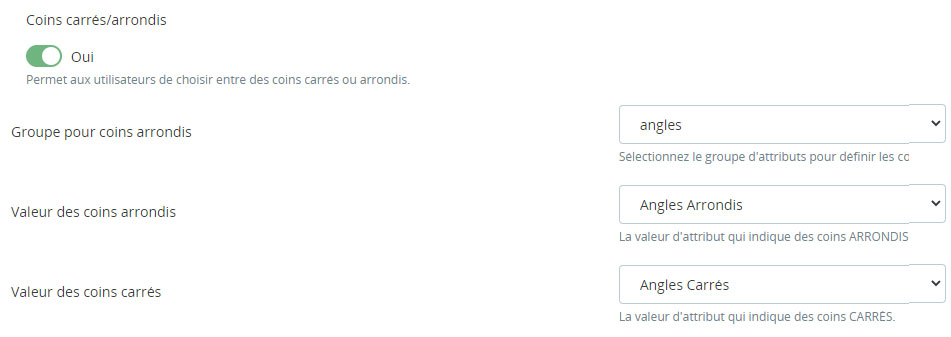
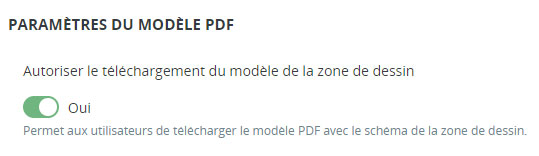
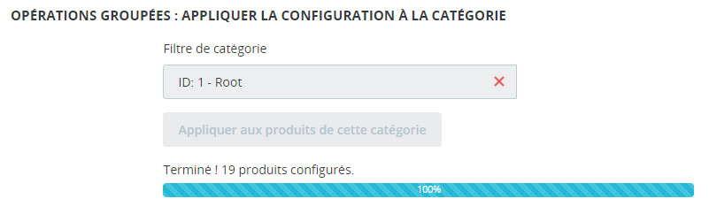

[← Sommaire](README.md) · [← Configuration du module](configuration-module.md) · Page suivante : [Dimensions d'impression →](dimensions-produit.md)

# Comment configurer le designer NonDesigner sur un produit PrestaShop

Après avoir configuré le [module au niveau global](configuration-module.md), le designer **NonDesigner** se configure produit par produit. Cette page décrit l'activation, l'impression recto/verso, la forme du produit, le modèle PDF et l'application en masse de la configuration à toute une catégorie.

**Chemin :** Panneau de contrôle → Catalogue → Produits → Modifier/ajouter un produit → Modules → NonDesigner → Configurer

## Paramètres généraux

### Comment activer le designer pour un produit ?

Activez **Activer le designer pour ce produit**. S'il est désactivé, le produit se comporte comme un article normal du catalogue.

> Il est utile de le laisser **désactivé** pendant que vous préparez une configuration que vous allez [copier en masse sur d'autres produits](#comment-appliquer-la-configuration-à-tous-les-produits-dune-catégorie-) : vous pouvez ainsi vérifier l'exactitude de la configuration de chaque produit avant d'activer le designer.

### À quoi sert l'option « Activer le bouton Ajouter au panier » ?

Elle contrôle la visibilité du bouton « Ajouter au panier » **dans l'interface du designer**. Lorsque l'utilisateur enregistre un design, le produit associé est **automatiquement ajouté au panier**.

- **Masquez** le bouton si vous voulez **obliger** le client à associer un design au produit.
- **Laissez-le visible** si vous voulez permettre l'achat du produit même **sans** design associé (voir [produit neutre « Sans impression »](prix-et-declinaisons.md#a-comment-vendre-aussi-le-produit-neutre-sans-impression-)).

## Comment configurer l'impression recto/verso ?

- **Activer l'option d'impression recto/verso :** si elle est désactivée, le client ne peut personnaliser que **le recto**.
- Si vous activez le recto/verso, de nouveaux champs de correspondance apparaissent :
  - **Groupe d'options recto/verso :** le groupe d'attributs qui définit les variantes d'impression.
  - **Correspondance des valeurs :** après avoir choisi le groupe, indiquez quelle valeur correspond à **Recto uniquement**, laquelle à **Recto/verso identique** et laquelle à **Recto/verso différent**.

Les champs de correspondance des valeurs se remplissent automatiquement en fonction du groupe choisi. Pour gérer les majorations de prix de ces variantes, voir [Prix et déclinaisons](prix-et-declinaisons.md).

## Dimensions du produit

La largeur et la hauteur de la zone d'impression se définissent avec trois méthodes (dimensions fixes, attributs distincts, valeurs associées L x H) plus la marge de fond perdu. C'est le paramètre le plus délicat ; il a sa propre page → [Comment définir les dimensions d'impression](dimensions-produit.md).

## Forme du produit

Définit le masque visuel du produit, c'est-à-dire la zone modifiable.

### Comment choisir la forme du produit ?

Dans **Sélectionner la forme du produit**, choisissez la forme de base : **carrée/rectangulaire** ou **ronde/ovale**.

### Comment configurer les angles arrondis ?

Le commutateur **Angles carrés/arrondis** n'est visible que **avec la forme carrée/rectangulaire** ; avec la forme ronde/ovale, l'option est forcée et masquée sur « Non ».

Si vous l'activez (**Oui**), vous devez associer le **Groupe des angles arrondis** et indiquer quelles valeurs d'attribut correspondent à **Angles arrondis** et lesquelles à **Angles carrés**.

## Modèle PDF de la zone de dessin

**Autoriser le téléchargement du modèle de la zone de dessin :** si l'option est activée, les utilisateurs peuvent télécharger le gabarit **PDF** de la zone de travail à l'**échelle 1:1 et en 300 ppp**, dans les dimensions sélectionnées dans l'onglet du produit.

> L'option ne s'affiche que si une **Forme du produit** valide a déjà été sélectionnée.

## Comment appliquer la configuration à tous les produits d'une catégorie ?

La fonctionnalité **Opérations en masse** permet de sélectionner une catégorie (en saisissant son nom ou son identifiant dans le champ de recherche) et d'appliquer **de manière récursive** la configuration du produit actuel aux produits de la catégorie et de ses sous-catégories.

> Disponible uniquement si le produit actuel dispose d'une **configuration de designer valide et déjà enregistrée**.

---

Page suivante : [Comment définir les dimensions d'impression →](dimensions-produit.md)
