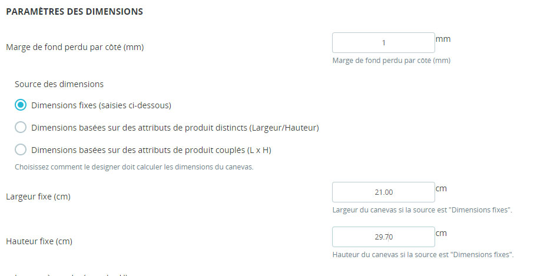
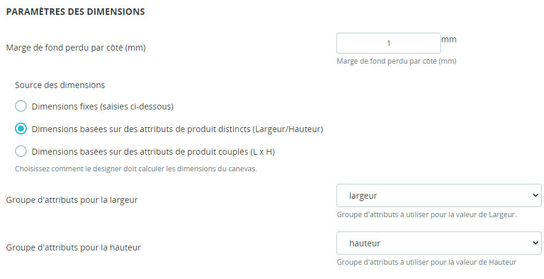
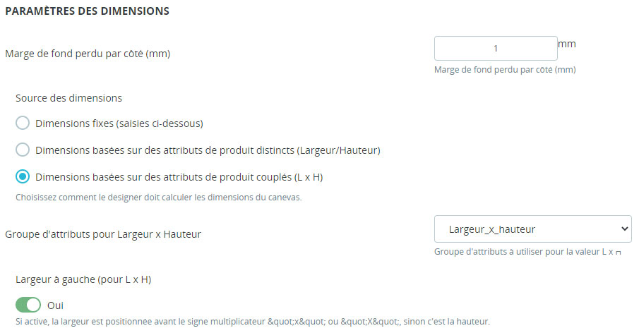

[← Sommaire](README.md) · [← Configuration du produit](configuration-produit.md) · Page suivante : [Commandes et export SVG →](commandes-et-export-svg.md)

# Comment définir les dimensions d'impression d'un produit dans NonDesigner

Les dimensions de la zone d'impression du produit sont exprimées par une **largeur** et une **hauteur**, en **centimètres**. Dans **NonDesigner** (module PrestaShop), vous pouvez les obtenir de trois façons, plus une marge de fond perdu.

**Chemin :** Catalogue → Produits → Modifier le produit → Modules → NonDesigner → Configurer → *Paramètres de taille*

**Sur cette page**

- [Signification de « attribut » et « combinaison »](#que-signifient-attribut-et-combinaison-)
- [Quelle méthode choisir](#quelle-méthode-de-calcul-de-taille-choisir-)
- [Marge de fond perdu](#1-marge-de-fond-perdu-par-côté-mm)
- [Méthode 2 : dimensions fixes](#2-dimensions-fixes)
- [Méthode 3 : attributs distincts](#3-dimensions-dérivées-dattributs-de-produit-distincts-largeurhauteur)
- [Méthode 4 : valeurs associées L x H](#4-dimensions-dérivées-de-valeurs-associées-l-x-h-dans-un-seul-attribut)

## Que signifient attribut et combinaison ?

Un **attribut** est une caractéristique qui génère des variantes de produit (par exemple, le groupe d'attributs « Taille » avec les valeurs « 50x70 cm », « 70x100 cm »…). Une **combinaison** est l'association d'attributs que le client choisit avant l'achat (par exemple, Taille : 50x70 cm + Couleur : Rouge).

Si votre produit n'a **pas de variantes/attributs** configurés, les méthodes 3 et 4 sont inutilisables : choisissez **Dimensions fixes** (méthode 2).

## Quelle méthode de calcul de taille choisir ?

| Situation | Méthode |
|---|---|
| Le produit a toujours la même dimension pour toutes les variantes (par exemple toujours 50x70 cm) | **Dimensions fixes** |
| La largeur et la hauteur sont deux attributs distincts (deux menus déroulants) | **Attributs distincts** |
| La largeur et la hauteur sont écrites ensemble dans un seul attribut (par exemple la variante « 50x70 ») | **Valeurs associées (L x H)** |

À l'exception de « Dimensions fixes », la **sélection du groupe d'attributs est obligatoire** : si elle reste vide, l'enregistrement est impossible et un avertissement s'affiche à l'écran.

---

## 1. Marge de fond perdu par côté (mm)

> **En bref :** si vous ne savez pas quoi choisir, demandez à votre imprimeur la valeur recommandée (généralement 2-3 mm) et saisissez-la ici. Elle sert uniquement à éviter des marges blanches indésirables après la découpe.

Il s'agit d'un champ de texte unique, **toujours visible** quelle que soit la méthode choisie, qui représente la marge de fond perdu ajoutée de **chaque côté** de la zone d'impression, en **millimètres**.

### À quoi sert la marge de fond perdu ?

Lorsqu'un design est imprimé sur une feuille plus grande puis découpé à la taille finale (cartes de visite, autocollants, affiches, panneaux…), la découpe n'est jamais précise au millimètre. Si l'arrière-plan ou une image atteint exactement le bord de la zone utile et que la coupe se décale même légèrement, une fine **bande blanche non imprimée** apparaît sur le bord : un défaut visuel évident, considéré comme une erreur d'impression.

La marge de fond perdu étend l'arrière-plan et les images de quelques millimètres au-delà du bord réel du produit. Le fichier d'impression est plus grand que le format final : même si la coupe se décale légèrement, elle tombe toujours dans la zone débordante, qui est imprimée.

Une valeur typique se situe entre **1 et 5 mm par côté**, selon le type de produit, le matériau et les tolérances de la machine de découpe de l'imprimeur. Le designer étend **automatiquement** l'arrière-plan au-delà des dimensions nominales, sans que l'utilisateur final ait à s'en préoccuper.

### Quel format le champ accepte-t-il ?

La validation est stricte et **bloque l'enregistrement** si le format est incorrect :

- Uniquement des **nombres entiers positifs** (chiffres 0 à 9) : `0`, `5`, `12`, `100`.
- **Aucune décimale** : ni point ni virgule.
- **Aucun signe** : les valeurs négatives ne sont pas autorisées.
- Le champ peut être laissé **vide** : il est enregistré comme `0` (aucune marge).

> **Erreur bloquante :** des valeurs comme `5.5`, `5,5`, `-5`, `5mm`, `abc` empêchent l'enregistrement de toute la fiche produit et affichent un message d'erreur explicite.

---

## 2. Dimensions fixes

> **En bref :** choisissez cette méthode si le produit a toujours la même dimension pour toutes les variantes : saisissez les deux nombres une seule fois, sans associer d'attributs.

Deux champs de saisie s'affichent (largeur et hauteur), n'acceptant que des nombres.

### Quel format les dimensions fixes acceptent-elles ?

La valeur n'est **ni interprétée ni nettoyée** : elle est convertie directement en nombre décimal telle qu'elle a été saisie.

- Séparateur décimal : **point** (`.`) ou **virgule** (`,`). Exemples valides : `50`, `50.5`, `120.75`, `50,5`, `120,75`.
- La virgule est **automatiquement convertie en point** lors de l'enregistrement (`50,5` → `50.5`).
- Pas d'unités, d'espaces ou de symboles : `50 cm` serait enregistré comme `50`, mais c'est déconseillé.
- La largeur et la hauteur sont **obligatoires** et doivent être **supérieures à zéro** (> 0,01 cm), sinon l'enregistrement est bloqué.

> S'agissant de la méthode la plus stricte (aucune extraction automatique depuis du texte ou des symboles), saisissez **uniquement des nombres avec un point décimal facultatif** (par exemple `45`, `45.5`).

---

## 3. Dimensions dérivées d'attributs de produit distincts (largeur/hauteur)

> **En bref :** choisissez cette méthode si la largeur et la hauteur sont deux attributs distincts (par exemple un menu déroulant pour la largeur et un autre pour la hauteur) : le système lit automatiquement le nombre de chacun.

Deux champs de sélection s'affichent (largeur et hauteur), contenant chacun la liste des groupes d'attributs faisant partie des combinaisons du produit.

### Comment les valeurs sont-elles lues ?

Une fois les groupes d'attributs de largeur et de hauteur choisis, le système lit la valeur/le nom de chaque attribut de la combinaison choisie par le client et **en extrait automatiquement le nombre**, en supprimant texte, unités et symboles, **à condition que la valeur ne contienne qu'un seul nombre**.

| Valeur de l'attribut (exemple) | Valeur lue |
|---|---|
| `50` | 50 |
| `50 cm` | 50 |
| `50cm` | 50 |
| `H : 50 cm` | 50 |
| `Hauteur 50 cm` | 50 |
| `50.5` / `50.5 cm` | 50.5 |
| `50,5` / `50,5 cm` | 50.5 |

Le point et la virgule sont tous deux acceptés comme séparateur décimal.

### Quelles valeurs d'attribut faut-il éviter ?

> **Règle fondamentale :** chaque valeur d'attribut ne doit contenir **qu'un seul nombre**. Si elle contient plusieurs nombres (un code, une taille numérique, deux mesures), le résultat est imprévisible et très probablement incorrect, **sans qu'aucune erreur ne soit signalée**.

| Valeur de l'attribut (incorrecte) | Valeur lue | Problème |
|---|---|---|
| `50x70` | 5070 | les deux nombres fusionnent en un seul |
| `Modèle X200, 50 cm` | 200.50 | les deux nombres fusionnent, générant des décimales incorrectes |
| `1.234 cm` (milliers) | 1.234 | interprété comme « 1 virgule 234 » au lieu de « 1234 » |
| `-50 cm` | 50 | le signe négatif est ignoré |

**Recommandation :** le nom de chaque attribut du groupe choisi (pour la largeur comme pour la hauteur) ne doit contenir que **le nombre de la mesure**, accompagné éventuellement de texte ou d'une unité, **jamais d'autres nombres**.

---

## 4. Dimensions dérivées de valeurs associées (L x H) dans un seul attribut

> **En bref :** choisissez cette méthode si la largeur et la hauteur sont écrites ensemble dans un seul attribut (par exemple la variante s'appelle `50x70`) : le système sépare les deux nombres de manière autonome, à condition qu'ils soient dans le bon format.

Un seul champ de sélection s'affiche, à partir duquel sont lues à la fois la largeur et la hauteur.

### Comment cela fonctionne-t-il ?

Le système recherche dans la valeur de l'attribut **deux nombres séparés par un « x »** (ou un symbole équivalent) et les attribue à la largeur et à la hauteur selon l'ordre défini dans l'option **Position de la largeur**.

### Quels séparateurs sont valides ?

Le séparateur entre les deux nombres doit être l'un des suivants :

- `x` (minuscule)
- `X` (majuscule)
- `*` (astérisque)

| Valeur de l'attribut (exemple) | 1ère valeur | 2e valeur |
|---|---|---|
| `50x70` | 50 | 70 |
| `50X70` | 50 | 70 |
| `50*70` | 50 | 70 |
| `50 x 70` | 50 | 70 |
| `50 x 70 cm` | 50 | 70 |
| `50cm x 70cm` | 50 | 70 |
| `L : 50 x H : 70 cm` | 50 | 70 |
| `50,5 x 70,2` | 50.5 | 70.2 |
| `50.5x70.2` | 50.5 | 70.2 |

Le point et la virgule sont acceptés comme séparateur décimal pour chacun des deux nombres.

### Quels formats ne sont PAS reconnus ?

> Ces formats donnent une largeur et une hauteur égales à **0 / 0**, **sans aucun message d'erreur** visible pour l'utilisateur.

| Valeur de l'attribut (incorrecte) | Résultat | Problème |
|---|---|---|
| `50-70` | 0 / 0 | le tiret n'est pas un séparateur valide |
| `50 / 70` | 0 / 0 | la barre oblique n'est pas un séparateur valide |
| `50×70` (symbole ×) | 0 / 0 | il faut utiliser la lettre x, pas le symbole × |
| `50 par 70` | 0 / 0 | il faut utiliser la lettre x, pas le mot « par » |
| `Taille unique` | 0 / 0 | aucun nombre présent |
| `70 cm` (une seule valeur) | 0 / 0 | le deuxième nombre et/ou le séparateur est manquant |

### Que se passe-t-il avec plus de deux mesures ?

Avec trois nombres ou plus (par exemple `50x70x30` pour inclure une profondeur), **seules les deux premières mesures** (50 et 70) sont lues ; la troisième est ignorée.

**Recommandation :** chaque attribut du groupe choisi doit contenir **exactement deux nombres**, séparés uniquement par `x`, `X` ou `*` (par exemple `50x70 cm`, `50,5 X 70,2`), en évitant les tirets, les barres obliques, le symbole × ou les descriptions textuelles du séparateur.

---

Si les dimensions apparaissent comme 0 / 0 dans le frontend, consultez la [FAQ](faq.md#les-dimensions-du-produit-sont-lues-comme-0--0-dans-le-frontend-comment-résoudre-ce-problème-).

Page suivante : [Commandes et export SVG →](commandes-et-export-svg.md)
