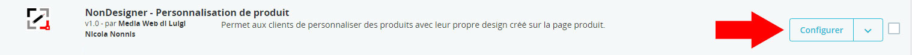

[← Sommaire](README.md) · Page suivante : [Configuration du module →](configuration-module.md)

# Comment installer le module NonDesigner sur PrestaShop

**NonDesigner** est un module PrestaShop qui permet aux clients de personnaliser des produits en ligne grâce à un designer graphique 2D intégré au frontend de la boutique et qui génère, pour chaque commande, des fichiers SVG vectoriels et PNG 1:1 prêts à imprimer. Cette page décrit la configuration requise, la compatibilité avec les versions de PrestaShop et la procédure d'installation.

## Avec quelles versions de PrestaShop et de PHP NonDesigner est-il compatible ?

- **Versions de PrestaShop compatibles :** v1.7.6.1 à v8.x et v9.x
- **Versions de PHP prises en charge :** de PHP 7.2 à PHP 8.5
- **Extensions PHP requises :** GD Library, cURL, Zip, SimpleXML
- **Directives serveur recommandées :** `upload_max_filesize` ≥ 10M et `post_max_size` ≥ 10M

> Les directives `upload_max_filesize` et `post_max_size` limitent en définitive la taille des images que les clients peuvent télécharger dans le designer. Voir [Taille maximale des images utilisateur](configuration-module.md#2-taille-maximale-des-images-utilisateur-mo).

## Comment installer NonDesigner pas à pas

1. Connectez-vous au Back Office de PrestaShop.
2. Accédez à **Panneau de contrôle → Gestionnaire de Modules → Gestionnaire de Modules**.
3. Cliquez sur le bouton **Télécharger un module** en haut à droite.
4. Glissez-déposez, ou sélectionnez, le fichier `.zip` du module NonDesigner téléchargé depuis PrestaShop Addons.
5. Attendez la fin de l'installation puis cliquez sur **Configurer**.

## NonDesigner nécessite-t-il l'activation d'une licence ?

Non. Le module **ne nécessite aucune activation de licence** : une fois installé et configuré, il est immédiatement opérationnel.

## Où se trouvent les paramètres du module après l'installation ?

**Panneau de contrôle → Gestionnaire de Modules → NonDesigner → Configurer**

Tous les paramètres du module prennent en charge la fonctionnalité **Multiboutique** native de PrestaShop : vous pouvez définir des règles différentes (par exemple, jours de nettoyage ou panneaux actifs) pour chaque boutique ou groupe de boutiques en sélectionnant la boutique via le sélecteur en haut à droite. Si vous ne définissez pas de valeur pour une boutique, la valeur globale héritée est utilisée automatiquement.

## Que faire avant d'installer ?

Effectuez une **sauvegarde des fichiers de votre serveur et de votre base de données** avant d'installer le module et, si possible, installez-le d'abord sur un **serveur de test** pour effectuer vos propres essais. L'installation se fait sous votre responsabilité : aucune responsabilité n'est assumée pour d'éventuels effets indésirables survenant lors de l'installation.

## Étapes suivantes

1. [Configurer les paramètres globaux du module](configuration-module.md)
2. [Configurer le designer sur un produit](configuration-produit.md)
3. En cas de problème, consultez la [FAQ](faq.md)
