[← Indice](README.md) · [← Installazione](installazione.md) · Prossima pagina: [Configurazione del prodotto →](configurazione-prodotto.md)

# Come configurare il modulo NonDesigner: impostazioni globali (lato modulo)

Questa pagina descrive le impostazioni globali del modulo **NonDesigner** per PrestaShop, divise in quattro schede: **Generale**, **Gestione Forme**, **Gestione Caratteri** e **Configurazione Strumenti**.

**Percorso:** Pannello di controllo → Gestione moduli → NonDesigner → Configura

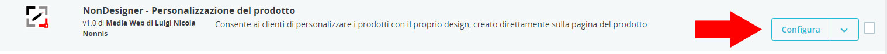

> **Multinegozio:** tutte le impostazioni supportano il Multinegozio nativo di PrestaShop. Puoi definire regole diverse per ogni negozio o gruppo di negozi selezionando lo shop dal selettore in alto a destra. Se per un negozio non imposti un valore, viene usato quello globale ereditato.

**In questa pagina**

- [Scheda Generale](#scheda-generale)
- [Scheda Gestione Forme](#scheda-gestione-forme)
- [Scheda Gestione Caratteri](#scheda-gestione-caratteri)
- [Scheda Configurazione Strumenti](#scheda-configurazione-strumenti)

---

## Scheda Generale

La scheda **Generale** gestisce la diagnostica (log), i limiti per l'upload dei file da parte dei clienti e i permessi di download dei file di progetto nel frontend.

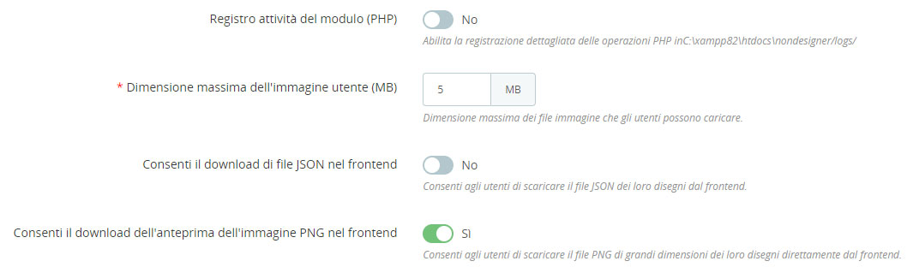

### 1. Log delle attività del modulo

Interruttore Sì/No che abilita o disabilita la registrazione dettagliata delle operazioni PHP eseguite dal modulo. Quando è attivo, i file di log vengono salvati nella cartella `/logs/` nella directory principale (`_PS_ROOT_DIR_`) del sito PrestaShop.

**Consiglio:** lascia l'opzione su **No** durante il normale utilizzo, per non appesantire il server. Attivala solo se hai problemi e il tuo sviluppatore deve diagnosticare errori.

### 2. Dimensione massima immagine utente (MB)

Definisce la dimensione massima dei file immagine che gli utenti possono caricare nel disegnatore.

- Il valore è espresso in Megabyte (MB) ed è obbligatorio.
- Deve essere un numero positivo maggiore di zero (es. 2 o 5); in caso contrario il sistema mostra un errore e impedisce il salvataggio.

> **Importante:** il limite effettivo dipende in ultima istanza dai limiti del server hosting (direttive `upload_max_filesize` e `post_max_size` nel file `php.ini`). Se imposti nel modulo un valore (es. 10 MB) superiore al limite del server (es. 2 MB), il server bloccherà comunque i caricamenti oltre 2 MB. Imposta quindi un valore uguale o inferiore a quello consentito dal tuo piano hosting.

### 3. Consenti il download JSON nel Frontend

Interruttore Sì/No: se abilitato, il cliente trova nel frontend un pulsante per scaricare il file **JSON** con i dati grezzi della struttura del suo progetto grafico.

### 4. Consenti il download dell'anteprima PNG nel Frontend

Interruttore Sì/No: se abilitato, il cliente può scaricare un'immagine **PNG in scala 1:1** del design appena creato. La qualità di questa anteprima **non è adatta alla stampa professionale**: i file per la stampa si scaricano dal Back Office (vedi [Ordini ed esportazione SVG](ordini-e-esportazione-svg.md)).

---

## Scheda Gestione Forme

Qui gestisci le forme geometriche o vettoriali che gli utenti possono inserire nei loro progetti. Le forme supportano il Multinegozio: ogni negozio ha la propria cartella dedicata.

### Come caricare nuove forme in NonDesigner?

Clicca sul pulsante di caricamento. Il sistema accetta **esclusivamente file `.svg`**. Per sicurezza, il modulo **sanitizza automaticamente** gli SVG caricati, rimuovendo tag e attributi dannosi.

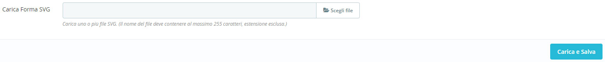

### Come cambiare l'ordine delle forme nel disegnatore?

Trascina le righe della tabella verso l'alto o verso il basso (drag-and-drop): l'ordine determina come le forme appaiono nel pannello forme del disegnatore del cliente. Il salvataggio della posizione è automatico.

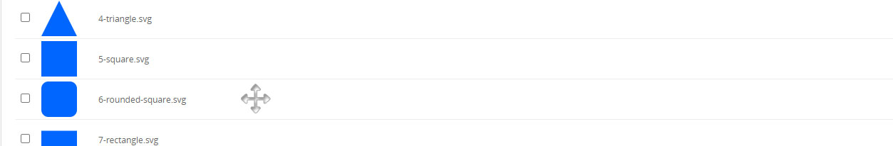

### Come attivare o disattivare una forma?

Clicca sulla spunta verde / X rossa per nascondere temporaneamente una forma senza cancellarla. Puoi anche selezionare più forme con le caselle di controllo e usare le **Azioni di massa** per attivarle o disattivarle insieme.

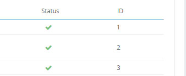

### Posso eliminare le forme di sistema?

Le forme che hai caricato tu possono essere eliminate definitivamente. Le **Forme di Sistema** (es. cerchi, quadrati base) **non possono essere eliminate, solo disattivate**, per garantire il funzionamento base del modulo; se provi a eliminarle compare un messaggio di errore.

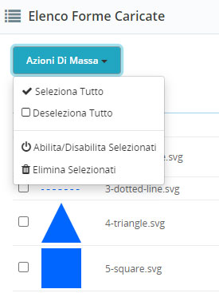

---

## Scheda Gestione Caratteri

Qui scarichi, attiva ed elimini i **font** messi a disposizione dei clienti nel disegnatore.

Per ottenere le massime prestazioni nel frontend e rispettare le normative sulla privacy (**GDPR**), il modulo **non carica i font da servizi esterni in tempo reale**: scarica i file delle famiglie tipografiche (`.ttf`) direttamente sul tuo server hosting e li serve localmente.

La schermata ha due sezioni: **Font Non Scaricati** e **Font Scaricati (Installati)**.

### Multinegozio e font

- Font scaricati e relativi stati di attivazione sono **isolati per singolo negozio**.
- Con il Multinegozio attivo, i file dei font sono organizzati in sottocartelle dedicate (es. `/fontfiles/1/`, `/fontfiles/2/`), così puoi avere un catalogo di font diverso per ciascun punto vendita.

### Font Non Scaricati (catalogo disponibile)

Elenca i font del catalogo del modulo non ancora presenti sul tuo server.

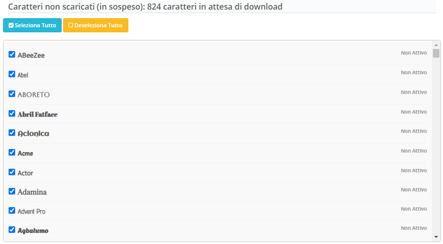

- **Anteprima dinamica e lazy-loading:** l'anteprima del nome del font viene mostrata solo quando compare a schermo, per non rallentare la pagina.
- **Download selettivo:** spunta i font desiderati e clicca **Scarica selezionati**.
- **Download massivo:** clicca **Avvia Download (Ricomincia Tutti)** per scaricare l'intero catalogo; il sistema seleziona automaticamente tutti i font in sospeso.
- **Interruzioni ed errori server:** durante il download vedi una barra di avanzamento con il font in elaborazione. Puoi cliccare **Annulla** in qualsiasi momento (il processo si ferma al termine del font corrente). In caso di sovraccarico momentaneo del server (es. errore HTTP 500) il modulo non perde il lavoro svolto e tenta di riprendere il download dal punto di interruzione.

### Font Scaricati (Installati)

Dopo il download i font passano nell'elenco degli installati.

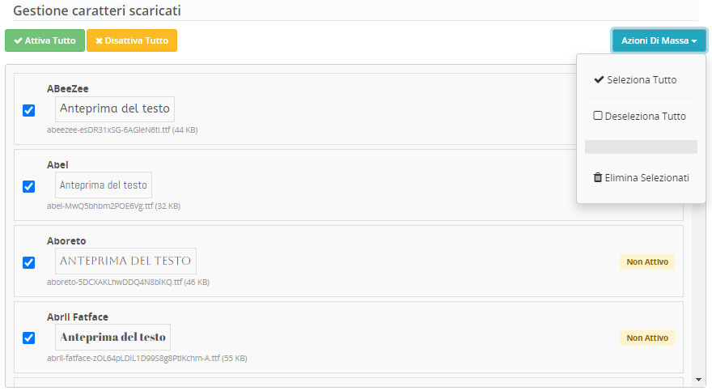

- **Anteprima locale reale:** generata dal file `.ttf` salvato sul tuo server, con nome file e peso in KB.
- **Attivazione singola:** per rendere un font disponibile ai clienti clicca sul pulsante di stato (**Non Attivo** / **Attiva**). I font appena scaricati sono **disattivati di default**.
- **Attivazione/disattivazione massiva:** pulsanti **Attiva Tutti** / **Disattiva Tutti**.
- **Eliminazione:** seleziona i font e clicca **Elimina Selezionati**; vengono rimossi sia il record nel database sia il file dal server, e il font torna tra i "Non Scaricati".
- **Font di sistema protetti:** i font base integrati nel modulo (ID 1, 2, 3, 4 o contrassegnati come locali) non hanno la casella di selezione e non possono essere eliminati.

> **Prestazioni:** attivare molti font contemporaneamente può rallentare il caricamento del disegnatore nel frontend. Attiva solo quelli strettamente necessari.

---

## Scheda Configurazione Strumenti

Controlla l'interfaccia del disegnatore visibile ai clienti, le regole di aggiunta al carrello e la manutenzione del database (pulizia dei file temporanei). È divisa in quattro sezioni più un pannello di pulizia manuale.

### 1. Impostazioni Pannelli

Attiva o disattiva intere schede (tab) del disegnatore del cliente. Un pannello disattivato scompare completamente dall'interfaccia.

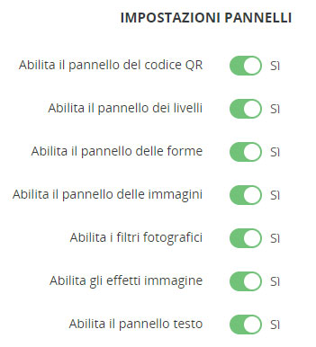

| Opzione | Cosa fa |
|---|---|
| Abilita il pannello QR-Code | Permette di generare e inserire un codice QR personalizzato sul prodotto |
| Abilita il pannello livelli | Gestione dei livelli (porta in primo piano, manda dietro, ecc.) per sovrapposizioni complesse |
| Abilita il pannello forme | Inserimento di forme predefinite (gestibili in "Gestione Forme") |
| Abilita il pannello immagini | I clienti caricano foto o loghi dal proprio dispositivo |
| Abilita i filtri foto | Strumenti per modificare colore, luminosità e applicare filtri alle immagini caricate |
| Abilita gli effetti immagine | Effetti grafici avanzati applicabili alle immagini caricate |
| Abilita il pannello testo | Inserimento di campi di testo personalizzati sul prodotto |

### 2. Impostazioni Pulsanti

Attiva o disattiva singoli strumenti di trasformazione applicabili a testi o immagini sul piano di lavoro.

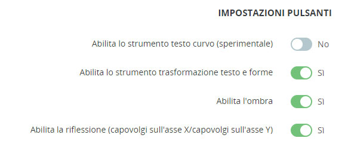

| Opzione | Cosa fa |
|---|---|
| Abilita lo strumento testo curvo (sperimentale) | Dispone il testo lungo una linea curva (es. loghi circolari o toppe). Funzione sperimentale: testala prima di attivarla |
| Abilita lo strumento di trasformazione (Warp) | Deforma liberamente testi e forme (prospettiva, distorsioni) con decine di trasformazioni |
| Abilita l'ombra | Aggiunge e personalizza le ombreggiature dietro gli elementi |
| Abilita il riflesso | Pulsanti per capovolgere gli elementi in orizzontale (Flip X) o verticale (Flip Y) |

### 3. Impostazioni Design e Carrello

Regole di comportamento quando un cliente salva un progetto o lo aggiunge al carrello.

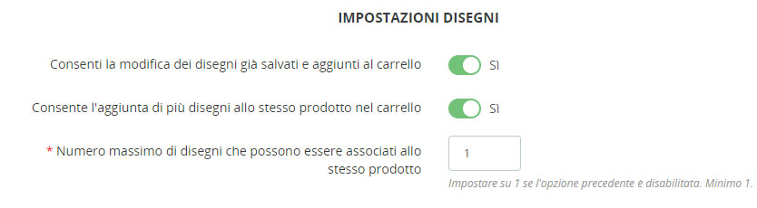

- **Consenti la modifica di disegni già salvati e aggiunti al carrello** – se **Sì**, il cliente può cliccare il prodotto nel carrello e tornare nel disegnatore per correggere un errore prima dell'acquisto.
- **Consenti di aggiungere più design allo stesso prodotto nel carrello** – se **Sì**, il cliente può personalizzare lo stesso prodotto più volte con grafiche diverse e aggiungerle al carrello come righe separate.
- **Numero massimo di design associabili allo stesso prodotto** – tetto massimo di personalizzazioni diverse per lo stesso articolo (es. 5). Valore minimo: 1.

> Se disabiliti l'opzione precedente (**No**), questo campo scompare e il sistema forza il limite a **1**, per evitare duplicati indesiderati.

### 4. Pulizia dei design dei carrelli abbandonati

Molti clienti iniziano a personalizzare un prodotto e abbandonano il sito senza ordinare. Questi design (senza ID Ordine associato) occupano spazio sul server: questa sezione ne automatizza l'eliminazione.

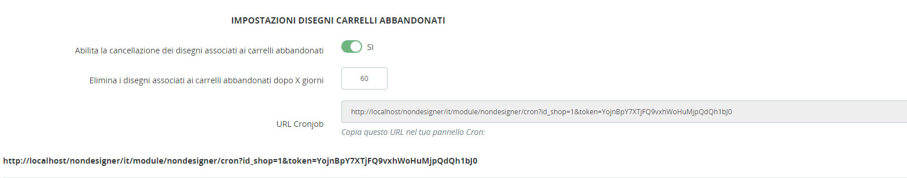

- **Abilita l'eliminazione dei design associati a carrelli abbandonati** – se **Sì**, sblocca le impostazioni di pulizia e mostra il pannello di Pulizia Manuale.
- **Elimina i design dopo X giorni** – per quanto conservare i progetti non acquistati (default **30 giorni**). Un valore inferiore a 1 viene forzato a 30.
- **URL Cronjob (automazione)** – il sistema genera un indirizzo univoco e sicuro, con un token segreto di 32 caratteri. Copialo nel gestore Cron del server (cPanel/Plesk) per eliminare automaticamente i file vecchi ogni notte o settimana. Il server deve eseguire una chiamata HTTP GET (es. con `wget` o `curl`).

### 5. Pulizia manuale

Se non vuoi configurare un cronjob, puoi pulire manualmente.

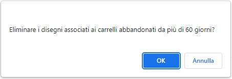

> Il riquadro è visibile solo se hai attivato l'eliminazione dei design dei carrelli abbandonati, e funziona solo dentro un negozio specifico (non nella vista "Tutti i negozi" in Multinegozio).

1. Clicca il pulsante giallo **Elimina Ora**.
2. Conferma la richiesta "Vuoi eliminare i design dei carrelli abbandonati più vecchi di [X] giorni?".
3. Compare una barra di progressione.
4. L'eliminazione avviene in background a **blocchi di 20 design** per volta: il server non va in timeout nemmeno con migliaia di file.
5. Attendi il 100%: riceverai una notifica verde ("Pulizia completata!") oppure, se non c'è nulla da pulire, un avviso azzurro ("Nessun design da eliminare").

---

Prossima pagina: [Come configurare il disegnatore su un prodotto →](configurazione-prodotto.md)
