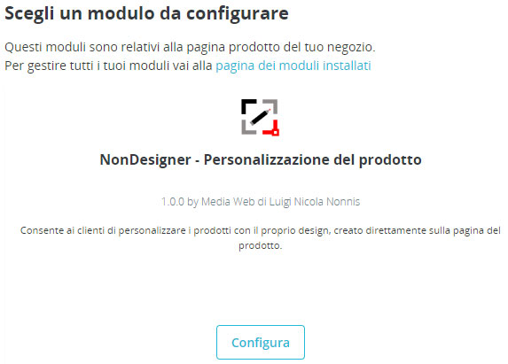
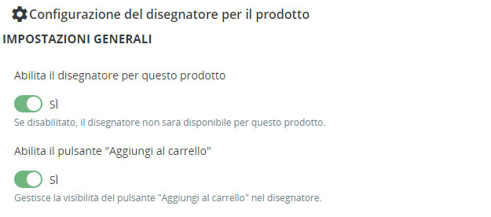
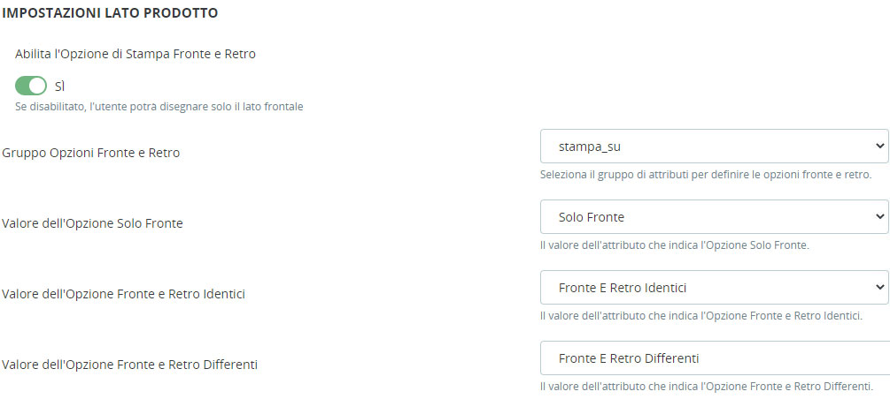
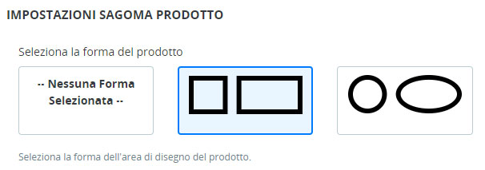
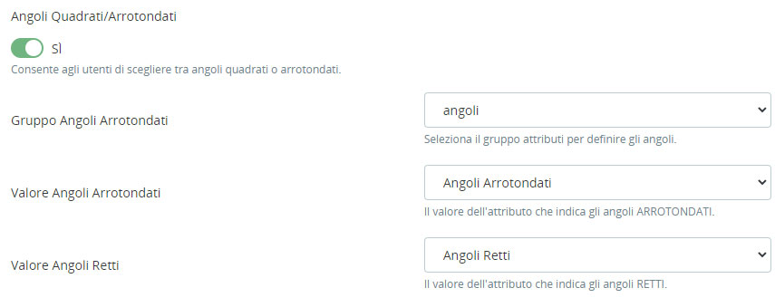
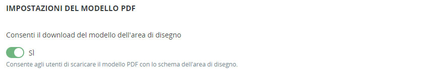
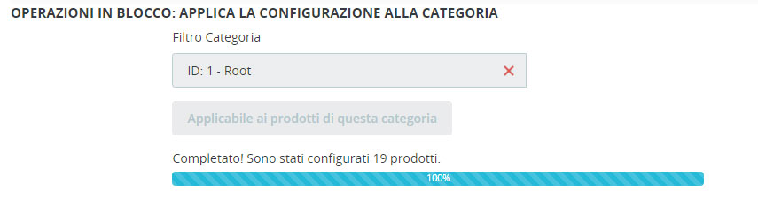

[← Indice](README.md) · [← Configurazione del modulo](configurazione-modulo.md) · Prossima pagina: [Dimensioni di stampa →](dimensioni-prodotto.md)

# Come configurare il disegnatore NonDesigner su un singolo prodotto PrestaShop

Dopo aver impostato il [modulo a livello globale](configurazione-modulo.md), il disegnatore **NonDesigner** si configura prodotto per prodotto. Questa pagina descrive abilitazione, stampa fronte/retro, sagoma del prodotto, modello PDF e applicazione in blocco della configurazione a un'intera categoria.

**Percorso:** Pannello di controllo → Catalogo → Prodotti → Modifica/Aggiungi prodotto → Moduli → NonDesigner → Configura

## Impostazioni generali

### Come abilitare il disegnatore per un prodotto?

Attiva **Abilita il disegnatore per questo prodotto**. Se è disabilitato, il prodotto si comporta come un normale articolo del catalogo.

> Conviene lasciarlo **disabilitato** mentre prepari una configurazione che poi [copierai in blocco su altri prodotti](#come-applicare-la-configurazione-a-tutti-i-prodotti-di-una-categoria): così puoi verificare la correttezza della configurazione di ciascun prodotto prima di attivare il disegnatore.

### Cosa fa l'opzione "Abilita il pulsante Aggiungi al carrello"?

Controlla la visibilità del pulsante di aggiunta al carrello **dentro l'interfaccia del disegnatore**. Quando l'utente salva un disegno, il prodotto associato viene **aggiunto automaticamente al carrello**.

- **Nascondi** il pulsante se vuoi **obbligare** il cliente ad associare un disegno al prodotto.
- **Lascialo visibile** se vuoi permettere l'acquisto del prodotto anche **senza** un disegno associato (vedi [prodotto neutro "Nessuna stampa"](prezzi-e-varianti.md#a-come-vendere-anche-il-prodotto-neutro-senza-stampa)).

## Come impostare la stampa fronte/retro?

- **Abilita Opzione Stampa Fronte/Retro:** se disabilitato, il cliente può personalizzare **solo il fronte**.
- Se abiliti il fronte/retro compaiono nuovi campi di mappatura:
  - **Gruppo Opzioni Fronte/Retro:** il gruppo di attributi che definisce le varianti di stampa.
  - **Mappatura Valori:** dopo aver scelto il gruppo, indica quale valore corrisponde a **Solo Fronte**, quale a **Fronte/Retro Identici** e quale a **Fronte/Retro Differenti**.

I campi per la mappatura dei valori si popolano automaticamente in base al gruppo scelto. Per gestire i sovrapprezzi di queste varianti vedi [Prezzi e varianti](prezzi-e-varianti.md).

## Dimensioni del prodotto

Larghezza e altezza dell'area di stampa si impostano con tre metodi diversi (dimensioni fisse, attributi distinti, valori accoppiati L x A) più il margine di abbondanza. È l'impostazione più delicata: ha una pagina dedicata → [Come impostare le dimensioni di stampa](dimensioni-prodotto.md).

## Sagoma del prodotto

Definisce la maschera visiva del prodotto, cioè l'area disegnabile.

### Come scegliere la forma del prodotto?

In **Seleziona la forma del prodotto** scegli la forma di base: **quadrata/rettangolare** oppure **circolare/ellittica**.

### Come impostare gli angoli arrotondati?

L'interruttore **Angoli Quadrati/Arrotondati** è visibile **solo con la sagoma quadrata/rettangolare**; con la sagoma circolare/ellittica l'opzione è forzata e nascosta su "No".

Se la attivi (**Sì**), devi mappare il **Gruppo Angoli Arrotondati** e indicare quali valori dell'attributo corrispondono ad **Angoli Arrotondati** e quali ad **Angoli Quadrati**.

## Modello PDF dell'area di disegno

**Consenti il download del modello dell'area di disegno:** se attivo, gli utenti possono scaricare lo schema **PDF** dell'area di lavoro in **scala 1:1 a 300 dpi**, di dimensioni corrispondenti a quelle impostate nella scheda del prodotto.

> L'opzione compare solo se hai già selezionato una **Sagoma del prodotto** valida.

## Come applicare la configurazione a tutti i prodotti di una categoria?

La funzione **Operazioni in blocco** permette di selezionare una categoria (digitando nome o ID nel campo di ricerca) e applicare **ricorsivamente** la configurazione del prodotto corrente ai prodotti della categoria e delle sue sottocategorie.

> Disponibile solo se il prodotto corrente ha una **configurazione del disegnatore valida e già salvata**.

---

Prossima pagina: [Come impostare le dimensioni di stampa →](dimensioni-prodotto.md)
