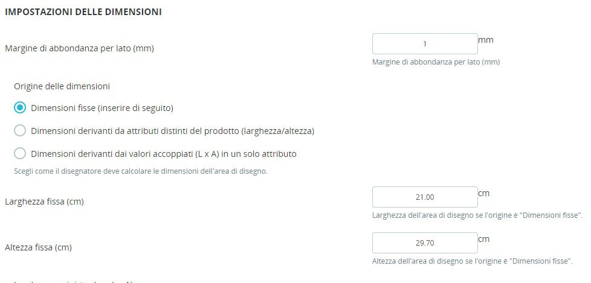
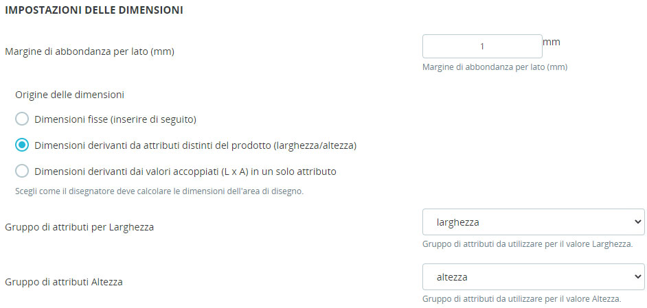
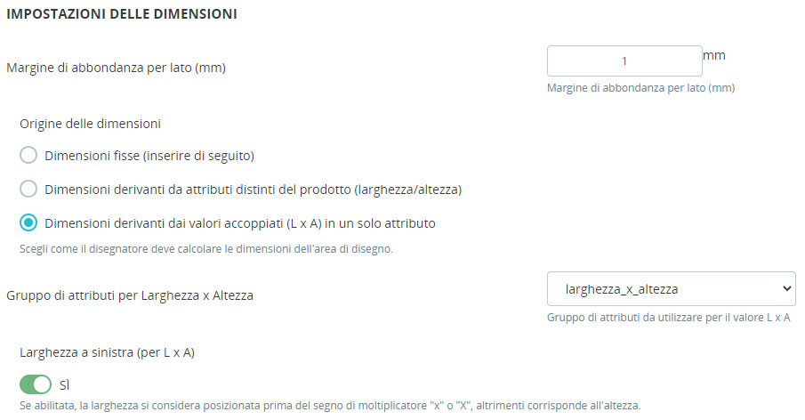

[← Indice](README.md) · [← Configurazione del prodotto](configurazione-prodotto.md) · Prossima pagina: [Ordini ed esportazione SVG →](ordini-e-esportazione-svg.md)

# Come impostare le dimensioni di stampa di un prodotto in NonDesigner

Le dimensioni dell'area di stampa del prodotto sono identificate da **larghezza** e **altezza**, espresse in **centimetri**. In **NonDesigner** (modulo PrestaShop) puoi ricavarle in tre modi, più un margine di abbondanza.

**Percorso:** Catalogo → Prodotti → Modifica prodotto → Moduli → NonDesigner → Configura → *Impostazioni delle dimensioni*

**In questa pagina**

- [Attributo e combinazione: cosa sono](#cosa-sono-attributo-e-combinazione)
- [Quale metodo scegliere](#quale-metodo-di-dimensionamento-scegliere)
- [Margine di abbondanza](#1-margine-di-abbondanza-per-lato-mm)
- [Metodo 2: dimensioni fisse](#2-dimensioni-fisse)
- [Metodo 3: attributi distinti](#3-dimensioni-derivanti-da-attributi-distinti-larghezzaaltezza)
- [Metodo 4: valori accoppiati L x A](#4-dimensioni-derivanti-dai-valori-accoppiati-l-x-a-in-un-solo-attributo)

## Cosa sono "attributo" e "combinazione"?

Un **attributo** è una caratteristica che genera varianti del prodotto (es. il gruppo attributo "Formato" con valori "50x70 cm", "70x100 cm"…). Una **combinazione** è l'abbinamento degli attributi che il cliente sceglie prima di acquistare (es. Formato: 50x70 cm + Colore: Rosso).

Se il tuo prodotto **non ha varianti/attributi** configurati, i metodi 3 e 4 non sono utilizzabili: scegli **Dimensioni fisse** (metodo 2).

## Quale metodo di dimensionamento scegliere?

| Situazione | Metodo |
|---|---|
| Il prodotto ha sempre la stessa dimensione per tutte le varianti (es. sempre 50x70 cm) | **Dimensioni fisse** |
| Larghezza e altezza sono due attributi separati (due menu a tendina) | **Attributi distinti** |
| Larghezza e altezza sono scritte insieme in un solo attributo (es. variante "50x70") | **Valori accoppiati (L x A)** |

Ad eccezione di "Dimensioni fisse", la **selezione del gruppo attributi è obbligatoria**: lasciare la selezione neutra impedisce il salvataggio e mostra un avviso a schermo.

---

## 1. Margine di abbondanza per lato (mm)

> **In breve:** se non sai cosa scegliere, chiedi al tuo fornitore di stampa il valore consigliato (di solito 2–3 mm) e inseriscilo qui. Serve a evitare bordi bianchi indesiderati dopo il taglio.

Il campo è un testo singolo, **sempre visibile** qualunque sia il metodo selezionato, e rappresenta il margine di abbondanza aggiunto su **ciascun lato** dell'area di stampa, in **millimetri**.

### A cosa serve il margine di abbondanza?

Quando un design viene stampato su un foglio più grande e poi tagliato alla misura finale (biglietti da visita, adesivi, poster, pannelli…), la taglierina non è mai precisa al millimetro. Se lo sfondo o un'immagine arrivano esattamente al bordo dell'area utile e il taglio si sposta anche di poco, resta una sottile **striscia bianca non stampata** lungo il bordo: un difetto estetico considerato errore di stampa.

Il margine di abbondanza estende lo sfondo e le immagini oltre il bordo reale del prodotto di qualche millimetro per lato. Il file di stampa risulta più grande del formato finale: anche se il taglio si sposta leggermente, cade sempre nell'area sovradimensionata, comunque stampata.

Il valore tipico va da **1 a 5 mm per lato**, in base al tipo di prodotto, al materiale e alle tolleranze della macchina da taglio della tipografia. Il disegnatore allarga **automaticamente** lo sfondo oltre le dimensioni nominali, senza che il cliente debba occuparsene.

### Quale formato accetta il campo?

La validazione è rigida e **blocca il salvataggio** se il formato è errato:

- Solo **numeri interi positivi** (cifre 0–9): `0`, `5`, `12`, `100`.
- **Nessun decimale**: né punto né virgola.
- **Nessun segno**: i valori negativi non sono ammessi.
- Il campo può essere lasciato **vuoto**: viene salvato come `0` (nessun margine).

> **Errore bloccante:** valori come `5.5`, `5,5`, `-5`, `5mm`, `abc` impediscono il salvataggio dell'intera scheda prodotto e mostrano un messaggio di errore esplicito.

---

## 2. Dimensioni fisse

> **In breve:** scegli questo metodo se il prodotto ha sempre la stessa dimensione per tutte le varianti: scrivi i due numeri una sola volta, senza associare attributi.

Compaiono due campi di input (larghezza e altezza) che accettano solo numeri.

### Quale formato accettano le dimensioni fisse?

Il valore **non viene interpretato né ripulito**: viene convertito direttamente in numero decimale così come digitato.

- Separatore decimale: **punto** (`.`) o **virgola** (`,`). Esempi validi: `50`, `50.5`, `120.75`, `50,5`, `120,75`.
- La virgola viene **convertita automaticamente in punto** al salvataggio (`50,5` → `50.5`).
- Niente unità di misura, spazi o simboli: `50 cm` verrebbe salvato come `50`, ma è sconsigliato.
- Larghezza e altezza sono **obbligatorie** e devono essere **maggiori di zero** (> 0,01 cm), altrimenti il salvataggio è bloccato.

> Essendo il metodo più "rigido" (nessuna estrazione automatica da testo o simboli), inserisci **solo numeri con eventuale punto decimale** (es. `45`, `45.5`).

---

## 3. Dimensioni derivanti da attributi distinti (larghezza/altezza)

> **In breve:** scegli questo metodo se larghezza e altezza sono due attributi separati (es. un menu a tendina per la larghezza e uno per l'altezza): il sistema legge automaticamente il numero da ciascuno.

Compaiono due campi di selezione (larghezza e altezza), ciascuno con l'elenco dei gruppi attributi che fanno parte delle combinazioni del prodotto.

### Come funziona la lettura dei valori?

Una volta scelti i gruppi attributi per larghezza e altezza, il sistema legge il valore/nome di ciascun attributo della combinazione scelta dal cliente e **ne estrae automaticamente il numero**, ripulendolo da testo, unità di misura e simboli, **purché nel valore sia presente un solo numero**.

| Valore attributo (esempio) | Valore letto |
|---|---|
| `50` | 50 |
| `50 cm` | 50 |
| `50cm` | 50 |
| `H: 50 cm` | 50 |
| `Altezza 50 cm` | 50 |
| `50.5` / `50.5 cm` | 50.5 |
| `50,5` / `50,5 cm` | 50.5 |

Sia punto sia virgola sono accettati come separatore decimale.

### Quali valori di attributo vanno evitati?

> **Regola fondamentale:** ogni valore di attributo deve contenere **un solo numero**. Se contiene più numeri (un codice, una taglia numerica, due misure) il risultato è imprevedibile e quasi certamente sbagliato, **senza alcun messaggio di errore**.

| Valore attributo (errato) | Valore letto | Problema |
|---|---|---|
| `50x70` | 5070 | i due numeri vengono uniti in uno solo |
| `Modello X200, 50 cm` | 200.50 | i due numeri vengono uniti, creando decimali errati |
| `1.234 cm` (migliaia) | 1.234 | interpretato come "1 virgola 234" invece di "1234" |
| `-50 cm` | 50 | il segno negativo viene ignorato |

**Raccomandazione:** il nome di ogni attributo del gruppo selezionato (per larghezza e per altezza) deve contenere **solo il numero della misura**, eventualmente accompagnato da testo o unità di misura, **mai da altri numeri**.

---

## 4. Dimensioni derivanti dai valori accoppiati (L x A) in un solo attributo

> **In breve:** scegli questo metodo se larghezza e altezza sono scritte insieme in un solo attributo (es. la variante si chiama `50x70`): il sistema separa da solo i due numeri, purché siano nel formato corretto.

Compare un solo campo di selezione, da cui vengono lette sia la larghezza sia l'altezza.

### Come funziona?

Il sistema cerca nel valore dell'attributo **due numeri separati da una "x"** (o simbolo equivalente) e li assegna a larghezza e altezza secondo l'ordine impostato nell'opzione **Posizione della larghezza**.

### Quali separatori sono validi?

Il separatore tra i due numeri deve essere uno di questi:

- `x` (minuscola)
- `X` (maiuscola)
- `*` (asterisco)

| Valore attributo (esempio) | 1° valore | 2° valore |
|---|---|---|
| `50x70` | 50 | 70 |
| `50X70` | 50 | 70 |
| `50*70` | 50 | 70 |
| `50 x 70` | 50 | 70 |
| `50 x 70 cm` | 50 | 70 |
| `50cm x 70cm` | 50 | 70 |
| `L: 50 x H: 70 cm` | 50 | 70 |
| `50,5 x 70,2` | 50.5 | 70.2 |
| `50.5x70.2` | 50.5 | 70.2 |

Punto e virgola sono accettati come separatore decimale per entrambi i numeri.

### Quali formati NON vengono riconosciuti?

> Questi formati producono larghezza e altezza pari a **0 / 0**, **senza alcun messaggio di errore** visibile all'utente.

| Valore attributo (errato) | Risultato | Problema |
|---|---|---|
| `50-70` | 0 / 0 | il trattino non è un separatore valido |
| `50 / 70` | 0 / 0 | lo slash non è un separatore valido |
| `50×70` (simbolo ×) | 0 / 0 | va usata la lettera x, non il simbolo × |
| `50 per 70` | 0 / 0 | va usata la lettera x, non la parola "per" |
| `Taglia unica` | 0 / 0 | nessun numero presente |
| `70 cm` (un solo valore) | 0 / 0 | manca il secondo numero e/o il separatore |

### Cosa succede con più di due misure?

Con tre o più numeri (es. `50x70x30` per includere la profondità) vengono lette **solo le prime due misure** (50 e 70); il terzo valore è ignorato.

**Raccomandazione:** ogni attributo del gruppo selezionato deve contenere **esattamente due numeri**, separati solo da `x`, `X` o `*` (es. `50x70 cm`, `50,5 X 70,2`), evitando trattini, barre, il simbolo × o descrizioni testuali del separatore.

---

Se le dimensioni risultano 0 / 0 nel frontend, vedi la [FAQ](faq.md#le-dimensioni-del-prodotto-vengono-lette-come-0--0-nel-frontend-come-risolvo).

Prossima pagina: [Ordini ed esportazione SVG →](ordini-e-esportazione-svg.md)
