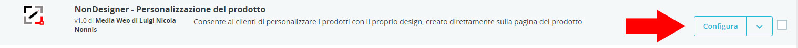

[← Indice](README.md) · Prossima pagina: [Configurazione del modulo →](configurazione-modulo.md)

# Come installare il modulo NonDesigner su PrestaShop

**NonDesigner** è un modulo PrestaShop che permette ai clienti di personalizzare i prodotti online con un disegnatore grafico 2D integrato nel frontend del negozio e genera, per ogni ordine, file SVG vettoriali e PNG 1:1 pronti per la stampa. Questa pagina descrive i requisiti di sistema, la compatibilità con le versioni di PrestaShop e la procedura di installazione.

## Con quali versioni di PrestaShop e PHP è compatibile NonDesigner?

- **Versioni PrestaShop compatibili:** da v1.7.6.1 fino a v8.x e v9.x
- **Versioni PHP supportate:** da PHP 7.2 a PHP 8.5
- **Estensioni PHP richieste:** GD Library, cURL, Zip, SimpleXML
- **Direttive server consigliate:** `upload_max_filesize` ≥ 10M e `post_max_size` ≥ 10M

> Le direttive `upload_max_filesize` e `post_max_size` limitano in ultima istanza la dimensione delle immagini che i clienti possono caricare nel disegnatore. Vedi [Dimensione massima immagine utente](configurazione-modulo.md#2-dimensione-massima-immagine-utente-mb).

## Come installare NonDesigner passo dopo passo

1. Accedi al Back Office di PrestaShop.
2. Vai in **Pannello di controllo → Gestione Moduli → Gestione Moduli**.
3. Clicca sul pulsante **Carica un modulo** in alto a destra.
4. Trascina o seleziona il file `.zip` del modulo NonDesigner scaricato da PrestaShop Addons.
5. Attendi il completamento dell'installazione e clicca su **Configura**.

## NonDesigner richiede l'attivazione di una licenza?

No. Il modulo **non richiede alcuna attivazione di licenza**: una volta installato e configurato, è immediatamente operativo.

## Dove si trovano le impostazioni del modulo dopo l'installazione?

**Pannello di controllo → Gestione moduli → NonDesigner → Configura**

Tutte le impostazioni del modulo supportano il **Multinegozio** nativo di PrestaShop: puoi avere regole diverse (per esempio giorni di pulizia o pannelli attivi) per ogni negozio o gruppo di negozi, selezionando lo shop dal selettore in alto a destra. Se per un negozio non imposti un valore, viene usato automaticamente il valore globale ereditato.

## Cosa fare prima di installare?

Esegui un **backup dei file del server e del database** prima di installare il modulo e, se possibile, installalo prima su un **server di test** per fare le tue prove. L'installazione avviene a tua responsabilità: gli sviluppatori non rispondono di eventuali effetti negativi durante l'installazione.

## Prossimi passi

1. [Configura le impostazioni globali del modulo](configurazione-modulo.md)
2. [Configura il disegnatore su un prodotto](configurazione-prodotto.md)
3. In caso di problemi consulta le [FAQ](faq.md)
