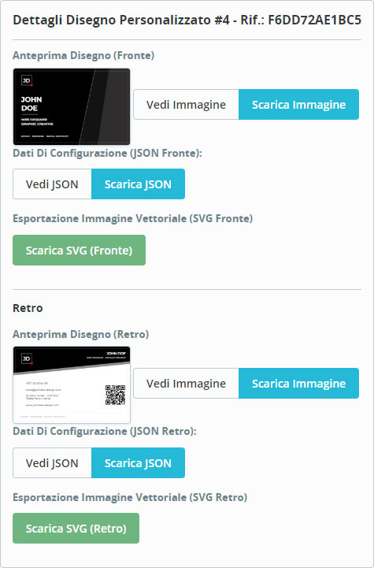

[← Indice](README.md) · [← Dimensioni di stampa](dimensioni-prodotto.md) · Prossima pagina: [Prezzi e varianti →](prezzi-e-varianti.md)

# Come gestire gli ordini e scaricare i file SVG pronti per la stampa con NonDesigner

Per ogni ordine con prodotti personalizzati, **NonDesigner** genera i file di stampa (**SVG vettoriale** e **PNG in scala 1:1**) e li rende disponibili direttamente nel dettaglio ordine del Back Office di PrestaShop.

**Percorso:** Pannello di controllo → Ordini → Dettaglio ordine

La gestione dei prodotti personalizzati è integrata nella pagina di dettaglio dell'ordine.

## Come vedere il design del cliente nel Back Office?

- Il modulo carica i dettagli della personalizzazione in modo **asincrono** nella tabella dei prodotti dell'ordine, sostituendo un marcatore temporaneo. Durante il caricamento vedi un indicatore con la dicitura di caricamento.
- Se i file immagine o i dati di configurazione **non sono disponibili sul server**, compare un avviso testuale **in rosso**.

> **Email di conferma ordine:** i file grafici generati dal modulo **non vengono mostrati direttamente** nelle email di conferma d'ordine. Nel riepilogo via email viene inserito un testo di cortesia che indica la presenza di un design personalizzato, consultabile nella cronologia ordini dell'account cliente.

## Quali informazioni mostra il dettaglio della personalizzazione?

- Ogni design mostra il proprio **ID univoco** e, se presente, il **nome di riferimento** assegnato alla configurazione.
- Per prodotti con stampa multipla o **fronte/retro**, l'interfaccia mostra una sezione per il **Fronte** e una separata per il **Retro**.
- **Anteprima grafica:** clicca **Visualizza Immagine**. Puoi salvarla in alta risoluzione con il pulsante blu **Scarica Immagine**.
- **Dati tecnici (JSON):** il modulo salva i parametri esatti della personalizzazione in un file **JSON**. Puoi aprirlo in una nuova finestra del browser (formattato e leggibile) oppure scaricarlo.

## Come esportare il file SVG vettoriale per la stampa?

1. Nel dettaglio ordine, individua la facciata (Fronte o Retro) da esportare.
2. Clicca il pulsante verde **Scarica SVG**. Passando il cursore sopra il pulsante vedi le **dimensioni esatte di stampa in centimetri**.
3. Al clic l'interfaccia disabilita temporaneamente i comandi e mostra un indicatore di attesa con una notifica a schermo.
4. Il file `.svg` viene calcolato dinamicamente a partire dai dati JSON salvati sul server e **scaricato automaticamente** al termine.

### Con quale programma si apre il file SVG?

Si consiglia **Inkscape** (programma gratuito): permette anche di esportare il file nei formati compatibili con altri programmi di grafica.

## Sicurezza e gestione errori nel Multinegozio

- In infrastrutture **Multinegozio** un controllo verifica sempre che il design visualizzato appartenga al **negozio attivo** nel contesto corrente.
- Se viene rilevato un tentativo di esportare o visualizzare un progetto di **un altro negozio**, l'operazione viene bloccata e compare l'avviso **"Accesso Negato"**.
- L'amministratore può **eliminare definitivamente** i file del design e i relativi dati di personalizzazione.
- Qualsiasi problema tecnico nel recupero dei dati (assenza di connessione di rete, file mancanti) genera subito notifiche di errore visibili nel Back Office.

---

Prossima pagina: [Prezzi e varianti →](prezzi-e-varianti.md) · Problemi? Vai alle [FAQ](faq.md).
