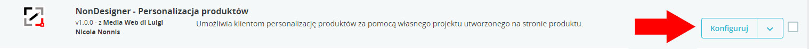

[← Indeks](README.md) · Następna strona: [Konfiguracja modułu →](konfiguracja-modulu.md)

# Jak zainstalować moduł NonDesigner w PrestaShop

**NonDesigner** to moduł PrestaShop, który umożliwia klientom personalizację produktów online za pomocą kreatora graficznego 2D zintegrowanego z frontendem sklepu i generuje dla każdego zamówienia wektorowe pliki SVG oraz PNG 1:1 gotowe do druku. Ta strona opisuje wymagania systemowe, kompatybilność z wersjami PrestaShop oraz procedurę instalacji.

## Z jakimi wersjami PrestaShop i PHP jest kompatybilny NonDesigner?

- **Kompatybilne wersje PrestaShop:** od v1.7.6.1 do v8.x i v9.x
- **Obsługiwane wersje PHP:** od PHP 7.2 do PHP 8.5
- **Wymagane rozszerzenia PHP:** GD Library, cURL, Zip, SimpleXML
- **Zalecane dyrektywy serwera:** `upload_max_filesize` ≥ 10M i `post_max_size` ≥ 10M

> Dyrektywy `upload_max_filesize` i `post_max_size` ostatecznie ograniczają rozmiar obrazów, które klienci mogą przesyłać w kreatorze. Zobacz [Maksymalny rozmiar obrazu użytkownika](konfiguracja-modulu.md#2-maksymalny-rozmiar-obrazu-użytkownika-mb).

## Jak zainstalować NonDesigner krok po kroku

1. Zaloguj się do panelu administracyjnego PrestaShop.
2. Przejdź do **Panel Sterowania → Menedżer Modułów → Menedżer Modułów**.
3. Kliknij przycisk **Prześlij moduł** w prawym górnym rogu.
4. Przeciągnij i upuść lub wybierz plik `.zip` modułu NonDesigner pobrany z PrestaShop Addons.
5. Poczekaj na zakończenie instalacji i kliknij **Konfiguruj**.

## Czy NonDesigner wymaga aktywacji licencji?

Nie. Moduł **nie wymaga żadnej aktywacji licencji**: po zainstalowaniu i skonfigurowaniu jest natychmiast gotowy do użytku.

## Gdzie znajdują się ustawienia modułu po instalacji?

**Panel Sterowania → Menedżer Modułów → NonDesigner → Konfiguruj**

Wszystkie ustawienia modułu obsługują natywną funkcję **Multistore** PrestaShop: możesz ustawić różne reguły (np. dni czyszczenia lub aktywne panele) dla każdego sklepu lub grupy sklepów, wybierając sklep za pomocą selektora w prawym górnym rogu. Jeśli nie ustawisz wartości dla konkretnego sklepu, system automatycznie użyje odziedziczonej wartości globalnej.

## Co zrobić przed instalacją?

Wykonaj **kopię zapasową plików serwera i bazy danych** przed zainstalowaniem modułu i, jeśli to możliwe, najpierw zainstaluj go na **serwerze testowym**, aby przeprowadzić własne testy. Instalacja odbywa się na Twoją odpowiedzialność: nie ponosi się żadnej odpowiedzialności za ewentualne negatywne skutki podczas instalacji.

## Kolejne kroki

1. [Skonfiguruj globalne ustawienia modułu](konfiguracja-modulu.md)
2. [Skonfiguruj kreator przy produkcie](konfiguracja-produktu.md)
3. W razie problemów zajrzyj do [FAQ](faq.md)
