[← Indeks](README.md) · [← Instalacja](instalacja.md) · Następna strona: [Konfiguracja produktu →](konfiguracja-produktu.md)

# Jak skonfigurować moduł NonDesigner: ustawienia globalne (po stronie modułu)

Ta strona opisuje globalne ustawienia modułu **NonDesigner** dla PrestaShop, podzielone na cztery zakładki: **Ogólne**, **Zarządzanie kształtami**, **Zarządzanie czcionkami** i **Konfiguracja narzędzi**.

**Ścieżka:** Panel Sterowania → Menedżer Modułów → NonDesigner → Konfiguruj

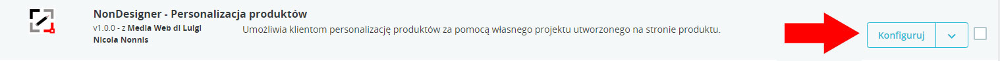

> **Multistore:** wszystkie ustawienia obsługują natywną funkcję Multistore PrestaShop. Możesz ustawić różne reguły dla każdego sklepu lub grupy sklepów, wybierając sklep za pomocą selektora w prawym górnym rogu. Jeśli nie ustawisz wartości dla konkretnego sklepu, używana jest odziedziczona wartość globalna.

**Na tej stronie**

- [Zakładka Ogólne](#zakładka-ogólne)
- [Zakładka Zarządzanie kształtami](#zakładka-zarządzanie-kształtami)
- [Zakładka Zarządzanie czcionkami](#zakładka-zarządzanie-czcionkami)
- [Zakładka Konfiguracja narzędzi](#zakładka-konfiguracja-narzędzi)

---

## Zakładka Ogólne

Zakładka **Ogólne** obejmuje diagnostykę (rejestrowanie zdarzeń), ograniczenia dotyczące plików przesyłanych przez klientów oraz uprawnienia do pobierania plików projektu we frontendzie.

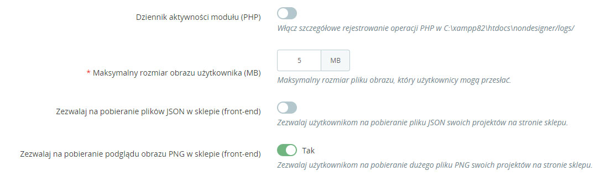

### 1. Rejestr aktywności modułu

Przełącznik (Tak/Nie), który włącza lub wyłącza szczegółowe rejestrowanie operacji PHP wykonywanych przez moduł. Gdy jest włączony, pliki dziennika zapisywane są w folderze `/logs/` w katalogu głównym (`_PS_ROOT_DIR_`) Twojej witryny PrestaShop.

**Wskazówka:** w normalnym trybie działania pozostaw **Nie**, aby nie obciążać serwera. Włącz wyłącznie w przypadku problemów, gdy Twój deweloper musi zdiagnozować błędy.

### 2. Maksymalny rozmiar obrazu użytkownika (MB)

Określa maksymalny rozmiar plików graficznych, które użytkownicy mogą przesyłać w kreatorze.

- Wartość podaje się w megabajtach (MB) i jest obowiązkowa.
- Musi być liczbą dodatnią większą od zera (np. 2 lub 5); w przeciwnym razie system wyświetli błąd i uniemożliwi zapisanie.

> **Ważne:** rzeczywisty limit zależy ostatecznie od ograniczeń Twojego serwera hostingowego (`upload_max_filesize` i `post_max_size` w pliku `php.ini`). Jeśli ustawisz w module wartość (np. 10 MB) wyższą niż limit serwera (np. 2 MB), serwer nadal będzie blokować przesyłanie plików powyżej 2 MB. Wprowadź wartość równą lub niższą niż pozwala Twój pakiet hostingowy.

### 3. Zezwól na pobieranie pliku JSON we Frontendzie

Przełącznik (Tak/Nie): jeśli jest włączony, klient znajdzie we frontendzie przycisk umożliwiający pobranie pliku **JSON** z surowymi danymi struktury jego projektu graficznego.

### 4. Zezwól na pobieranie podglądu PNG we Frontendzie

Przełącznik (Tak/Nie): jeśli jest włączony, klient może pobrać obraz **PNG w skali 1:1** właśnie utworzonego projektu. Jakość tego podglądu **nie jest odpowiednia do druku profesjonalnego**: pliki do druku pobiera się z panelu administracyjnego (zobacz [Zamówienia i eksport SVG](zamowienia-i-eksport-svg.md)).

---

## Zakładka Zarządzanie kształtami

Tutaj zarządzasz kształtami geometrycznymi lub wektorowymi, które użytkownicy mogą wstawiać do swoich projektów. Kształty w pełni obsługują Multistore: każdy sklep ma własny, dedykowany folder.

### Jak przesłać nowe kształty do NonDesigner?

Kliknij przycisk przesyłania. System akceptuje **wyłącznie pliki `.svg`**. Ze względów bezpieczeństwa moduł **automatycznie oczyszcza** przesłane pliki SVG, usuwając szkodliwe znaczniki i atrybuty.

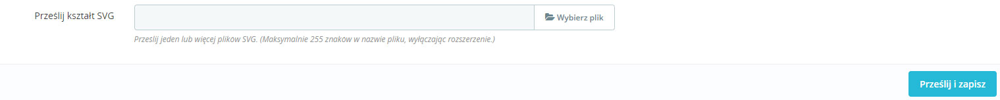

### Jak zmienić kolejność kształtów w kreatorze?

Przeciągaj wiersze tabeli w górę lub w dół (przeciągnij i upuść): kolejność określa, jak kształty pojawiają się w panelu kształtów kreatora klienta. Pozycja jest zapisywana automatycznie.

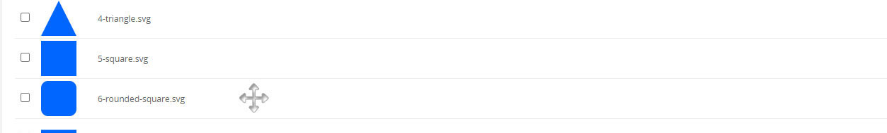

### Jak aktywować lub dezaktywować kształt?

Kliknij zieloną ikonę / czerwony znak X, aby tymczasowo ukryć kształt bez jego usuwania. Możesz też zaznaczyć wiele kształtów polami wyboru i użyć opcji **Operacje masowe**, aby aktywować lub dezaktywować je jednocześnie.

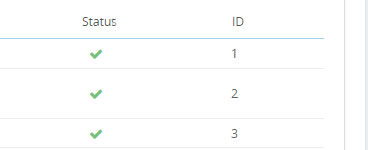

### Czy mogę usunąć kształty systemowe?

Kształty, które przesłałeś, można trwale usunąć. **Kształtów systemowych** (np. prostych kół i kwadratów) **nie można usunąć, a jedynie dezaktywować**, aby zapewnić podstawowe działanie modułu; jeśli spróbujesz je usunąć, pojawi się komunikat o błędzie.

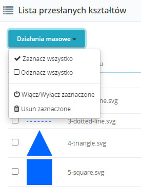

---

## Zakładka Zarządzanie czcionkami

Tutaj pobierasz, aktywujesz i usuwasz **czcionki** udostępniane klientom w kreatorze.

Aby zapewnić maksymalną wydajność ładowania we frontendzie i zachować zgodność z przepisami o ochronie danych (**RODO**), moduł **nie ładuje czcionek zewnętrznie w czasie rzeczywistym**: pobiera pliki czcionek (`.ttf`) bezpośrednio na Twój serwer hostingowy i udostępnia je lokalnie.

Ekran jest podzielony na dwa obszary: **Niepobrane czcionki** oraz **Pobrane czcionki (zainstalowane)**.

### Multistore i czcionki

- Pobrane czcionki i ich statusy aktywacji są **odizolowane dla każdego sklepu**.
- Gdy Multistore jest aktywny, pliki czcionek są organizowane na serwerze w dedykowanych podfolderach (np. `/fontfiles/1/`, `/fontfiles/2/`), co pozwala zdefiniować odrębny katalog czcionek dla każdego sklepu.

### Niepobrane czcionki (dostępny katalog)

Pokazuje czcionki z katalogu modułu, które nie znajdują się jeszcze na Twoim serwerze.

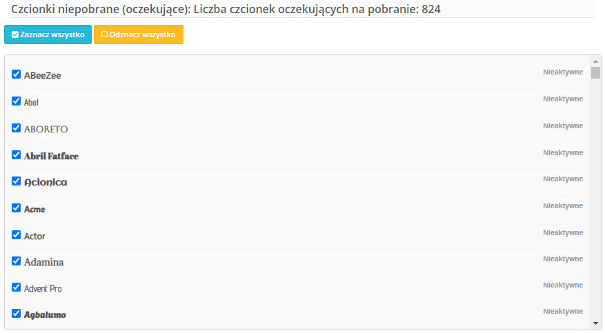

- **Dynamiczny podgląd i leniwe ładowanie:** podgląd nazwy czcionki wyświetla się dopiero wtedy, gdy czcionka pojawi się na ekranie, aby nie spowalniać strony.
- **Wybiórcze pobieranie:** zaznacz wybrane czcionki i kliknij **Pobierz zaznaczone**.
- **Pobieranie masowe:** kliknij **Rozpocznij pobieranie (Uruchom ponownie wszystko)**, aby pobrać cały katalog; system automatycznie zaznaczy wszystkie oczekujące czcionki.
- **Przerwania i błędy serwera:** podczas pobierania pasek postępu pokazuje aktualnie przetwarzaną czcionkę. W dowolnym momencie możesz kliknąć **Anuluj** (operacja zatrzyma się po zakończeniu bieżącej czcionki). W przypadku tymczasowego przeciążenia serwera (np. błędu HTTP 500) wykonana już praca nie zostanie utracona, a moduł spróbuje wznowić pobieranie od miejsca przerwania.

### Pobrane czcionki (zainstalowane)

Po pobraniu czcionki trafiają na listę zainstalowanych.

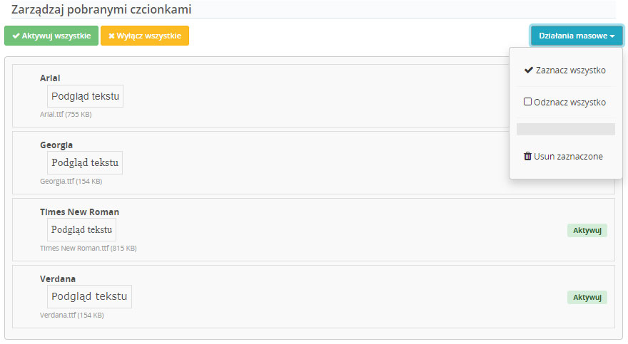

- **Prawdziwy lokalny podgląd:** generowany na podstawie pliku `.ttf` zapisanego na Twoim serwerze, wraz z nazwą pliku i rozmiarem w KB.
- **Indywidualna aktywacja:** aby udostępnić czcionkę klientom, kliknij jej przycisk statusu (**Nieaktywna** / **Aktywuj**). Nowo pobrane czcionki są **domyślnie wyłączone**.
- **Masowa aktywacja/dezaktywacja:** przyciski **Aktywuj wszystkie** / **Dezaktywuj wszystkie**.
- **Usuwanie:** zaznacz czcionki i kliknij **Usuń zaznaczone**; usuwany jest zarówno wpis w bazie danych, jak i plik z serwera, a czcionka wraca do listy „Niepobrane czcionki".
- **Chronione czcionki systemowe:** podstawowe czcionki wbudowane w moduł (ID 1, 2, 3, 4 lub oznaczone jako lokalne) nie mają pola wyboru i nie można ich usunąć.

> **Wydajność:** jednoczesna aktywacja dużej liczby czcionek może spowolnić ładowanie kreatora we frontendzie. Aktywuj wyłącznie niezbędne czcionki.

---

## Zakładka Konfiguracja narzędzi

Steruje interfejsem kreatora widzianym przez klientów, regułami dodawania do koszyka oraz konserwacją bazy danych (czyszczenie plików tymczasowych). Podzielona jest na cztery obszary, wraz z panelem czyszczenia ręcznego.

### 1. Ustawienia paneli

Włączaj lub wyłączaj całe zakładki kreatora klienta. Wyłączony panel całkowicie znika z interfejsu.

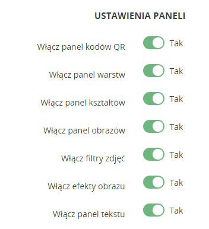

| Opcja | Funkcja |
|---|---|
| Aktywuj panel kodu QR | Umożliwia wygenerowanie i umieszczenie na produkcie spersonalizowanego kodu QR |
| Aktywuj panel warstw | Zarządzanie warstwami (przenoszenie na wierzch, wysyłanie na spód itp.) przy złożonych nakładających się elementach |
| Aktywuj panel kształtów | Wstawianie predefiniowanych kształtów (zarządzanych w zakładce „Zarządzanie kształtami") |
| Aktywuj panel obrazów | Klienci przesyłają własne zdjęcia lub logo ze swojego urządzenia |
| Aktywuj filtry zdjęć | Narzędzia do regulacji koloru i jasności oraz filtry dla przesłanych obrazów |
| Aktywuj efekty obrazu | Zaawansowane efekty graficzne dla przesłanych obrazów |
| Aktywuj panel tekstu | Wstawianie spersonalizowanych pól tekstowych na produkcie |

### 2. Ustawienia przycisków

Włączaj lub wyłączaj określone narzędzia transformacji, stosowane do pojedynczych elementów (tekstu lub obrazów) w obszarze roboczym.

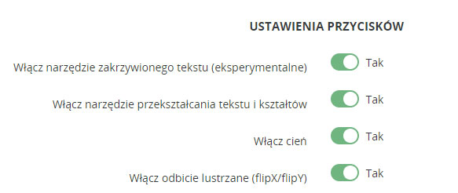

| Opcja | Funkcja |
|---|---|
| Włącz narzędzie tekstu zakrzywionego (eksperymentalne) | Rozmieszcza tekst wzdłuż zakrzywionej linii (np. dla okrągłych logo lub naszywek). Funkcja eksperymentalna: przetestuj ją przed aktywacją |
| Włącz narzędzie transformacji (Warp) | Swobodnie odkształca tekst i kształty (perspektywa, zniekształcenie) za pomocą dziesiątek transformacji |
| Włącz cień | Dodawanie i dostosowywanie cieni za elementami |
| Włącz odbicie lustrzane | Przyciski odbicia elementów w poziomie (Flip X) lub w pionie (Flip Y) |

### 3. Ustawienia projektu i koszyka

Reguły działania, gdy klient zapisuje projekt lub dodaje go do koszyka.

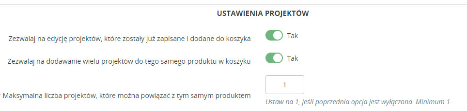

- **Zezwól na edycję już zapisanych i dodanych do koszyka projektów** – jeśli **Tak**, klient może kliknąć swój produkt w koszyku i wrócić do kreatora, aby poprawić błąd przed finalizacją zakupu.
- **Zezwól na dodanie wielu projektów do tego samego produktu w koszyku** – jeśli **Tak**, klient może wielokrotnie spersonalizować ten sam produkt różnymi projektami i dodać je do koszyka jako osobne pozycje.
- **Maksymalna liczba projektów, które można powiązać z tym samym produktem** – maksymalny limit różnych personalizacji tego samego artykułu (np. 5). Wartość minimalna: 1.

> Jeśli wyłączysz poprzednią opcję (**Nie**), to pole zniknie z interfejsu, a system wymusi limit **1**, aby uniknąć niepożądanych duplikatów.

### 4. Czyszczenie projektów z porzuconych koszyków

Klienci często zaczynają personalizować produkt, ale opuszczają witrynę bez finalizacji zamówienia. Te projekty (bez identyfikatora zamówienia) zajmują miejsce na serwerze: ta sekcja automatyzuje ich usuwanie.

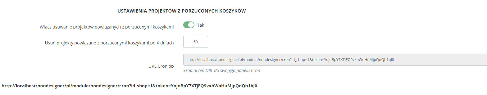

- **Włącz usuwanie projektów z porzuconych koszyków** – jeśli **Tak**, odblokowuje ustawienia czyszczenia i wyświetla panel czyszczenia ręcznego.
- **Usuń projekty po X dniach** – jak długo przechowywane są niezakupione projekty (domyślnie **30 dni**). Każda wartość poniżej 1 zostanie wymuszona na 30.
- **URL zadania Cron (automatyzacja)** – system generuje unikalny, bezpieczny adres z 32-znakowym tajnym tokenem. Skopiuj go do menedżera zadań Cron na serwerze (cPanel/Plesk), aby automatycznie usuwać stare pliki co noc lub co tydzień. Serwer musi wykonywać wywołanie HTTP GET (np. za pomocą `wget` lub `curl`).

### 5. Czyszczenie ręczne

Jeśli nie chcesz konfigurować zadania Cron, możesz wyczyścić projekty ręcznie.

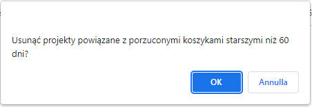

> Pole jest widoczne tylko wtedy, gdy włączono usuwanie projektów z porzuconych koszyków, i działa wyłącznie w obrębie konkretnego sklepu (nie w widoku „Wszystkie sklepy" przy Multistore).

1. Kliknij żółty przycisk **Usuń teraz**.
2. Potwierdź: „Czy chcesz usunąć projekty z porzuconych koszyków starsze niż [X] dni?".
3. Pojawi się pasek postępu.
4. Usuwanie odbywa się w tle w **partiach po 20 projektów**: serwer nie zablokuje się (przekroczenie limitu czasu) nawet przy tysiącach plików.
5. Poczekaj do 100%: otrzymasz zielony komunikat o sukcesie („Czyszczenie zakończone!") lub, jeśli nie ma nic do wyczyszczenia, niebieskie powiadomienie („Brak projektów do usunięcia").

---

Następna strona: [Jak skonfigurować kreator przy produkcie →](konfiguracja-produktu.md)
