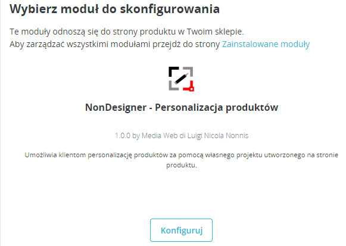
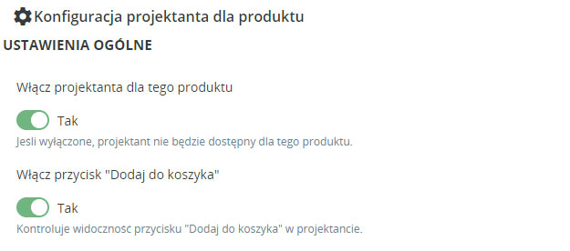
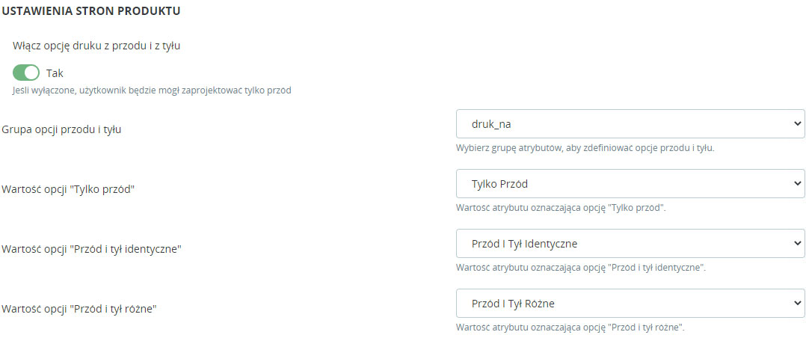
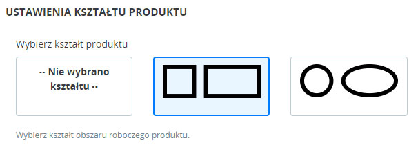
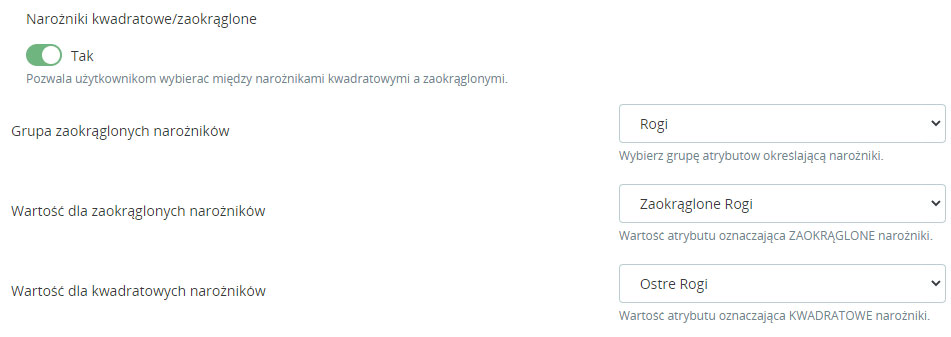
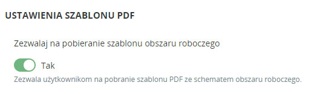
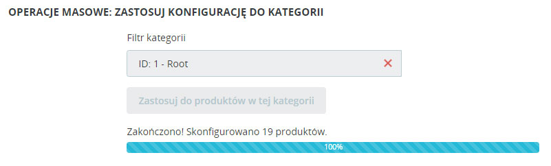

[← Indeks](README.md) · [← Konfiguracja modułu](konfiguracja-modulu.md) · Następna strona: [Wymiary druku →](wymiary-produktu.md)

# Jak skonfigurować kreator NonDesigner przy produkcie PrestaShop

Po skonfigurowaniu [modułu na poziomie globalnym](konfiguracja-modulu.md) kreator **NonDesigner** konfiguruje się produkt po produkcie. Ta strona opisuje aktywację, druk przód/tył, kształt produktu, szablon PDF oraz masowe zastosowanie konfiguracji do całej kategorii.

**Ścieżka:** Panel Sterowania → Katalog → Produkty → Edytuj/dodaj produkt → Moduły → NonDesigner → Konfiguruj

## Ustawienia ogólne

### Jak włączyć kreator dla produktu?

Włącz opcję **Włącz kreator dla tego produktu**. Jeśli jest wyłączona, produkt zachowuje się jak zwykły artykuł w katalogu.

> Warto zostawić ją **wyłączoną** podczas przygotowywania konfiguracji, która ma zostać [skopiowana masowo do innych produktów](#jak-zastosować-konfigurację-do-wszystkich-produktów-kategorii): dzięki temu możesz sprawdzić poprawność konfiguracji każdego produktu przed aktywacją kreatora.

### Co robi opcja Włącz przycisk „Dodaj do koszyka"?

Kontroluje widoczność przycisku „Dodaj do koszyka" **w interfejsie kreatora**. Gdy użytkownik zapisze projekt, odpowiadający mu produkt zostaje **automatycznie dodany do koszyka**.

- **Ukryj** przycisk, jeśli chcesz **zmusić** klienta do powiązania projektu z produktem.
- **Zostaw go widocznym**, jeśli chcesz umożliwić zakup produktu także **bez** powiązanego projektu (zobacz [produkt neutralny „Bez druku"](ceny-i-warianty.md#a-jak-sprzedawać-także-produkt-neutralny-bez-druku)).

## Jak skonfigurować druk przód/tył?

- **Włącz opcję druku dwustronnego:** jeśli jest wyłączona, klient może personalizować wyłącznie **przód** produktu.
- Jeśli aktywujesz przód/tył, pojawią się nowe pola mapowania:
  - **Grupa opcji przód/tył:** grupa atrybutów, która definiuje warianty druku.
  - **Mapowanie wartości:** po wybraniu grupy wskaż, która wartość odpowiada **Tylko przód**, która **Identyczny przód/tył**, a która **Różny przód/tył**.

Pola mapowania wartości wypełniają się automatycznie na podstawie wybranej grupy. Aby zarządzać dopłatami za te warianty, zobacz [Ceny i warianty](ceny-i-warianty.md).

## Wymiary produktu

Szerokość i wysokość obszaru druku ustawia się trzema metodami (wymiary stałe, odrębne atrybuty, połączone wartości Sz x W) oraz marginesem spadu. To najbardziej wrażliwe ustawienie, dlatego ma własną stronę → [Jak ustawić wymiary druku](wymiary-produktu.md).

## Kształt produktu

Definiuje wizualną maskę produktu, czyli obszar edytowalny.

### Jak wybrać kształt produktu?

W polu **Wybierz kształt produktu** wskaż kształt podstawowy: **kwadratowy/prostokątny** lub **okrągły/owalny**.

### Jak skonfigurować zaokrąglone rogi?

Przełącznik **Rogi ostre/zaokrąglone** jest widoczny tylko przy **kształcie kwadratowym/prostokątnym**; przy kształcie okrągłym/owalnym opcja jest wymuszona i ukryta jako „Nie".

Jeśli ją włączysz (**Tak**), musisz przypisać **Grupę zaokrąglonych rogów** i wskazać, które wartości atrybutu odpowiadają **Zaokrąglonym rogom**, a które **Ostrym rogom**.

## Szablon PDF obszaru rysowania

**Zezwól na pobieranie szablonu obszaru rysowania:** jeśli opcja jest włączona, użytkownicy mogą pobrać układ **PDF** obszaru roboczego w **skali 1:1 i rozdzielczości 300 dpi**, w wymiarach wybranych w zakładce produktu.

> Opcja jest widoczna wyłącznie wtedy, gdy wcześniej wybrano prawidłowy **Kształt produktu**.

## Jak zastosować konfigurację do wszystkich produktów kategorii?

Funkcja **Operacje masowe** umożliwia wybranie kategorii (przez wpisanie jej nazwy lub identyfikatora w polu wyszukiwania) i **rekurencyjne** zastosowanie konfiguracji bieżącego produktu do produktów tej kategorii oraz jej podkategorii.

> Dostępne tylko wtedy, gdy bieżący produkt ma **prawidłową i zapisaną konfigurację kreatora**.

---

Następna strona: [Jak ustawić wymiary druku →](wymiary-produktu.md)
