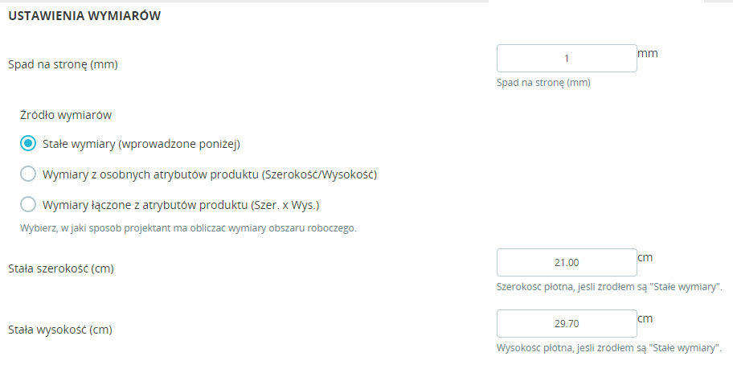
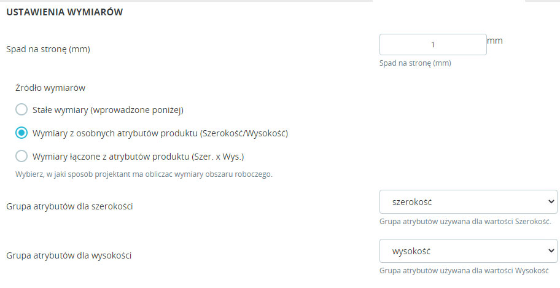
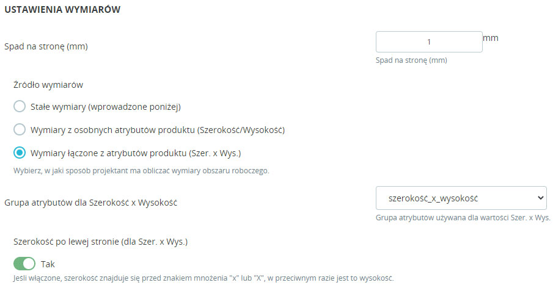

[← Indeks](README.md) · [← Konfiguracja produktu](konfiguracja-produktu.md) · Następna strona: [Zamówienia i eksport SVG →](zamowienia-i-eksport-svg.md)

# Jak ustawić wymiary druku produktu w NonDesigner

Wymiary obszaru druku produktu wyraża się za pomocą **szerokości** i **wysokości** w **centymetrach**. W **NonDesigner** (module PrestaShop) możesz je uzyskać na trzy sposoby, plus margines spadu.

**Ścieżka:** Katalog → Produkty → Edytuj produkt → Moduły → NonDesigner → Konfiguruj → *Ustawienia rozmiaru*

**Na tej stronie**

- [Co oznaczają atrybut i kombinacja](#co-oznaczają-atrybut-i-kombinacja)
- [Którą metodę wybrać](#którą-metodę-obliczania-rozmiaru-wybrać)
- [Margines spadu](#1-margines-spadu-na-stronę-mm)
- [Metoda 2: wymiary stałe](#2-wymiary-stałe)
- [Metoda 3: odrębne atrybuty](#3-wymiary-wynikające-z-odrębnych-atrybutów-produktu-szerokośćwysokość)
- [Metoda 4: połączone wartości Sz x W](#4-wymiary-wynikające-z-połączonych-wartości-sz-x-w-w-jednym-atrybucie)

## Co oznaczają atrybut i kombinacja

**Atrybut** to cecha, która tworzy warianty produktu (np. grupa atrybutów „Rozmiar" z wartościami „50x70 cm", „70x100 cm"…). **Kombinacja** to połączenie atrybutów, które klient wybiera przed zakupem (np. Rozmiar: 50x70 cm + Kolor: Czerwony).

Jeśli Twój produkt **nie ma skonfigurowanych wariantów/atrybutów**, nie możesz użyć metod 3 i 4: wybierz **Wymiary stałe** (metoda 2).

## Którą metodę obliczania rozmiaru wybrać

| Sytuacja | Metoda |
|---|---|
| Produkt ma zawsze taki sam wymiar we wszystkich wariantach (np. zawsze 50x70 cm) | **Wymiary stałe** |
| Szerokość i wysokość są dwoma odrębnymi atrybutami (dwie listy rozwijane) | **Odrębne atrybuty** |
| Szerokość i wysokość są zapisane razem w jednym atrybucie (np. wariant „50x70") | **Połączone wartości (Sz x W)** |

Z wyjątkiem metody „Wymiary stałe" **wybór grupy atrybutów jest obowiązkowy**: jeśli pozostanie pusty, nie będzie można zapisać konfiguracji i na ekranie pojawi się ostrzeżenie.

---

## 1. Margines spadu na stronę (mm)

> **W skrócie:** jeśli nie masz pewności, co wybrać, zapytaj swojego dostawcę usług drukarskich o zalecaną wartość (zazwyczaj 2-3 mm) i wprowadź ją tutaj. Służy ona wyłącznie do uniknięcia niepożądanych białych marginesów po przycięciu.

To pojedyncze pole tekstowe, **zawsze widoczne** niezależnie od wybranej metody, reprezentujące margines spadu dodawany po **każdej stronie** obszaru druku, w **milimetrach**.

### Do czego służy margines spadu

Gdy projekt jest drukowany na większym arkuszu, a następnie przycinany do ostatecznego rozmiaru (wizytówki, naklejki, plakaty, tablice itp.), przycinanie nigdy nie jest dokładne co do milimetra. Jeśli tło lub obraz sięga dokładnie do krawędzi użytecznego obszaru, a cięcie przesunie się choćby nieznacznie, na krawędzi pojawi się cienki pasek **niezadrukowanego białego papieru**: wyraźna wada estetyczna, uznawana za błąd druku.

Margines spadu rozszerza tło i obrazy o kilka milimetrów po każdej stronie poza rzeczywistą krawędź produktu. Plik do druku jest większy niż format końcowy: nawet przy niewielkim przesunięciu cięcie zawsze mieści się w wystającym, nadal zadrukowanym obszarze.

Typowa wartość mieści się w zakresie od **1 do 5 mm na stronę**, w zależności od typu produktu, materiału i tolerancji maszyny tnącej drukarni. Kreator **automatycznie** rozszerza tło poza nominalne wymiary, bez konieczności zajmowania się tym przez użytkownika końcowego.

### Jaki format akceptuje pole?

Walidacja jest rygorystyczna i **blokuje zapisanie**, jeśli format jest nieprawidłowy:

- Wyłącznie **dodatnie liczby całkowite** (cyfry 0-9): `0`, `5`, `12`, `100`.
- **Bez miejsc dziesiętnych**: ani kropka, ani przecinek.
- **Bez znaku**: wartości ujemne nie są dozwolone.
- Pole można pozostawić **puste**: zostanie zapisane jako `0` (brak marginesu spadu).

> **Błąd blokujący:** wartości takie jak `5.5`, `5,5`, `-5`, `5mm`, `abc` uniemożliwiają zapisanie całej karty produktu i wyświetlają wyraźny komunikat o błędzie.

---

## 2. Wymiary stałe

> **W skrócie:** wybierz tę metodę, jeśli produkt ma zawsze taki sam wymiar we wszystkich wariantach: wprowadź obie liczby jednorazowo, bez wiązania atrybutów.

Wyświetlają się dwa pola wprowadzania (szerokość i wysokość), w których można wpisywać wyłącznie liczby.

### Jaki format akceptują wymiary stałe?

Wartość **nie jest interpretowana ani oczyszczana**: zostaje bezpośrednio przekształcona w liczbę dziesiętną tak, jak została wprowadzona.

- Separator dziesiętny: **kropka** (`.`) lub **przecinek** (`,`). Prawidłowe przykłady: `50`, `50.5`, `120.75`, `50,5`, `120,75`.
- Przecinek jest **automatycznie zamieniany na kropkę** podczas zapisywania (`50,5` → `50.5`).
- Bez jednostek miary, spacji ani symboli: `50 cm` zostałoby zapisane jako `50`, ale nie jest to zalecane.
- Szerokość i wysokość są **obowiązkowe** i muszą być **większe od zera** (> 0,01 cm); w przeciwnym razie zapisanie zostanie zablokowane.

> Ponieważ jest to najbardziej rygorystyczna metoda (brak automatycznego wyodrębniania z tekstu lub symboli), wprowadzaj **wyłącznie liczby z opcjonalną kropką dziesiętną** (np. `45`, `45.5`).

---

## 3. Wymiary wynikające z odrębnych atrybutów produktu (szerokość/wysokość)

> **W skrócie:** wybierz tę metodę, jeśli szerokość i wysokość są dwoma odrębnymi atrybutami (np. lista rozwijana dla szerokości i osobna dla wysokości): system automatycznie odczyta liczbę z każdego z nich.

Wyświetlają się dwa pola wyboru (szerokość i wysokość), z których każde zawiera listę grup atrybutów będących częścią kombinacji produktu.

### Jak odczytywane są wartości?

Po wybraniu grup atrybutów dla szerokości i wysokości system odczytuje wartość/nazwę każdego atrybutu kombinacji wybranej przez klienta i **automatycznie wyodrębnia liczbę**, usuwając tekst, jednostki i symbole, **pod warunkiem że wartość zawiera tylko jedną liczbę**.

| Wartość atrybutu (przykład) | Odczytana wartość |
|---|---|
| `50` | 50 |
| `50 cm` | 50 |
| `50cm` | 50 |
| `W: 50 cm` | 50 |
| `Wysokość 50 cm` | 50 |
| `50.5` / `50.5 cm` | 50.5 |
| `50,5` / `50,5 cm` | 50.5 |

Zarówno kropka, jak i przecinek są akceptowane jako separator dziesiętny.

### Jakich wartości atrybutów unikać?

> **Podstawowa zasada:** każda wartość atrybutu musi zawierać **tylko jedną liczbę**. Jeśli zawiera więcej niż jedną (kod, numeryczny rozmiar, dwa wymiary), odczytana wartość jest nieprzewidywalna i z dużym prawdopodobieństwem nieprawidłowa, **bez zgłoszenia żadnego błędu**.

| Wartość atrybutu (nieprawidłowa) | Odczytana wartość | Problem |
|---|---|---|
| `50x70` | 5070 | obie liczby łączą się w jedną |
| `Model X200, 50 cm` | 200.50 | obie liczby łączą się, tworząc nieprawidłowe miejsca dziesiętne |
| `1.234 cm` (tysiące) | 1.234 | interpretowane jako „1 przecinek 234" zamiast „1234" |
| `-50 cm` | 50 | znak ujemny jest ignorowany |

**Zalecenie:** nazwa/wartość każdego atrybutu w wybranej grupie (zarówno dla szerokości, jak i wysokości) powinna zawierać **wyłącznie liczbę wymiaru**, opcjonalnie z towarzyszącym tekstem lub jednostką miary, **ale nigdy z innymi liczbami**.

---

## 4. Wymiary wynikające z połączonych wartości (Sz x W) w jednym atrybucie

> **W skrócie:** wybierz tę metodę, jeśli szerokość i wysokość są zapisane razem w jednym atrybucie (np. wariant nazywa się `50x70`): system samodzielnie rozdzieli obie liczby, pod warunkiem że są w prawidłowym formacie.

Wyświetla się jedno pole wyboru, z którego odczytywane są zarówno szerokość, jak i wysokość.

### Jak to działa?

System wyszukuje w wartości atrybutu **dwie liczby oddzielone znakiem „x"** (lub równoważnym symbolem) i przypisuje je do szerokości i wysokości zgodnie z kolejnością ustaloną w opcji **Pozycja szerokości**.

### Jakie separatory są prawidłowe?

Separatorem między dwiema liczbami musi być jeden z następujących znaków:

- `x` (mała litera)
- `X` (wielka litera)
- `*` (gwiazdka)

| Wartość atrybutu (przykład) | 1. wartość | 2. wartość |
|---|---|---|
| `50x70` | 50 | 70 |
| `50X70` | 50 | 70 |
| `50*70` | 50 | 70 |
| `50 x 70` | 50 | 70 |
| `50 x 70 cm` | 50 | 70 |
| `50cm x 70cm` | 50 | 70 |
| `Sz: 50 x W: 70 cm` | 50 | 70 |
| `50,5 x 70,2` | 50.5 | 70.2 |
| `50.5x70.2` | 50.5 | 70.2 |

Kropka i przecinek są akceptowane jako separator dziesiętny dla każdej z dwóch liczb.

### Jakie formaty NIE są rozpoznawane?

> Poniższe formaty dają w wyniku szerokość i wysokość równe **0 / 0**, **bez żadnego komunikatu o błędzie** widocznego dla użytkownika.

| Wartość atrybutu (nieprawidłowa) | Wynik | Problem |
|---|---|---|
| `50-70` | 0 / 0 | myślnik nie jest prawidłowym separatorem |
| `50 / 70` | 0 / 0 | ukośnik nie jest prawidłowym separatorem |
| `50×70` (symbol ×) | 0 / 0 | należy użyć litery x, a nie symbolu × |
| `50 na 70` | 0 / 0 | należy użyć litery x, a nie słowa „na" |
| `Rozmiar uniwersalny` | 0 / 0 | brak jakiejkolwiek liczby |
| `70 cm` (pojedyncza wartość) | 0 / 0 | brakuje drugiej liczby i/lub separatora |

### Co się stanie przy więcej niż dwóch wymiarach?

Przy trzech lub więcej liczbach (np. `50x70x30`, aby uwzględnić głębokość) **odczytane zostaną tylko dwa pierwsze wymiary** (50 i 70); trzecia wartość jest ignorowana.

**Zalecenie:** każdy atrybut w wybranej grupie musi zawierać **dokładnie dwie liczby**, oddzielone wyłącznie znakiem `x`, `X` lub `*` (np. `50x70 cm`, `50,5 X 70,2`), unikając myślników, ukośników, symbolu × lub tekstowych opisów separatora.

---

Jeśli wymiary wyświetlają się jako 0 / 0 we frontendzie, zajrzyj do [FAQ](faq.md#wymiary-produktu-są-odczytywane-jako-0--0-we-frontendzie-jak-to-rozwiązać).

Następna strona: [Zamówienia i eksport SVG →](zamowienia-i-eksport-svg.md)
