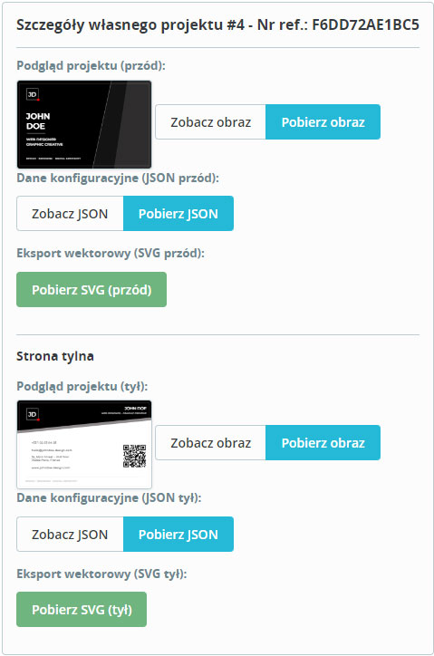

[← Indeks](README.md) · [← Wymiary druku](wymiary-produktu.md) · Następna strona: [Ceny i warianty →](ceny-i-warianty.md)

# Jak zarządzać zamówieniami i pobierać pliki SVG gotowe do druku w NonDesigner

Dla każdego zamówienia ze spersonalizowanymi produktami **NonDesigner** generuje pliki do druku (**wektorowy SVG** i **PNG w skali 1:1**) i udostępnia je bezpośrednio na stronie szczegółów zamówienia w panelu administracyjnym PrestaShop.

**Ścieżka:** Panel Sterowania → Zamówienia → Szczegóły zamówienia

Zarządzanie spersonalizowanymi produktami jest zintegrowane ze stroną szczegółów zamówienia.

## Jak zobaczyć projekt klienta w panelu administracyjnym?

- Moduł ładuje szczegóły personalizacji **asynchronicznie** w tabeli produktów zamówienia, zastępując tymczasowy element zastępczy. Podczas ładowania danych zobaczysz komunikat o ładowaniu.
- Jeśli pliki graficzne lub dane konfiguracyjne **nie są dostępne na serwerze**, wyświetla się **czerwone** ostrzeżenie tekstowe.

> **E-maile z potwierdzeniem zamówienia:** pliki graficzne generowane przez moduł **nie są wyświetlane bezpośrednio** w wiadomościach e-mail z potwierdzeniem zamówienia. Podsumowanie e-maila zawiera tekst informacyjny wskazujący na obecność spersonalizowanego projektu, dostępnego do przeglądania w historii zamówień konta klienta.

## Jakie informacje pokazują szczegóły personalizacji?

- Każdy projekt pokazuje swój unikalny **identyfikator** oraz, jeśli istnieje, **nazwę referencyjną** przypisaną do konfiguracji.
- Dla produktu z wielokrotnym drukiem lub **drukiem dwustronnym** interfejs pokazuje osobny obszar dla **Przodu** i dla **Tyłu**.
- **Podgląd graficzny:** kliknij **Wyświetl obraz**. Możesz go zapisać w wysokiej rozdzielczości niebieskim przyciskiem **Pobierz obraz**.
- **Dane techniczne (JSON):** moduł zapisuje dokładne parametry personalizacji w pliku **JSON**. Możesz otworzyć go w nowym oknie przeglądarki (sformatowany i czytelny) lub pobrać.

## Jak wyeksportować wektorowy plik SVG do druku?

1. W szczegółach zamówienia znajdź stronę (Przód lub Tył), którą chcesz wyeksportować.
2. Kliknij zielony przycisk **Pobierz SVG**. Po najechaniu kursorem na przycisk zobaczysz **dokładne wymiary druku w centymetrach**.
3. Po kliknięciu interfejs tymczasowo dezaktywuje elementy sterujące i wyświetla wskaźnik oczekiwania wraz z powiadomieniem na ekranie.
4. Plik `.svg` jest obliczany dynamicznie na podstawie danych JSON zapisanych na serwerze i **pobierany automatycznie** po zakończeniu operacji.

### Jakim programem otworzyć plik SVG?

Polecamy **Inkscape** (darmowy program): umożliwia też wyeksportowanie pliku do formatów zgodnych z innymi programami graficznymi.

## Bezpieczeństwo i obsługa błędów w Multistore

- W środowiskach **Multistore** system kontroli zawsze sprawdza, czy wyświetlany projekt należy do **sklepu aktywnego w danym kontekście**.
- Jeśli wykryta zostanie próba wyeksportowania lub wyświetlenia projektu należącego do **innego sklepu**, operacja zostaje zablokowana, a system zwraca ostrzeżenie **„Odmowa dostępu"**.
- Administrator może **trwale usunąć** pliki projektu i powiązane z nimi dane personalizacji.
- Każdy problem techniczny podczas pobierania danych (brak połączenia sieciowego, brak wymaganych plików) natychmiast generuje widoczne komunikaty o błędach w panelu administracyjnym.

---

Następna strona: [Ceny i warianty →](ceny-i-warianty.md) · Problemy? Zajrzyj do [FAQ](faq.md).
